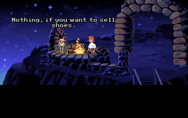
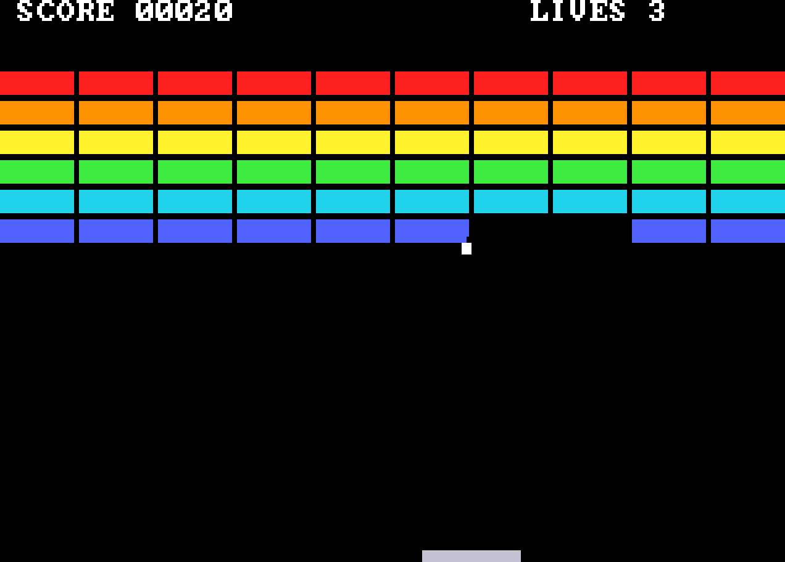
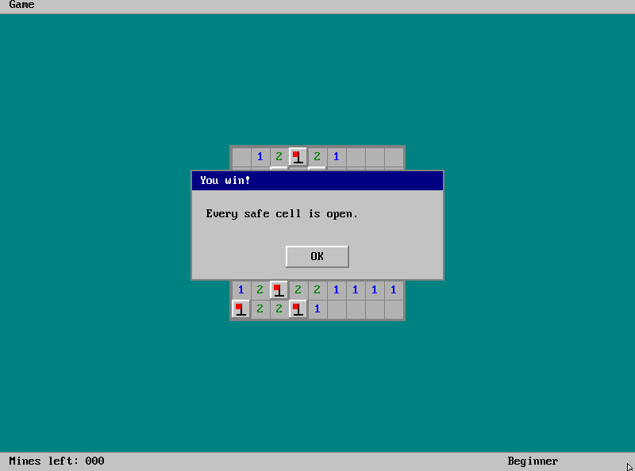
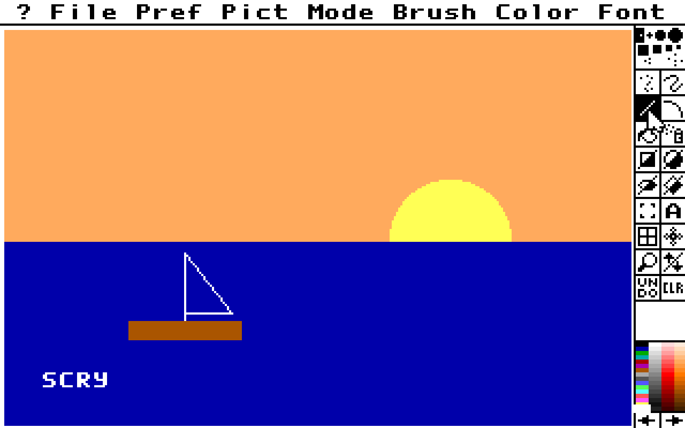
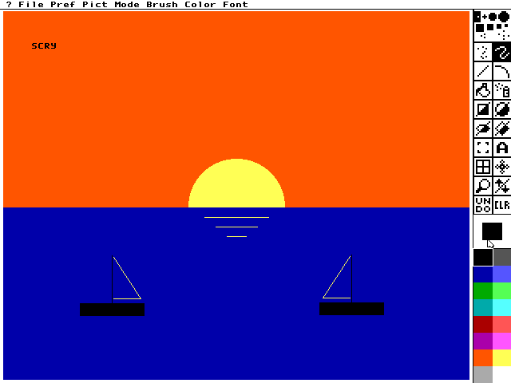
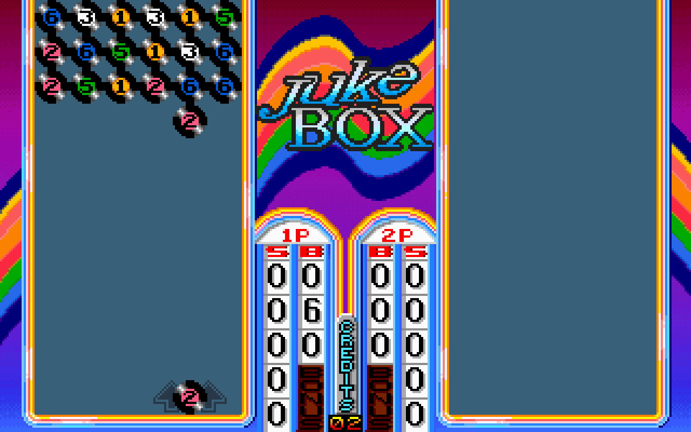
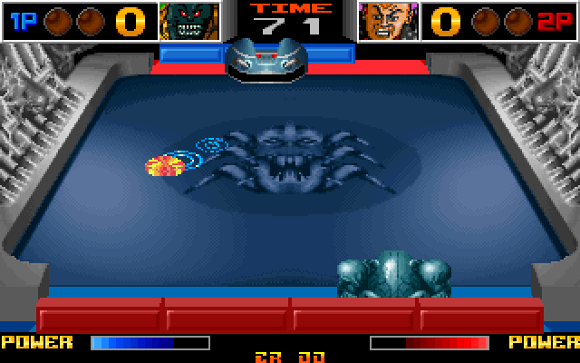
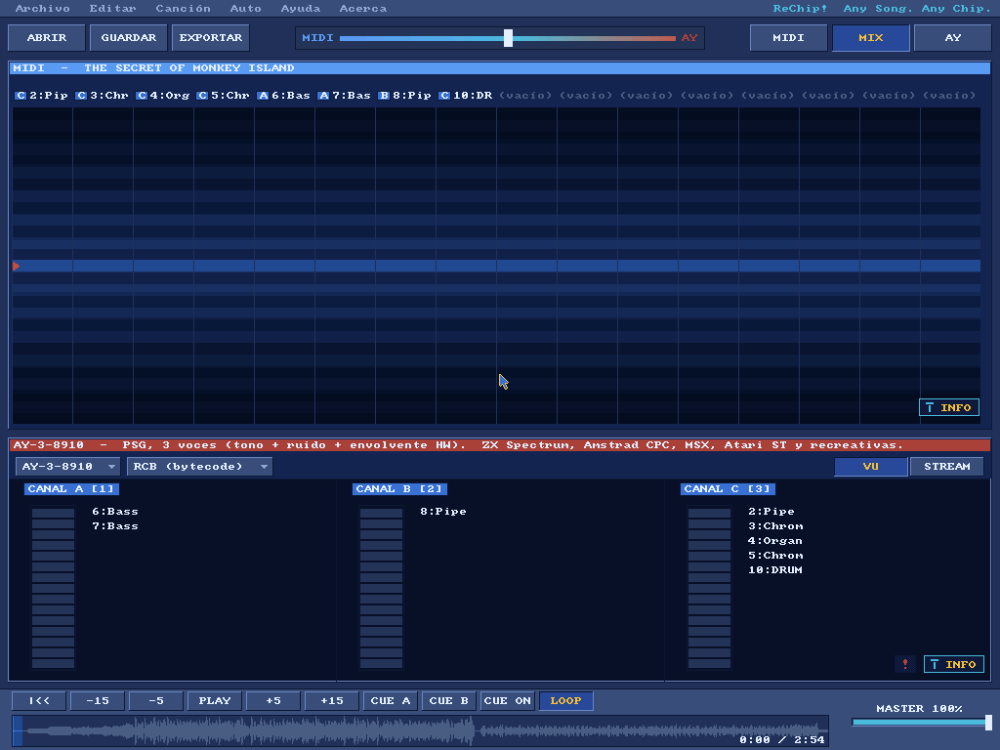
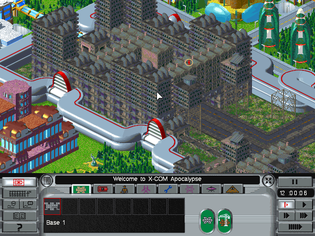

<h1 align="center">
  <br>
  scry-dosbox-x
</h1>

<p align="center"><b>Ask your AI client what a DOS program is doing, and it finds out: it stops the program, reads its memory and presses its keys.</b></p>

<p align="center">
  <a href="#install">Install</a> ·
  <a href="#what-you-can-ask">What you can ask</a> ·
  <a href="#see-it-run">Demos</a> ·
  <a href="REFERENCE.md">Reference</a>
</p>

<!-- demo-lead:begin monkey -->
<p align="center"><a href="demos/monkey/"><picture><source media="(prefers-reduced-motion: reduce)" srcset="demos/monkey/screen.png"></picture></a></p>
<p align="center"><em>The Secret of Monkey Island under this server: the lookout answers as written, then with a line written over his script in memory.</em></p>

<table align="center">
<tr><th align="left">You ask</th><td>Make the lookout say "Nothing, if you're a Scry debugger."</td></tr>
<tr><th align="left">Your client calls</th><td><code>write(ref="82DD:000C", data_hex="1c6e…6c61")</code></td></tr>
<tr><th align="left">SCRY answers</th><td><code>{"bytes_written": 128, "verified": true}</code></td></tr>
</table>
<!-- demo-lead:end monkey -->

scry-dosbox-x is an [MCP](https://modelcontextprotocol.io) server for
[DOSBox-X](https://dosbox-x.com), the DOS emulator. It gives your client a DOSBox-X held open
at its debugger, so a question costs one call, not a boot.

Your client reads memory by your program's own symbol names, reads the log your program writes,
sets breakpoints and watches, sends keys and mouse, and reads the screen. Replies carry their
evidence: a write is read back, and a key press can say whether the program reacted.

The clip is [the Monkey Island demo](demos/monkey/), which needs the game's disc.
[Your first question](#your-first-question) needs only this repository.

## Install

You need git, [uv](https://docs.astral.sh/uv/) and a DOSBox-X built with its debugger, on macOS
or Windows.

```sh
git clone https://github.com/scry-mcp/scry-dosbox-x
cd scry-dosbox-x
```

### Add it to your client

<!-- scry-install:begin -->
<details open><summary>Claude Code</summary>

Run this from the clone. `--scope user` makes the server available to you across all projects, and `claude mcp list` shows it.

```sh
claude mcp add --scope user dosbox-x -- uv run --directory "$PWD" scry-dosbox-x
```

</details>

<details><summary>Codex</summary>

Run this from the clone. `codex mcp list` shows the server.

```sh
codex mcp add dosbox-x -- uv run --directory "$PWD" scry-dosbox-x
```

</details>

<details><summary>Claude Desktop</summary>

In Settings, open the Developer tab and choose Edit Config, which opens `claude_desktop_config.json`; add this with the clone's absolute path. Then quit Claude Desktop completely and start it again.

```json
{
  "mcpServers": {
    "dosbox-x": {
      "command": "uv",
      "args": ["run", "--directory", "/path/to/scry-dosbox-x", "scry-dosbox-x"]
    }
  }
}
```

</details>

<details><summary>Cursor</summary>

Put this in `~/.cursor/mcp.json` to have the server everywhere, or in `.cursor/mcp.json` inside one project, with the clone's absolute path.

```json
{
  "mcpServers": {
    "dosbox-x": {
      "type": "stdio",
      "command": "uv",
      "args": ["run", "--directory", "/path/to/scry-dosbox-x", "scry-dosbox-x"]
    }
  }
}
```

</details>

<details><summary>VS Code</summary>

Put this in `.vscode/mcp.json` in your workspace, with the clone's absolute path.

```json
{
  "servers": {
    "dosbox-x": {
      "type": "stdio",
      "command": "uv",
      "args": ["run", "--directory", "/path/to/scry-dosbox-x", "scry-dosbox-x"]
    }
  }
}
```

</details>

<details><summary>Copilot CLI</summary>

Run this from the clone. `copilot mcp list` shows the server.

```sh
copilot mcp add dosbox-x -- uv run --directory "$PWD" scry-dosbox-x
```

</details>

<details><summary>Gemini CLI</summary>

Run this from the clone. `--scope user` keeps it in your own settings, and `gemini mcp list` shows it, disabled while the folder you are in is not trusted.

```sh
gemini mcp add --scope user dosbox-x uv run -- --directory "$PWD" scry-dosbox-x
```

</details>

<details><summary>Antigravity</summary>

Put this in `~/.gemini/config/mcp_config.json` for every workspace, or in `.agents/mcp_config.json` inside one, with the clone's absolute path.

```json
{
  "mcpServers": {
    "dosbox-x": {
      "command": "uv",
      "args": ["run", "--directory", "/path/to/scry-dosbox-x", "scry-dosbox-x"]
    }
  }
}
```

</details>

<details><summary>Devin</summary>

Run this from the clone. `--scope user` keeps it in your own configuration, `~/.config/devin/mcp_config.json`, and `devin mcp list` shows the server.

```sh
devin mcp add --scope user dosbox-x -- uv run --directory "$PWD" scry-dosbox-x
```

</details>

<details><summary>Another client</summary>

Any client that runs a local server over stdio starts this command, with the clone's absolute path.

```sh
uv run --directory /path/to/scry-dosbox-x scry-dosbox-x
```

</details>
<!-- scry-install:end -->

### Your first question

It needs only Bricks, a small game this repository builds:

> Start DOSBox-X on `demos/bricks/bricks.conf` from its folder, stopping at the program's own
> `int 3`. Run to it and tell me where DOS loaded the program.

Your client calls `start` and `resume`, which stops at the program's own `int 3` and gives its
address, whose segment is where DOS loaded it.

## What you can ask

- **"What is in this variable, this register, right now?"** `read_memory`, `registers`,
  `disassemble`. With your symbol table loaded you say `_engine_set_rate`, not `00AF:0017A6EC`.
- **"What did the program log?"** `log`, `log_wait`. A program that writes to port `0xE9` has a log
  the server can search and wait on.
- **"Who changes this variable?"** `watch_add`, `breakpoint_at`. Stop when it changes, count every
  value it takes, or record every write without stopping.
- **"What is on the screen?"** `screen_view`, `screen_wait`. The screen is read from video memory,
  as text or as a picture, with no window needed.
- **"What happens if I press this key?"** `send_keys`, `send_mouse`. Input goes in inside DOS, and
  with `expect` the reply says whether the program reacted.
- **"What did DOS and the hardware see?"** `port`, `pic`, `guest_file`. I/O ports, the interrupt
  controllers, and the files the program wrote.

## See it run

Each demo is a `demo.py` that makes the calls a model would and checks every answer. Each
picture is the screen that run ended on, linked to its guide, where it moves.

<p align="center">
  <a href="demos/bricks/"></a>
  <a href="demos/mines/"></a>
  <a href="demos/dpaint/"></a>
  <a href="demos/dpaint_maps/"></a>
</p>
<p align="center">
  <a href="demos/lineup/"></a>
  <a href="demos/speedf/"></a>
  <a href="demos/rechip/"></a>
  <a href="demos/xcom/"></a>
</p>

- [`demos/bricks/`](demos/bricks/): a breakout game this repository builds, stopped by name
  where each brick falls.
- [`demos/mines/`](demos/mines/): a Minesweeper this repository builds, its mines read out of
  memory and the board cleared without a miss.
- [`demos/dpaint/`](demos/dpaint/): Deluxe Paint II paints a sunset, and a scan finds the
  byte that holds its colour; it needs the program.
- [`demos/dpaint_maps/`](demos/dpaint_maps/): Deluxe Paint II driven through its menus and a
  dialog, each picked by name; it needs the program.
- [`demos/monkey/`](demos/monkey/): The Secret of Monkey Island, with the lookout's lines
  written into the game's memory while it is stopped; it needs the disc.
- [`demos/lineup/`](demos/lineup/): *LineUp*, replayed from the list of steps in its `.scry/`
  folder; it needs a copy of the game.
- [`demos/speedf/`](demos/speedf/): *Speed Fight*, started from a file in its `.scry/` folder;
  it needs a copy of the game.
- [`demos/rechip/`](demos/rechip/): *ReChip!*, a tracker driven by its keys and read by its own
  log; it needs a copy of the program.
- [`demos/xcom/`](demos/xcom/): *X-COM Apocalypse*, led through its menus by its own DOS calls
  and a screen map, every file it opens listed; it needs a copy of the game.

### Bricks, step by step

These are steps of the Bricks demo, written here by the demo itself from its last run. Each
follows the ones before it in the demo, whose guide has the whole prompt.

<!-- demo-flow:begin bricks -->
#### 1. Set a breakpoint by a name

Ask:

> Put a breakpoint on `brick_hit`.

Call:

```text
breakpoint_at(ref="brick_hit")
```

Reply, 3 of 10 fields:

```json
{
  "summary": "breakpoint_at brick_hit: armed",
  "entry": "BP 08DF:02C8",
  "by": "symbol"
}
```

`brick_hit` is a label of the symbol table the build wrote, so `by` says `symbol`. `armed` means the breakpoint is set in the debugger, at the address `entry` gives.

#### 2. Run until the program stops itself

Ask:

> Let the game run until that breakpoint stops it, and tell me the score.

Call:

```text
resume(seconds=60)
```

Reply, 3 of 16 fields:

```json
{
  "summary": "resume: OTHER_STOP, stopped at 08DF:000002C8",
  "verdict": "OTHER_STOP",
  "cause": "breakpoint brick_hit (by symbol) at 08DF:000002C8"
}
```

`OTHER_STOP` means the breakpoint stopped the run, not a time limit. `cause` names it; the whole reply also holds `watches`, the score read by its name.

#### 3. Read a value after a saved state is loaded

Ask:

> Now that the state saved before the left arrow is loaded, read `paddle_x` again.

Call:

```text
read_memory(ref="paddle_x", length=2)
```

Reply, 2 of 7 fields:

```json
{
  "summary": "read_memory paddle_x: 2 bytes at 08DF:0000061F: dc00",
  "hex": "dc00"
}
```

A saved state is the whole machine, not the game's own save. So the paddle reads where it was before the arrow moved it.
<!-- demo-flow:end bricks -->

## Set up SCRY in your own project

Ask your client to `start` your own program with `conf`, `cwd` and a `logfile` for its log.
Every path you give is absolute or starts with `~`, and your conf needs
`bochs debug port e9 = true` for that log to exist.

To keep what a session learned with your repository, ask it to `promote` what is worth keeping.
`promote(dry_run=true, root=<your repository>)` lists what it would create. Once you approve,
the same call with `entries` creates a `.scry/` folder with them; it writes nothing before
that.

[scry-core's page on that folder](https://github.com/scry-mcp/scry-core/blob/main/docs/scry-readme.md#set-up-scry-in-a-new-project)
says what is in it.

## Platforms

macOS and Windows: the server and its tests run on both. Linux runs the unit tests
(`.github/workflows/ci.yml`) and nothing else.

- `start` runs the DOSBox-X its `binary` argument names, else `DOSBOX_X_BINARY`, else the
  `dosbox-x` on your `PATH`. `build_check` says whether a build has the debugger.
- What a session can do depends on the debugger commands its build has, and `build_check` lists
  them. A tool whose command is missing says so and does nothing.
- Which tool needs which command is the
  [debugger commands](REFERENCE.md#debugger-commands) table.
- On Windows the emulator runs in a console of its own, hidden.

## The tools

The tools by group, each with its arguments, its reply and a real example, are in the index at
the top of [REFERENCE.md](REFERENCE.md). Every reply opens with a one-line `summary` and ends
with a `session` block that says whether anything was written to the machine.

A file a tool writes is named by
[one rule](https://github.com/scry-mcp/scry-core/blob/main/docs/file-names.md), and the reply
names the file as written.

## Going further

- [REFERENCE.md](REFERENCE.md) has what the groups of tools share, and links each group's page.
- To watch a program run, `start` takes `shared`, `display`, `fullscreen` and `size`;
  [its page](docs/reference/session.md#start) covers each.
- [CONTRIBUTING.md](CONTRIBUTING.md) is for changing the server: its checks, and what proves a
  change.
- What this server shares with the other SCRY server lives in
  [scry-core](https://github.com/scry-mcp/scry-core), pinned by tag.

## Licence

MIT. See `LICENSE`.

## Credits

Developed by Optimiza ([Marcos Hernández](https://www.linkedin.com/in/optimiza/)), in collaboration with [MS-DOS Club](https://msdos.club) and its [podcast](https://www.ivoox.com/podcast-ms-dos-club_sq_f11160693_1.html).
