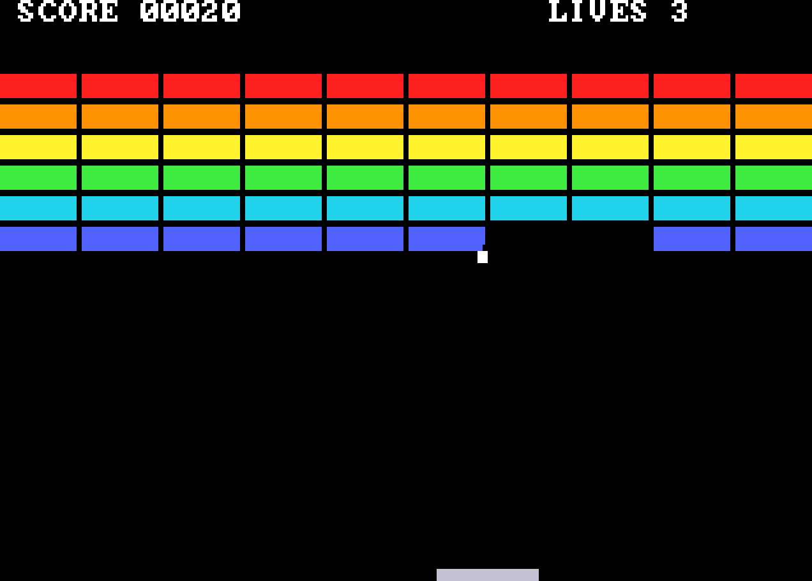

# Bricks: a game, stopped where every brick falls



`BRICKS.COM` is a wall, a ball and a paddle in mode 13h, written in this directory to be
debugged as much as played. It keeps its score in a variable with a name, sends every falling
brick through one routine, answers the arrow keys and the mouse, and has no random number in
it: the serve is fixed and the game is paced by the retrace of a machine whose clock its conf
pins, so two runs from cold knock down the same bricks on the same frames. Until the first arrow
key (or mouse motion, once M has handed it the mouse) it plays itself.

Everything it needs is here: the source (`bricks.asm`, MIT like the rest of the repository), the
program built from it, the symbol table the build generates from NASM's own map, and the conf
that boots it. The build recipe is in the header of `bricks.asm`.

## Run it

```sh
WINDOW_APP=/path/to/your/placement-helper uv run python demos/bricks/demo.py
```

The demo opens a window so the game can be watched; nothing in it needs the window: `stop` and
the saved states go down the debugger channel, and the keys and the mouse go in inside the
guest. The saved states need a DOSBox-X that carries SAVESTATE and LOADSTATE (the repository's
REFERENCE.md, *Saved states*), named with `DOSBOX_X_BINARY`.

Where that window goes is your machine's to say, so the demo asks the placement helper named by
`WINDOW_APP`: `<helper> dosbox` prints the emulator's window flags, one argument a line, for a
run nobody watches (exit 0 with nothing printed means it has nowhere to put one). The demo
refuses to start rather than open the window on top of your work when there is no helper, the
helper fails, or it has nowhere else to put the window.

- `--shared` says somebody is watching: the helper is asked with `--shared`, and a missing or
  empty helper falls back to a centred window; a failing helper still refuses.
- `--binary PATH` (absolute) picks the DOSBox-X to start; left out, `DOSBOX_X_BINARY`, else the
  `dosbox-x` on your `PATH`.
- `--transcript PATH` moves the whole transcript; the run's other files go beside it.
- `--update-readme` rewrites the block below and `screen.png` from a run where every step
  passed.

Each step prints one `OK <step>: <summary>` or `FAIL <step>: <why>` line, then a `DEMO` verdict
line and the paths of the two transcripts. Exit codes: 0 every step passed, 1 a step failed, 2
a usage error, 3 nothing was demonstrated (no placement for the window, a relative path, a
server that did not start).

To play it yourself, run it from this directory: `cd demos/bricks && dosbox-x -conf
bricks.conf`. The arrows move the paddle and SPACE serves the ball; press M to hand the paddle to
the mouse, which then centres it under the pointer. ESC returns to DOS.

## The prompt

Give this to an MCP client with this server connected:

> Start DOSBox-X windowed on `demos/bricks/bricks.conf` from that directory, placed where my
> placement helper says, stopping at the guest's own `int 3`, with the log in a file. Let it run
> to that first stop and tell me where DOS loaded the program. Load `bricks.sym` with its base set
> to that segment times 16, show me the start of `brick_hit`, put a breakpoint on it and keep
> `score` in view at every stop. Run to the first brick and the second: which row and column, and
> what is the score? Read `score` by name and show me the screen. Then clear the breakpoint, run
> three frames and tell me where the ball is. Let the game run, press the right arrow three times
> and show me the game took them, stop it and read `paddle_x`. Let it run again, press M to hand
> the paddle to the mouse, put the pointer on pixel 240, 100 and show me the game saw it, then
> press M again to take the paddle back. Stop and read `paddle_x`: the paddle should be centred
> under the pointer. Let it run,
> save a state, press the left arrow, load the state back, stop, and show me `paddle_x` is where
> it was saved. Let it run, press SPACE to serve the ball waiting on the paddle, clear the watch
> and close.

## What it walks

| Family | Calls |
|---|---|
| Session | `start` (windowed, stopping at the guest's `int 3`), `close` |
| Advance | `resume` to a stop, `run_for` by retraces on the conf's fixed clock, `stop` |
| Names | `symbols_load` at the measured segment |
| Read | `disassemble`, `read_memory` by symbol, `screen_view` |
| Declarations | `breakpoint_at` by name, `breakpoint_clear`, `watch_add` (`score` in view at every stop), `watch_clear` |
| Input | `send_keys`, `send_mouse` |
| Sequences | `drive` (three keys and their proof in one call) |
| States | `state_save`, `state_load` |

## The transcript

Generated by `demo.py --update-readme` from a run where every step passed; the window's
placement reads `<host>`, and temporary paths, process ids, wall-clock times and the host's own
DOSBox-X `<volatile>`.

<!-- demo-transcript:begin -->
**1. `start`**: OK start: shared DOSBox-X, parked at the debugger before DOS boots

<details><summary>call and reply</summary>

```json
{
  "conf": "./demos/bricks/bricks.conf",
  "cwd": "./demos/bricks",
  "session_seconds": 900,
  "shared": true,
  "window_flags": "<host>",
  "break_on_int3": true,
  "logfile": "./tmp/demos/bricks/bricks-e9.log",
  "state_dir": "./tmp/demos/bricks/bricks-states"
}
```

```json
{
  "summary": "<volatile>",
  "status": "ok",
  "shared": true,
  "ready_after_s": "<volatile>",
  "argv": "<volatile>",
  "binary": "<volatile>",
  "binary_origin": "<volatile>",
  "version": "<volatile>",
  "stub": "./guest/INJECT.COM",
  "input_port": "<volatile>",
  "background": false,
  "presence": true,
  "session": {
    "pid": "<volatile>",
    "alive": true,
    "running": false,
    "altered": false,
    "conf": "./demos/bricks/bricks.conf",
    "conf_digest": "6a91a7cd8d6ac7c3",
    "conf_changed_on_disk": false,
    "watched": true,
    "bound_s": 900,
    "elapsed_s": "<volatile>",
    "terminal_bytes_dropped": 0,
    "drain_alive": true,
    "captures": "off",
    "state_dir": "./tmp/demos/bricks/bricks-states"
  }
}
```

</details>

**2. `resume`**: OK ready: the program's own int 3 at 08A2:0119: loaded at 08A2

<details><summary>call and reply</summary>

```json
{
  "seconds": 60
}
```

```json
{
  "summary": "resume: OTHER_STOP, stopped at 08A2:00000119",
  "status": "ok",
  "verdict": "OTHER_STOP",
  "omitted": [
    "screen_delta",
    "screen_chars",
    "clipped"
  ],
  "how": "detail=True adds the debugger's repaint for this command",
  "waited_s": "<volatile>",
  "pc": "08A2:00000119",
  "cpu_mode": "real",
  "regs": {
    "EAX": "D05B0E0A",
    "ESI": "000005B2",
    "DS": "08A2",
    "ES": "A000",
    "FS": "0000",
    "GS": "0000",
    "SS": "08A2",
    "EBX": "0000000F",
    "EDI": "0000BC1E",
    "CS": "08A2",
    "EIP": "00000119",
    "ECX": "005B0004",
    "EBP": "0000091C",
    "EDX": "00000000",
    "ESP": "0000FFFE"
  },
  "watches": [],
  "attribution": {
    "attributed": false,
    "at": "08A2:00000119",
    "why": "the stop address matches no declared code breakpoint. The debugger keeps no hit flag, and a memory watch stops at the WRITING instruction rather than the watched address, so which declaration fired cannot be derived from the stop"
  },
  "e9": {
    "lines_total": 2,
    "unfiltered": 2,
    "filter": ".",
    "shown": 0,
    "how": "pass e9='all', e9='lines:N', e9='since' or e9='seconds:N' (with e9_stamp=<regex capturing the seconds>), with e9_filter=<pattern>, to include the lines"
  },
  "stop_seq": 2,
  "instruction": {
    "seg_off": "08A2:00000119",
    "bytes": "CD03",
    "text": "int 3",
    "flow": "call",
    "code_bits": 16,
    "bytes_from": "code pane",
    "symbol": {
      "available": false,
      "why": "no symbol table is loaded"
    },
    "delta": {
      "available": false,
      "why": "no symbol table is loaded"
    }
  },
  "session": {
    "pid": "<volatile>",
    "alive": true,
    "running": false,
    "altered": false,
    "conf": "./demos/bricks/bricks.conf",
    "conf_digest": "6a91a7cd8d6ac7c3",
    "conf_changed_on_disk": false,
    "watched": true,
    "bound_s": 900,
    "elapsed_s": "<volatile>",
    "terminal_bytes_dropped": 0,
    "drain_alive": true,
    "captures": "off",
    "state_dir": "./tmp/demos/bricks/bricks-states"
  }
}
```

</details>

**3. `symbols_load`**: OK symbols: 65 symbols placed at base 0x8a20

<details><summary>call and reply</summary>

```json
{
  "path": "./demos/bricks/bricks.sym",
  "base": "8a20"
}
```

```json
{
  "summary": "symbols_load: 65 loaded of 65 parsed, base 35360",
  "status": "ok",
  "base": 35360,
  "limit": -1,
  "descriptor": -1,
  "declarations": {
    "rearmed": 0,
    "rearmed_refs": [],
    "stale": [],
    "unresolved": 0,
    "ambiguous": 0,
    "unarmable": 0
  },
  "pending": false,
  "base_from": "caller",
  "parsed": 65,
  "kept": 65,
  "excluded_sections": 0,
  "excluded_pattern": 0,
  "excluded_unplaceable": 0,
  "unencodable": [],
  "unencodable_total": 0,
  "truncated_names": 0,
  "disambiguated": 0,
  "renamed": 0,
  "unreadable": 0,
  "overlay_idle": 0,
  "table_mode": "replaced",
  "table_total": 65,
  "loaded": 65,
  "bytes": 1302,
  "symbols_typed": 0,
  "session": {
    "pid": "<volatile>",
    "alive": true,
    "running": false,
    "altered": false,
    "conf": "./demos/bricks/bricks.conf",
    "conf_digest": "6a91a7cd8d6ac7c3",
    "conf_changed_on_disk": false,
    "watched": true,
    "bound_s": 900,
    "elapsed_s": "<volatile>",
    "terminal_bytes_dropped": 0,
    "drain_alive": true,
    "captures": "off",
    "state_dir": "./tmp/demos/bricks/bricks-states"
  }
}
```

</details>

**4. `disassemble`**: OK look: brick_hit opens with: mov bh, bl

<details><summary>call and reply</summary>

```json
{
  "ref": "brick_hit",
  "length": 32
}
```

```json
{
  "summary": "disassemble brick_hit: 14 lines at 08A2:000002C8, 16-bit",
  "status": "ok",
  "ref": "brick_hit",
  "seg_off": "08A2:000002C8",
  "length": 32,
  "code_bits": 16,
  "code_bits_from": "real mode",
  "lines": [
    "08A2:000002C8 88DF                 mov bh, bl",
    "08A2:000002CA 88C3                 mov bl, al",
    "08A2:000002CC E81FFF               call 0x1ee",
    "08A2:000002CF C6842C0600           mov byte ptr [si + 0x62c], 0",
    "08A2:000002D4 FE0E2B06             dec byte ptr [0x62b]",
    "08A2:000002D8 53                   push bx",
    "08A2:000002D9 30C0                 xor al, al",
    "08A2:000002DB E81BFF               call 0x1f9",
    "08A2:000002DE 5B                   pop bx",
    "08A2:000002DF B006                 mov al, 6",
    "08A2:000002E1 28D8                 sub al, bl",
    "08A2:000002E3 B40A                 mov ah, 0xa",
    "08A2:000002E5 F6E4                 mul ah",
    "08A2:000002E7 01061506             add word ptr [0x615], ax"
  ],
  "flow": [
    "sequential",
    "sequential",
    "call",
    "sequential",
    "sequential",
    "sequential",
    "sequential",
    "call",
    "sequential",
    "sequential",
    "sequential",
    "sequential",
    "sequential",
    "sequential"
  ],
  "flow_source": "capstone",
  "resolved": [
    {
      "line": 2,
      "operand": "0x1ee",
      "kind": "target",
      "seg_off": "08A2:000001EE",
      "addr": "0x00008c0e",
      "symbol": "brick_index",
      "delta": 0
    },
    {
      "line": 4,
      "operand": "byte ptr [0x62b]",
      "kind": "memory",
      "register": "DS",
      "seg_off": "08A2:0000062B",
      "addr": "0x0000904b",
      "symbol": "bricks_left",
      "delta": 0
    },
    {
      "line": 7,
      "operand": "0x1f9",
      "kind": "target",
      "seg_off": "08A2:000001F9",
      "addr": "0x00008c19",
      "symbol": "brick_rect",
      "delta": 0
    },
    {
      "line": 13,
      "operand": "word ptr [0x615]",
      "kind": "memory",
      "register": "DS",
      "seg_off": "08A2:00000615",
      "addr": "0x00009035",
      "symbol": "score",
      "delta": 0
    }
  ],
  "session": {
    "pid": "<volatile>",
    "alive": true,
    "running": false,
    "altered": false,
    "conf": "./demos/bricks/bricks.conf",
    "conf_digest": "6a91a7cd8d6ac7c3",
    "conf_changed_on_disk": false,
    "watched": true,
    "bound_s": 900,
    "elapsed_s": "<volatile>",
    "terminal_bytes_dropped": 0,
    "drain_alive": true,
    "captures": "off",
    "state_dir": "./tmp/demos/bricks/bricks-states"
  }
}
```

</details>

**5. `breakpoint_at`**: OK break: breakpoint BP 08A2:02C8

<details><summary>call and reply</summary>

```json
{
  "ref": "brick_hit"
}
```

```json
{
  "summary": "breakpoint_at brick_hit: armed",
  "status": "ok",
  "ref": "brick_hit",
  "by": "symbol",
  "stored": true,
  "already_stored": false,
  "armed": true,
  "state": "armed",
  "entry": "BP 08A2:02C8",
  "marked": false,
  "session": {
    "pid": "<volatile>",
    "alive": true,
    "running": false,
    "altered": true,
    "conf": "./demos/bricks/bricks.conf",
    "conf_digest": "6a91a7cd8d6ac7c3",
    "conf_changed_on_disk": false,
    "watched": true,
    "bound_s": 900,
    "elapsed_s": "<volatile>",
    "terminal_bytes_dropped": 0,
    "drain_alive": true,
    "captures": "off",
    "state_dir": "./tmp/demos/bricks/bricks-states"
  }
}
```

</details>

**6. `watch_add`**: OK watch: score shown at every stop

<details><summary>call and reply</summary>

```json
{
  "ref": "score",
  "mode": "show",
  "fmt": "u16"
}
```

```json
{
  "summary": "watch_add score: evaluated",
  "status": "ok",
  "ref": "score",
  "by": "symbol",
  "mode": "show",
  "fmt": "u16",
  "length": 2,
  "stored": true,
  "already_stored": false,
  "armed": false,
  "state": "evaluated",
  "session": {
    "pid": "<volatile>",
    "alive": true,
    "running": false,
    "altered": true,
    "conf": "./demos/bricks/bricks.conf",
    "conf_digest": "6a91a7cd8d6ac7c3",
    "conf_changed_on_disk": false,
    "watched": true,
    "bound_s": 900,
    "elapsed_s": "<volatile>",
    "terminal_bytes_dropped": 0,
    "drain_alive": true,
    "captures": "off",
    "state_dir": "./tmp/demos/bricks/bricks-states"
  }
}
```

</details>

**7. `resume`**: OK first brick: brick_hit for the first brick, row 5 column 7, score 0

<details><summary>call and reply</summary>

```json
{
  "seconds": 60
}
```

```json
{
  "summary": "resume: OTHER_STOP, stopped at 08A2:000002C8",
  "status": "ok",
  "verdict": "OTHER_STOP",
  "omitted": [
    "screen_delta",
    "screen_chars",
    "clipped"
  ],
  "how": "detail=True adds the debugger's repaint for this command",
  "waited_s": "<volatile>",
  "pc": "08A2:000002C8",
  "cpu_mode": "real",
  "regs": {
    "EAX": "D05B0005",
    "ESI": "00000039",
    "DS": "08A2",
    "ES": "A000",
    "FS": "0000",
    "GS": "0000",
    "SS": "08A2",
    "EBX": "00000707",
    "EDI": "000064E4",
    "CS": "08A2",
    "EIP": "000002C8",
    "ECX": "005B0020",
    "EBP": "0000091C",
    "EDX": "00000000",
    "ESP": "0000FFFA"
  },
  "watches": [
    {
      "ref": "score",
      "by": "symbol",
      "mode": "show",
      "length": 2,
      "fmt": "u16",
      "state": "evaluated",
      "value": 0,
      "bytes": "0000"
    }
  ],
  "attribution": {
    "attributed": true,
    "ref": "brick_hit",
    "by": "symbol",
    "at": "08A2:000002C8"
  },
  "e9": {
    "lines_total": 2,
    "unfiltered": 2,
    "filter": ".",
    "shown": 0,
    "how": "pass e9='all', e9='lines:N', e9='since' or e9='seconds:N' (with e9_stamp=<regex capturing the seconds>), with e9_filter=<pattern>, to include the lines"
  },
  "stop_seq": 3,
  "instruction": {
    "seg_off": "08A2:000002C8",
    "bytes": "88DF",
    "text": "mov bh, bl",
    "flow": "sequential",
    "code_bits": 16,
    "bytes_from": "code pane",
    "symbol": "brick_hit",
    "delta": 0
  },
  "session": {
    "pid": "<volatile>",
    "alive": true,
    "running": false,
    "altered": true,
    "conf": "./demos/bricks/bricks.conf",
    "conf_digest": "6a91a7cd8d6ac7c3",
    "conf_changed_on_disk": false,
    "watched": true,
    "bound_s": 900,
    "elapsed_s": "<volatile>",
    "terminal_bytes_dropped": 0,
    "drain_alive": true,
    "captures": "off",
    "state_dir": "./tmp/demos/bricks/bricks-states"
  }
}
```

</details>

**8. `resume`**: OK second brick: brick_hit for the second brick, row 5 column 6, score 10

<details><summary>call and reply</summary>

```json
{
  "seconds": 60
}
```

```json
{
  "summary": "resume: OTHER_STOP, stopped at 08A2:000002C8",
  "status": "ok",
  "verdict": "OTHER_STOP",
  "omitted": [
    "screen_delta",
    "screen_chars",
    "clipped"
  ],
  "how": "detail=True adds the debugger's repaint for this command",
  "waited_s": "<volatile>",
  "pc": "08A2:000002C8",
  "cpu_mode": "real",
  "regs": {
    "EAX": "D05B0005",
    "ESI": "00000038",
    "DS": "08A2",
    "ES": "A000",
    "FS": "0000",
    "GS": "0000",
    "SS": "08A2",
    "EBX": "00000606",
    "EDI": "000064C2",
    "CS": "08A2",
    "EIP": "000002C8",
    "ECX": "005B0020",
    "EBP": "0000091C",
    "EDX": "00000000",
    "ESP": "0000FFFA"
  },
  "watches": [
    {
      "ref": "score",
      "by": "symbol",
      "mode": "show",
      "length": 2,
      "fmt": "u16",
      "state": "evaluated",
      "value": 10,
      "bytes": "0a00"
    }
  ],
  "attribution": {
    "attributed": true,
    "ref": "brick_hit",
    "by": "symbol",
    "at": "08A2:000002C8"
  },
  "e9": {
    "lines_total": 3,
    "unfiltered": 3,
    "filter": ".",
    "shown": 0,
    "how": "pass e9='all', e9='lines:N', e9='since' or e9='seconds:N' (with e9_stamp=<regex capturing the seconds>), with e9_filter=<pattern>, to include the lines"
  },
  "stop_seq": 4,
  "instruction": {
    "seg_off": "08A2:000002C8",
    "bytes": "88DF",
    "text": "mov bh, bl",
    "flow": "sequential",
    "code_bits": 16,
    "bytes_from": "code pane",
    "symbol": "brick_hit",
    "delta": 0
  },
  "session": {
    "pid": "<volatile>",
    "alive": true,
    "running": false,
    "altered": true,
    "conf": "./demos/bricks/bricks.conf",
    "conf_digest": "6a91a7cd8d6ac7c3",
    "conf_changed_on_disk": false,
    "watched": true,
    "bound_s": 900,
    "elapsed_s": "<volatile>",
    "terminal_bytes_dropped": 0,
    "drain_alive": true,
    "captures": "off",
    "state_dir": "./tmp/demos/bricks/bricks-states"
  }
}
```

</details>

**9. `read_memory`**: OK score: score 10, read by name

<details><summary>call and reply</summary>

```json
{
  "ref": "score",
  "length": 2
}
```

```json
{
  "summary": "read_memory score: 8 rows at 08A2:00000615",
  "status": "ok",
  "ref": "score",
  "seg_off": "08A2:00000615",
  "length": 2,
  "hex": "0a00",
  "rows": [
    "08A2:00000615 0A 00 03 01 00 01 00 40 01 00 B0 00 C0 00 4E 00  .......@......N.",
    "08A2:00000625 FE FF FE FF 8C 00 3B 01 01 01 01 01 01 01 01 01  ......;.........",
    "08A2:00000635 01 01 01 01 01 01 01 01 01 01 01 01 01 01 01 01  ................",
    "08A2:00000645 01 01 01 01 01 01 01 01 01 01 01 01 01 01 01 01  ................",
    "08A2:00000655 01 01 01 01 01 01 01 01 01 01 01 01 01 01 01 01  ................",
    "08A2:00000665 00 01 01 00 00 00 00 00 00 00 00 00 00 00 00 00  ................",
    "08A2:00000675 00 00 00 00 00 00 00 00 00 00 00 00 00 00 00 00  ................",
    "08A2:00000685 00 00 00 00 00 00 00 00 00 00 00 00 00 00 00 00  ................"
  ],
  "session": {
    "pid": "<volatile>",
    "alive": true,
    "running": false,
    "altered": true,
    "conf": "./demos/bricks/bricks.conf",
    "conf_digest": "6a91a7cd8d6ac7c3",
    "conf_changed_on_disk": false,
    "watched": true,
    "bound_s": 900,
    "elapsed_s": "<volatile>",
    "terminal_bytes_dropped": 0,
    "drain_alive": true,
    "captures": "off",
    "state_dir": "./tmp/demos/bricks/bricks-states"
  }
}
```

</details>

**10. `screen_view`**: OK screen: mode M_VGA, 320x200 by palette index

<details><summary>call and reply</summary>

```json
{
  "dest": "./tmp/demos/bricks/screen.png"
}
```

```json
{
  "summary": "screen_view M_VGA: 320x200 at [0, 0] pixels; 1280x800 PNG x4, inline",
  "status": "ok",
  "vga_mode": "M_VGA",
  "kind": "pixel",
  "width": 320,
  "height": 200,
  "crop": [
    0,
    0,
    320,
    200
  ],
  "image": {
    "path": "./tmp/demos/bricks/screen.png",
    "bytes": 5608,
    "sha256": "64126aceb88896f082fe44ad8e0b33f4e873fe46e5db8a5ea2d152b6488b0df6",
    "width": 1280,
    "height": 800,
    "scale": 4,
    "indexed": true,
    "inline": true
  },
  "display_start": "0h",
  "session": {
    "pid": "<volatile>",
    "alive": true,
    "running": false,
    "altered": true,
    "conf": "./demos/bricks/bricks.conf",
    "conf_digest": "6a91a7cd8d6ac7c3",
    "conf_changed_on_disk": false,
    "watched": true,
    "bound_s": 900,
    "elapsed_s": "<volatile>",
    "terminal_bytes_dropped": 0,
    "drain_alive": true,
    "captures": "off",
    "state_dir": "./tmp/demos/bricks/bricks-states"
  }
}
```

Also attached: image/png.

</details>

**11. `breakpoint_clear`**: OK unbreak: breakpoint cleared

<details><summary>call and reply</summary>

```json
{
  "all": true
}
```

```json
{
  "summary": "breakpoint_clear all: 1 cleared",
  "status": "ok",
  "declarations_cleared": 1,
  "disarmed": [
    "BP 08A2:02C8"
  ],
  "pending_disarm": [],
  "session": {
    "pid": "<volatile>",
    "alive": true,
    "running": false,
    "altered": true,
    "conf": "./demos/bricks/bricks.conf",
    "conf_digest": "6a91a7cd8d6ac7c3",
    "conf_changed_on_disk": false,
    "watched": true,
    "bound_s": 900,
    "elapsed_s": "<volatile>",
    "terminal_bytes_dropped": 0,
    "drain_alive": true,
    "captures": "off",
    "state_dir": "./tmp/demos/bricks/bricks-states"
  }
}
```

</details>

**12. `run_for`**: OK frames: three retraces, the emulated clock from 2.0023 s to 2.0318 s

<details><summary>call and reply</summary>

```json
{
  "frames": 3,
  "seconds": 60
}
```

```json
{
  "summary": "<volatile>",
  "status": "ok",
  "verdict": "ELAPSED",
  "polls": 3,
  "pc": "<volatile>",
  "cpu_mode": "real",
  "regs": "<volatile>",
  "watches": [
    {
      "ref": "score",
      "by": "symbol",
      "mode": "show",
      "length": 2,
      "fmt": "u16",
      "state": "evaluated",
      "value": 20,
      "bytes": "1400"
    }
  ],
  "attribution": "<volatile>",
  "e9": {
    "lines_total": 4,
    "unfiltered": 4,
    "filter": ".",
    "shown": 0,
    "how": "pass e9='all', e9='lines:N', e9='since' or e9='seconds:N' (with e9_stamp=<regex capturing the seconds>), with e9_filter=<pattern>, to include the lines"
  },
  "stop_seq": 5,
  "instruction": "<volatile>",
  "emulated_before_s": 2.0022688,
  "emulated_after_s": 2.0317822000000003,
  "frame_before": {
    "available": false,
    "why": "a DOS machine keeps no frame counter a server could read: `polls` counts the retraces"
  },
  "frame_after": {
    "available": false,
    "why": "a DOS machine keeps no frame counter a server could read: `polls` counts the retraces"
  },
  "cycles": {
    "available": false,
    "why": "the pane's `cc=` counts cycles only on the normal core, and which core runs is not something this server can read, so no count is given"
  },
  "waited_s": "<volatile>",
  "session": {
    "pid": "<volatile>",
    "alive": true,
    "running": false,
    "altered": true,
    "conf": "./demos/bricks/bricks.conf",
    "conf_digest": "6a91a7cd8d6ac7c3",
    "conf_changed_on_disk": false,
    "watched": true,
    "bound_s": 900,
    "elapsed_s": "<volatile>",
    "terminal_bytes_dropped": 0,
    "drain_alive": true,
    "captures": "off",
    "state_dir": "./tmp/demos/bricks/bricks-states"
  }
}
```

</details>

**13. `read_memory`**: OK ball: the ball at (188, 82) moving (-2, +2)

<details><summary>call and reply</summary>

```json
{
  "ref": "ball_x",
  "length": 8
}
```

```json
{
  "summary": "read_memory ball_x: 8 rows at 08A2:00000621",
  "status": "ok",
  "ref": "ball_x",
  "seg_off": "08A2:00000621",
  "length": 8,
  "hex": "bc005200feff0200",
  "rows": [
    "08A2:00000621 BC 00 52 00 FE FF 02 00 8E 00 3A 01 01 01 01 01  ..R.......:.....",
    "08A2:00000631 01 01 01 01 01 01 01 01 01 01 01 01 01 01 01 01  ................",
    "08A2:00000641 01 01 01 01 01 01 01 01 01 01 01 01 01 01 01 01  ................",
    "08A2:00000651 01 01 01 01 01 01 01 01 01 01 01 01 01 01 01 01  ................",
    "08A2:00000661 01 01 01 00 00 01 01 00 00 00 00 00 00 00 00 00  ................",
    "08A2:00000671 00 00 00 00 00 00 00 00 00 00 00 00 00 00 00 00  ................",
    "08A2:00000681 00 00 00 00 00 00 00 00 00 00 00 00 00 00 00 00  ................",
    "08A2:00000691 00 00 00 00 00 00 00 00 00 00 00 00 00 00 00 00  ................"
  ],
  "session": {
    "pid": "<volatile>",
    "alive": true,
    "running": false,
    "altered": true,
    "conf": "./demos/bricks/bricks.conf",
    "conf_digest": "6a91a7cd8d6ac7c3",
    "conf_changed_on_disk": false,
    "watched": true,
    "bound_s": 900,
    "elapsed_s": "<volatile>",
    "terminal_bytes_dropped": 0,
    "drain_alive": true,
    "captures": "off",
    "state_dir": "./tmp/demos/bricks/bricks-states"
  }
}
```

</details>

**14. `resume`**: OK play: the game runs

<details><summary>call and reply</summary>

```json
{}
```

```json
{
  "summary": "resume: running",
  "status": "ok",
  "omitted": [
    "screen_delta",
    "screen_chars",
    "clipped"
  ],
  "how": "detail=True adds the debugger's repaint for this command",
  "session": {
    "pid": "<volatile>",
    "alive": true,
    "running": true,
    "altered": true,
    "conf": "./demos/bricks/bricks.conf",
    "conf_digest": "6a91a7cd8d6ac7c3",
    "conf_changed_on_disk": false,
    "watched": true,
    "bound_s": 900,
    "elapsed_s": "<volatile>",
    "terminal_bytes_dropped": 0,
    "drain_alive": true,
    "captures": "off",
    "state_dir": "./tmp/demos/bricks/bricks-states"
  }
}
```

</details>

**15. `drive`**: OK keys: the game logged PLAYER, KEY R, KEY R, KEY R

<details><summary>call and reply</summary>

```json
{
  "act": [
    {
      "op": "send_keys",
      "keys": [
        "right"
      ],
      "expect": "KEY R",
      "seconds": 10
    },
    {
      "op": "send_keys",
      "keys": [
        "right"
      ],
      "expect": "KEY R",
      "seconds": 10
    },
    {
      "op": "send_keys",
      "keys": [
        "right"
      ],
      "expect": "KEY R",
      "seconds": 10
    }
  ],
  "pattern": "KEY|PLAYER"
}
```

```json
{
  "summary": "drive: no expectation",
  "status": "ok",
  "act": {
    "ran": [
      {
        "op": "send_keys",
        "reply": {
          "summary": "send_keys (guest): effect seen",
          "status": "ok",
          "keys": [
            "right"
          ],
          "modifiers": [],
          "route": "guest",
          "posted": 1,
          "bytes": 4,
          "ticks": 4,
          "verify": {
            "checked": true,
            "seen": true,
            "expected": "KEY R",
            "verdict": "TARGET",
            "line": "Bochs port E9h: KEY R",
            "seen_before_waiting": "<volatile>",
            "lines_before": "<volatile>",
            "waited_s": "<volatile>",
            "lines_total": "<volatile>"
          },
          "session": {
            "pid": "<volatile>",
            "alive": true,
            "running": true,
            "altered": true,
            "conf": "./demos/bricks/bricks.conf",
            "conf_digest": "6a91a7cd8d6ac7c3",
            "conf_changed_on_disk": false,
            "watched": true,
            "bound_s": 900,
            "elapsed_s": "<volatile>",
            "terminal_bytes_dropped": 0,
            "drain_alive": true,
            "captures": "off",
            "state_dir": "./tmp/demos/bricks/bricks-states"
          }
        }
      },
      {
        "op": "send_keys",
        "reply": {
          "summary": "send_keys (guest): effect seen",
          "status": "ok",
          "keys": [
            "right"
          ],
          "modifiers": [],
          "route": "guest",
          "posted": 1,
          "bytes": 4,
          "ticks": 4,
          "verify": {
            "checked": true,
            "seen": true,
            "expected": "KEY R",
            "verdict": "TARGET",
            "line": "Bochs port E9h: KEY R",
            "seen_before_waiting": "<volatile>",
            "lines_before": "<volatile>",
            "waited_s": "<volatile>",
            "lines_total": "<volatile>"
          },
          "session": {
            "pid": "<volatile>",
            "alive": true,
            "running": true,
            "altered": true,
            "conf": "./demos/bricks/bricks.conf",
            "conf_digest": "6a91a7cd8d6ac7c3",
            "conf_changed_on_disk": false,
            "watched": true,
            "bound_s": 900,
            "elapsed_s": "<volatile>",
            "terminal_bytes_dropped": 0,
            "drain_alive": true,
            "captures": "off",
            "state_dir": "./tmp/demos/bricks/bricks-states"
          }
        }
      },
      {
        "op": "send_keys",
        "reply": {
          "summary": "send_keys (guest): effect seen",
          "status": "ok",
          "keys": [
            "right"
          ],
          "modifiers": [],
          "route": "guest",
          "posted": 1,
          "bytes": 4,
          "ticks": 4,
          "verify": {
            "checked": true,
            "seen": true,
            "expected": "KEY R",
            "verdict": "TARGET",
            "line": "Bochs port E9h: KEY R",
            "seen_before_waiting": "<volatile>",
            "lines_before": "<volatile>",
            "waited_s": "<volatile>",
            "lines_total": "<volatile>"
          },
          "session": {
            "pid": "<volatile>",
            "alive": true,
            "running": true,
            "altered": true,
            "conf": "./demos/bricks/bricks.conf",
            "conf_digest": "6a91a7cd8d6ac7c3",
            "conf_changed_on_disk": false,
            "watched": true,
            "bound_s": 900,
            "elapsed_s": "<volatile>",
            "terminal_bytes_dropped": 0,
            "drain_alive": true,
            "captures": "off",
            "state_dir": "./tmp/demos/bricks/bricks-states"
          }
        }
      }
    ],
    "steps_completed": 3,
    "failed_at": {
      "available": false,
      "why": "no step failed"
    },
    "held": 0
  },
  "verify": {
    "checked": false,
    "why": "no `expect` given; the act's own steps carried whatever verification they asked for"
  },
  "looked": {
    "guest": {
      "available": true,
      "since_mark": "<volatile>",
      "lines_written": "<volatile>",
      "lines_total": "<volatile>",
      "truncated": false,
      "lines": [
        "Bochs port E9h: PLAYER",
        "Bochs port E9h: KEY R",
        "Bochs port E9h: KEY R",
        "Bochs port E9h: KEY R"
      ],
      "pattern": "KEY|PLAYER"
    }
  },
  "session": {
    "pid": "<volatile>",
    "alive": true,
    "running": true,
    "altered": true,
    "conf": "./demos/bricks/bricks.conf",
    "conf_digest": "6a91a7cd8d6ac7c3",
    "conf_changed_on_disk": false,
    "watched": true,
    "bound_s": 900,
    "elapsed_s": "<volatile>",
    "terminal_bytes_dropped": 0,
    "drain_alive": true,
    "captures": "off",
    "state_dir": "./tmp/demos/bricks/bricks-states"
  }
}
```

</details>

**16. `stop`**: OK pause: stopped through the debugger channel

<details><summary>call and reply</summary>

```json
{}
```

```json
{
  "summary": "<volatile>",
  "status": "ok",
  "interrupted": true,
  "via": "break",
  "waited_s": "<volatile>",
  "pc": "<volatile>",
  "cpu_mode": "real",
  "regs": "<volatile>",
  "watches": "<volatile>",
  "attribution": "<volatile>",
  "e9": "<volatile>",
  "stop_seq": 6,
  "instruction": "<volatile>",
  "session": {
    "pid": "<volatile>",
    "alive": true,
    "running": false,
    "altered": true,
    "conf": "./demos/bricks/bricks.conf",
    "conf_digest": "6a91a7cd8d6ac7c3",
    "conf_changed_on_disk": false,
    "watched": true,
    "bound_s": 900,
    "elapsed_s": "<volatile>",
    "terminal_bytes_dropped": 0,
    "drain_alive": true,
    "captures": "off",
    "state_dir": "./tmp/demos/bricks/bricks-states"
  }
}
```

</details>

**17. `read_memory`**: OK paddle: the paddle at x 164: the middle, then 3 steps right

<details><summary>call and reply</summary>

```json
{
  "ref": "paddle_x",
  "length": 2
}
```

```json
{
  "summary": "read_memory paddle_x: 8 rows at 08A2:0000061F",
  "status": "ok",
  "ref": "paddle_x",
  "seg_off": "08A2:0000061F",
  "length": 2,
  "hex": "a400",
  "rows": "<volatile>",
  "session": {
    "pid": "<volatile>",
    "alive": true,
    "running": false,
    "altered": true,
    "conf": "./demos/bricks/bricks.conf",
    "conf_digest": "6a91a7cd8d6ac7c3",
    "conf_changed_on_disk": false,
    "watched": true,
    "bound_s": 900,
    "elapsed_s": "<volatile>",
    "terminal_bytes_dropped": 0,
    "drain_alive": true,
    "captures": "off",
    "state_dir": "./tmp/demos/bricks/bricks-states"
  }
}
```

</details>

**18. `resume`**: OK again: the game runs

<details><summary>call and reply</summary>

```json
{}
```

```json
{
  "summary": "resume: running",
  "status": "ok",
  "omitted": [
    "screen_delta",
    "screen_chars",
    "clipped"
  ],
  "how": "detail=True adds the debugger's repaint for this command",
  "session": {
    "pid": "<volatile>",
    "alive": true,
    "running": true,
    "altered": true,
    "conf": "./demos/bricks/bricks.conf",
    "conf_digest": "6a91a7cd8d6ac7c3",
    "conf_changed_on_disk": false,
    "watched": true,
    "bound_s": 900,
    "elapsed_s": "<volatile>",
    "terminal_bytes_dropped": 0,
    "drain_alive": true,
    "captures": "off",
    "state_dir": "./tmp/demos/bricks/bricks-states"
  }
}
```

</details>

**19. `send_keys`**: OK mouse on: M handed the paddle to the mouse: the game logged MOUSE ON

<details><summary>call and reply</summary>

```json
{
  "keys": [
    "m"
  ],
  "expect": "MOUSE ON$",
  "seconds": 10
}
```

```json
{
  "summary": "send_keys (guest): effect seen",
  "status": "ok",
  "keys": [
    "m"
  ],
  "modifiers": [],
  "route": "guest",
  "posted": 1,
  "bytes": 2,
  "ticks": 2,
  "verify": {
    "checked": true,
    "seen": true,
    "expected": "MOUSE ON$",
    "verdict": "TARGET",
    "line": "Bochs port E9h: MOUSE ON",
    "seen_before_waiting": "<volatile>",
    "lines_before": "<volatile>",
    "waited_s": "<volatile>",
    "lines_total": "<volatile>"
  },
  "session": {
    "pid": "<volatile>",
    "alive": true,
    "running": true,
    "altered": true,
    "conf": "./demos/bricks/bricks.conf",
    "conf_digest": "6a91a7cd8d6ac7c3",
    "conf_changed_on_disk": false,
    "watched": true,
    "bound_s": 900,
    "elapsed_s": "<volatile>",
    "terminal_bytes_dropped": 0,
    "drain_alive": true,
    "captures": "off",
    "state_dir": "./tmp/demos/bricks/bricks-states"
  }
}
```

</details>

**20. `send_mouse`**: OK mouse: the pointer read back at pixel 240,100 and the game logged MOUSE

<details><summary>call and reply</summary>

```json
{
  "x": 240,
  "y": 100,
  "expect": "MOUSE$",
  "seconds": 10
}
```

```json
{
  "summary": "send_mouse: pointer at 240,100; effect seen",
  "status": "ok",
  "x": 240,
  "y": 100,
  "units": "screen",
  "route": "guest",
  "pointer": {
    "screen": {
      "x": 240,
      "y": 100,
      "width": 320,
      "height": 200
    },
    "mouse": {
      "x": 480,
      "y": 100,
      "max_x": 639,
      "max_y": 199
    },
    "buttons": [],
    "bios_mode": "0x13"
  },
  "arrived": true,
  "verify": {
    "checked": true,
    "seen": true,
    "expected": "MOUSE$",
    "verdict": "TARGET",
    "line": "Bochs port E9h: MOUSE",
    "seen_before_waiting": "<volatile>",
    "lines_before": "<volatile>",
    "waited_s": "<volatile>",
    "lines_total": "<volatile>"
  },
  "session": {
    "pid": "<volatile>",
    "alive": true,
    "running": true,
    "altered": true,
    "conf": "./demos/bricks/bricks.conf",
    "conf_digest": "6a91a7cd8d6ac7c3",
    "conf_changed_on_disk": false,
    "watched": true,
    "bound_s": 900,
    "elapsed_s": "<volatile>",
    "terminal_bytes_dropped": 0,
    "drain_alive": true,
    "captures": "off",
    "state_dir": "./tmp/demos/bricks/bricks-states"
  }
}
```

</details>

**21. `send_keys`**: OK mouse off: M took the paddle back, so the pointer moves nothing from here on

<details><summary>call and reply</summary>

```json
{
  "keys": [
    "m"
  ],
  "expect": "MOUSE OFF$",
  "seconds": 10
}
```

```json
{
  "summary": "send_keys (guest): effect seen",
  "status": "ok",
  "keys": [
    "m"
  ],
  "modifiers": [],
  "route": "guest",
  "posted": 1,
  "bytes": 2,
  "ticks": 2,
  "verify": {
    "checked": true,
    "seen": true,
    "expected": "MOUSE OFF$",
    "verdict": "TARGET",
    "line": "Bochs port E9h: MOUSE OFF",
    "seen_before_waiting": "<volatile>",
    "lines_before": "<volatile>",
    "waited_s": "<volatile>",
    "lines_total": "<volatile>"
  },
  "session": {
    "pid": "<volatile>",
    "alive": true,
    "running": true,
    "altered": true,
    "conf": "./demos/bricks/bricks.conf",
    "conf_digest": "6a91a7cd8d6ac7c3",
    "conf_changed_on_disk": false,
    "watched": true,
    "bound_s": 900,
    "elapsed_s": "<volatile>",
    "terminal_bytes_dropped": 0,
    "drain_alive": true,
    "captures": "off",
    "state_dir": "./tmp/demos/bricks/bricks-states"
  }
}
```

</details>

**22. `stop`**: OK mark: stopped through the debugger channel

<details><summary>call and reply</summary>

```json
{}
```

```json
{
  "summary": "<volatile>",
  "status": "ok",
  "interrupted": true,
  "via": "break",
  "waited_s": "<volatile>",
  "pc": "<volatile>",
  "cpu_mode": "real",
  "regs": "<volatile>",
  "watches": "<volatile>",
  "attribution": "<volatile>",
  "e9": "<volatile>",
  "stop_seq": 7,
  "instruction": "<volatile>",
  "session": {
    "pid": "<volatile>",
    "alive": true,
    "running": false,
    "altered": true,
    "conf": "./demos/bricks/bricks.conf",
    "conf_digest": "6a91a7cd8d6ac7c3",
    "conf_changed_on_disk": false,
    "watched": true,
    "bound_s": 900,
    "elapsed_s": "<volatile>",
    "terminal_bytes_dropped": 0,
    "drain_alive": true,
    "captures": "off",
    "state_dir": "./tmp/demos/bricks/bricks-states"
  }
}
```

</details>

**23. `read_memory`**: OK before save: the paddle at x 220, centred under the pointer at pixel 240

<details><summary>call and reply</summary>

```json
{
  "ref": "paddle_x",
  "length": 2
}
```

```json
{
  "summary": "read_memory paddle_x: 8 rows at 08A2:0000061F",
  "status": "ok",
  "ref": "paddle_x",
  "seg_off": "08A2:0000061F",
  "length": 2,
  "hex": "dc00",
  "rows": "<volatile>",
  "session": {
    "pid": "<volatile>",
    "alive": true,
    "running": false,
    "altered": true,
    "conf": "./demos/bricks/bricks.conf",
    "conf_digest": "6a91a7cd8d6ac7c3",
    "conf_changed_on_disk": false,
    "watched": true,
    "bound_s": 900,
    "elapsed_s": "<volatile>",
    "terminal_bytes_dropped": 0,
    "drain_alive": true,
    "captures": "off",
    "state_dir": "./tmp/demos/bricks/bricks-states"
  }
}
```

</details>

**24. `resume`**: OK on again: the game runs

<details><summary>call and reply</summary>

```json
{}
```

```json
{
  "summary": "resume: running",
  "status": "ok",
  "omitted": [
    "screen_delta",
    "screen_chars",
    "clipped"
  ],
  "how": "detail=True adds the debugger's repaint for this command",
  "session": {
    "pid": "<volatile>",
    "alive": true,
    "running": true,
    "altered": true,
    "conf": "./demos/bricks/bricks.conf",
    "conf_digest": "6a91a7cd8d6ac7c3",
    "conf_changed_on_disk": false,
    "watched": true,
    "bound_s": 900,
    "elapsed_s": "<volatile>",
    "terminal_bytes_dropped": 0,
    "drain_alive": true,
    "captures": "off",
    "state_dir": "./tmp/demos/bricks/bricks-states"
  }
}
```

</details>

**25. `state_save`**: OK save: state saved as bricks.sav

<details><summary>call and reply</summary>

```json
{
  "name": "bricks"
}
```

```json
{
  "summary": "<volatile>",
  "status": "ok",
  "name": "bricks",
  "path": "./tmp/demos/bricks/bricks-states/bricks.sav",
  "bytes": "<volatile>",
  "version": "<volatile>",
  "program": "BRICKS",
  "machine": "MCH_VGA",
  "memory_mb": 4096,
  "saved_at": "<volatile>",
  "paused": true,
  "waited_s": "<volatile>",
  "session": {
    "pid": "<volatile>",
    "alive": true,
    "running": true,
    "altered": true,
    "conf": "./demos/bricks/bricks.conf",
    "conf_digest": "6a91a7cd8d6ac7c3",
    "conf_changed_on_disk": false,
    "watched": true,
    "bound_s": 900,
    "elapsed_s": "<volatile>",
    "terminal_bytes_dropped": 0,
    "drain_alive": true,
    "captures": "off",
    "state_dir": "./tmp/demos/bricks/bricks-states"
  }
}
```

</details>

**26. `send_keys`**: OK left: the left arrow moved the paddle after the save

<details><summary>call and reply</summary>

```json
{
  "keys": [
    "left"
  ],
  "expect": "KEY L$",
  "seconds": 10
}
```

```json
{
  "summary": "send_keys (guest): effect seen",
  "status": "ok",
  "keys": [
    "left"
  ],
  "modifiers": [],
  "route": "guest",
  "posted": 1,
  "bytes": 4,
  "ticks": 4,
  "verify": {
    "checked": true,
    "seen": true,
    "expected": "KEY L$",
    "verdict": "TARGET",
    "line": "Bochs port E9h: KEY L",
    "seen_before_waiting": "<volatile>",
    "lines_before": "<volatile>",
    "waited_s": "<volatile>",
    "lines_total": "<volatile>"
  },
  "session": {
    "pid": "<volatile>",
    "alive": true,
    "running": true,
    "altered": true,
    "conf": "./demos/bricks/bricks.conf",
    "conf_digest": "6a91a7cd8d6ac7c3",
    "conf_changed_on_disk": false,
    "watched": true,
    "bound_s": 900,
    "elapsed_s": "<volatile>",
    "terminal_bytes_dropped": 0,
    "drain_alive": true,
    "captures": "off",
    "state_dir": "./tmp/demos/bricks/bricks-states"
  }
}
```

</details>

**27. `state_load`**: OK load: state loaded from bricks.sav

<details><summary>call and reply</summary>

```json
{
  "name": "bricks"
}
```

```json
{
  "summary": "<volatile>",
  "status": "ok",
  "name": "bricks",
  "path": "./tmp/demos/bricks/bricks-states/bricks.sav",
  "version": "<volatile>",
  "program": "BRICKS",
  "machine": "MCH_VGA",
  "memory_mb": 4096,
  "saved_at": "<volatile>",
  "paused": true,
  "waited_s": "<volatile>",
  "session": {
    "pid": "<volatile>",
    "alive": true,
    "running": true,
    "altered": true,
    "conf": "./demos/bricks/bricks.conf",
    "conf_digest": "6a91a7cd8d6ac7c3",
    "conf_changed_on_disk": false,
    "watched": true,
    "bound_s": 900,
    "elapsed_s": "<volatile>",
    "terminal_bytes_dropped": 0,
    "drain_alive": true,
    "captures": "off",
    "state_dir": "./tmp/demos/bricks/bricks-states"
  }
}
```

</details>

**28. `stop`**: OK halt: stopped through the debugger channel

<details><summary>call and reply</summary>

```json
{}
```

```json
{
  "summary": "<volatile>",
  "status": "ok",
  "interrupted": true,
  "via": "break",
  "waited_s": "<volatile>",
  "pc": "<volatile>",
  "cpu_mode": "real",
  "regs": "<volatile>",
  "watches": "<volatile>",
  "attribution": "<volatile>",
  "e9": "<volatile>",
  "stop_seq": 8,
  "instruction": "<volatile>",
  "session": {
    "pid": "<volatile>",
    "alive": true,
    "running": false,
    "altered": true,
    "conf": "./demos/bricks/bricks.conf",
    "conf_digest": "6a91a7cd8d6ac7c3",
    "conf_changed_on_disk": false,
    "watched": true,
    "bound_s": 900,
    "elapsed_s": "<volatile>",
    "terminal_bytes_dropped": 0,
    "drain_alive": true,
    "captures": "off",
    "state_dir": "./tmp/demos/bricks/bricks-states"
  }
}
```

</details>

**29. `read_memory`**: OK restored: the paddle is back where the state was saved: the load undid the left arrow

<details><summary>call and reply</summary>

```json
{
  "ref": "paddle_x",
  "length": 2
}
```

```json
{
  "summary": "read_memory paddle_x: 8 rows at 08A2:0000061F",
  "status": "ok",
  "ref": "paddle_x",
  "seg_off": "08A2:0000061F",
  "length": 2,
  "hex": "dc00",
  "rows": "<volatile>",
  "session": {
    "pid": "<volatile>",
    "alive": true,
    "running": false,
    "altered": true,
    "conf": "./demos/bricks/bricks.conf",
    "conf_digest": "6a91a7cd8d6ac7c3",
    "conf_changed_on_disk": false,
    "watched": true,
    "bound_s": 900,
    "elapsed_s": "<volatile>",
    "terminal_bytes_dropped": 0,
    "drain_alive": true,
    "captures": "off",
    "state_dir": "./tmp/demos/bricks/bricks-states"
  }
}
```

</details>

**30. `resume`**: OK play on: the game runs

<details><summary>call and reply</summary>

```json
{}
```

```json
{
  "summary": "resume: running",
  "status": "ok",
  "omitted": [
    "screen_delta",
    "screen_chars",
    "clipped"
  ],
  "how": "detail=True adds the debugger's repaint for this command",
  "session": {
    "pid": "<volatile>",
    "alive": true,
    "running": true,
    "altered": true,
    "conf": "./demos/bricks/bricks.conf",
    "conf_digest": "6a91a7cd8d6ac7c3",
    "conf_changed_on_disk": false,
    "watched": true,
    "bound_s": 900,
    "elapsed_s": "<volatile>",
    "terminal_bytes_dropped": 0,
    "drain_alive": true,
    "captures": "off",
    "state_dir": "./tmp/demos/bricks/bricks-states"
  }
}
```

</details>

**31. `send_keys`**: OK serve: SPACE served the ball that was waiting on the paddle

<details><summary>call and reply</summary>

```json
{
  "keys": [
    "space"
  ],
  "expect": "SERVE$",
  "seconds": 10
}
```

```json
{
  "summary": "send_keys (guest): effect seen",
  "status": "ok",
  "keys": [
    "space"
  ],
  "modifiers": [],
  "route": "guest",
  "posted": 1,
  "bytes": 2,
  "ticks": 2,
  "verify": {
    "checked": true,
    "seen": true,
    "expected": "SERVE$",
    "verdict": "TARGET",
    "line": "Bochs port E9h: SERVE",
    "seen_before_waiting": "<volatile>",
    "lines_before": "<volatile>",
    "waited_s": "<volatile>",
    "lines_total": "<volatile>"
  },
  "session": {
    "pid": "<volatile>",
    "alive": true,
    "running": true,
    "altered": true,
    "conf": "./demos/bricks/bricks.conf",
    "conf_digest": "6a91a7cd8d6ac7c3",
    "conf_changed_on_disk": false,
    "watched": true,
    "bound_s": 900,
    "elapsed_s": "<volatile>",
    "terminal_bytes_dropped": 0,
    "drain_alive": true,
    "captures": "off",
    "state_dir": "./tmp/demos/bricks/bricks-states"
  }
}
```

</details>

**32. `watch_clear`**: OK unwatch: watch cleared

<details><summary>call and reply</summary>

```json
{
  "all": true
}
```

```json
{
  "summary": "watch_clear all: 1 cleared",
  "status": "ok",
  "declarations_cleared": 1,
  "disarmed": [],
  "pending_disarm": [],
  "session": {
    "pid": "<volatile>",
    "alive": true,
    "running": true,
    "altered": true,
    "conf": "./demos/bricks/bricks.conf",
    "conf_digest": "6a91a7cd8d6ac7c3",
    "conf_changed_on_disk": false,
    "watched": true,
    "bound_s": 900,
    "elapsed_s": "<volatile>",
    "terminal_bytes_dropped": 0,
    "drain_alive": true,
    "captures": "off",
    "state_dir": "./tmp/demos/bricks/bricks-states"
  }
}
```

</details>

**33. `close`**: OK close: closed: quit

<details><summary>call and reply</summary>

```json
{}
```

```json
{
  "summary": "close: quit, exit code 0",
  "status": "ok",
  "closed": true,
  "ended_by": "quit",
  "exit_code": 0,
  "session": {
    "pid": "<volatile>",
    "alive": true,
    "running": true,
    "altered": true,
    "conf": "./demos/bricks/bricks.conf",
    "conf_digest": "6a91a7cd8d6ac7c3",
    "conf_changed_on_disk": false,
    "watched": true,
    "bound_s": 900,
    "elapsed_s": "<volatile>",
    "terminal_bytes_dropped": 0,
    "drain_alive": true,
    "captures": "off",
    "state_dir": "./tmp/demos/bricks/bricks-states"
  }
}
```

</details>
<!-- demo-transcript:end -->
