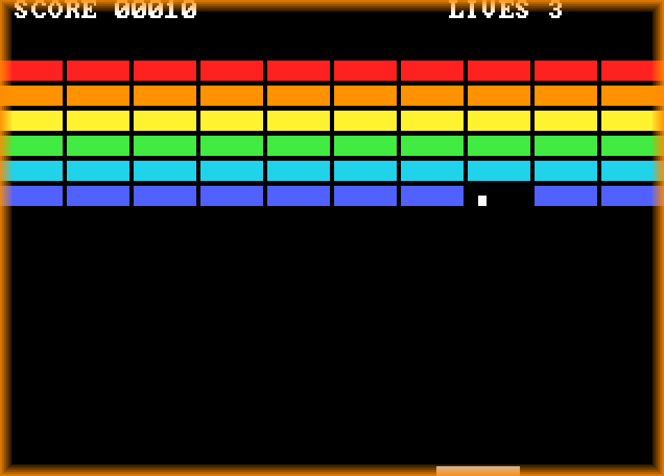

# Bricks: a breakout game stopped at every brick it loses

<!-- demo-motion:begin -->
<p align="center"><picture><source media="(prefers-reduced-motion: reduce)" srcset="screen.png"></picture></p>

1. `resume` runs the game to the breakpoint on `brick_hit`, and the ball falls into the next brick.
2. `read_memory` reads the score by its name: twenty points from the two bricks the ball broke.
3. `send_keys` steps the paddle right, left and right; the game logs each key.
4. With `lives` frozen, the same ball is lost and the status line still reads 3.
5. `send_mouse` puts the pointer at 240,100 and the paddle centres itself under it.

<!-- moments-ms: 1484,1569,1569,1569,1569 -->
<!-- demo-motion:end -->

`BRICKS.COM` is a wall, a ball and a paddle, written in this folder to be debugged as much as
played. This demo stops it by name where each brick falls, reads the score, takes the paddle
with keys and with the mouse, and undoes a move with a saved state.

## The program

Everything it needs is here: the source (`bricks.asm`, MIT like the rest of the repository),
the program built from it, its symbol table and the conf that starts it. The header of
`bricks.asm` says how to build it.

The game has no random number in it, and its conf fixes the emulator's speed. So two runs
knock down the same bricks on the same frames.

## Run it

```sh
uv run python demos/bricks/demo.py
```

Each line it prints is one call and its check. The window opens behind the others, so the run
does not take your keyboard.

- `--binary PATH` (absolute or `~`-led) picks the DOSBox-X to start. Left out, it is
  `DOSBOX_X_BINARY`, else the `dosbox-x` on your `PATH`.
- `--display N` opens the window on that display. Left out, it opens on the main one.
- `--transcript PATH` moves the whole transcript; the run's other files go beside it.
- `--update-readme` rewrites this page's generated parts, `TRANSCRIPT.md`, `screen.png`,
  `loop.webp` and the README's example calls, from a run where every step passed. It needs ffmpeg and `img2webp` on your
  `PATH`, and Pillow and numpy (the `decorate` extra), which draw the call captions, the keys and the pointer over the loop.

Exit codes: 0 every step passed, 1 a step failed, 2 a usage error, 3 nothing was demonstrated.
That last one is a relative path or a server that did not start.

The saved states need a DOSBox-X that has the SAVESTATE and LOADSTATE debugger commands
([REFERENCE.md](../../REFERENCE.md), *Saved states*).

To play it yourself: `cd demos/bricks && dosbox-x -conf bricks.conf`. The arrows move the
paddle and SPACE serves the ball. M hands the paddle to the mouse, and ESC returns to DOS.

## Try it yourself

[Add the server to your client](../../README.md#install) and ask it to start DOSBox-X on `demos/bricks/bricks.conf`. Each of these is a step of
the demo, in the order the demo makes them.

<!-- demo-transcript:begin -->
### 1. Set a breakpoint by a name

Ask:

> Put a breakpoint on `brick_hit`.

Call:

```text
breakpoint_at(ref="brick_hit")
```

Reply, 3 of 11 fields:

```json
{
  "summary": "breakpoint_at brick_hit: armed",
  "entry": "BP 08DF:02A5",
  "by": "symbol"
}
```

`brick_hit` is a label of the symbol table the build wrote, so `by` says `symbol`. `armed` means the breakpoint is set in the debugger, at the address `entry` gives.

<details><summary>The whole reply</summary>

```json
{
  "summary": "breakpoint_at brick_hit: armed",
  "status": "ok",
  "ref": "brick_hit",
  "by": "symbol",
  "role": "stop",
  "stored": true,
  "armed": true,
  "state": "armed",
  "entry": "BP 08DF:02A5",
  "names": [
    {"field": "given.ref", "number": "0x00009095", "kind": "symbol", "name": "brick_hit"}
  ],
  "session": {"alive": true, "running": false, "altered": false}
}
```

</details>

### 2. Run until the program stops itself

Ask:

> Let the game run until that breakpoint stops it, and tell me the score.

Call:

```text
resume(seconds=60)
```

Reply, 3 of 16 fields:

```json
{
  "summary": "resume: OTHER_STOP, stopped at 08DF:000002A5",
  "verdict": "OTHER_STOP",
  "cause": "breakpoint brick_hit (by symbol) at 08DF:000002A5"
}
```

`OTHER_STOP` means the breakpoint stopped the run, not a time limit. `cause` names it; the whole reply also holds `watches`, the score read by its name.

<details><summary>The whole reply</summary>

```json
{
  "summary": "resume: OTHER_STOP, stopped at 08DF:000002A5",
  "status": "ok",
  "verdict": "OTHER_STOP",
  "omitted": ["output", "output_chars", "clipped"],
  "how": "detail=True adds what the debugger printed for this command",
  "waited_s": "<volatile>",
  "pc": "08DF:000002A5",
  "cpu_mode": "real",
  "frame": 36,
  "regs": {
    "EAX": "0xd05b0005",
    "EBX": "0x00000707",
    "ECX": "0x005b0020",
    "EDX": "0x00000000",
    "ESI": "0x00000039",
    "EDI": "0x000064e4",
    "EBP": "0x0000091c",
    "ESP": "0x0000fffa",
    "EIP": "0x000002a5",
    "CS": "0x08df",
    "DS": "0x08df",
    "ES": "0xa000",
    "FS": "0x0000",
    "GS": "0x0000",
    "SS": "0x08df"
  },
  "watches": [
    {
      "ref": "score",
      "by": "symbol",
      "mode": "show",
      "length": 2,
      "fmt": "u16",
      "state": "evaluated",
      "value": 0,
      "bytes": "0000"
    }
  ],
  "cause": "breakpoint brick_hit (by symbol) at 08DF:000002A5",
  "e9": {"lines_total": 0, "truncated": false, "lines": [], "mark": "<volatile>"},
  "stop_seq": 3,
  "instruction": {
    "address": "08DF:000002A5",
    "bytes": "88DF",
    "text": "mov bh, bl",
    "flow": "sequential",
    "code_bits": 16,
    "bytes_from": "memory",
    "symbol": "brick_hit",
    "delta": 0
  },
  "session": {"alive": true, "running": false, "altered": false}
}
```

</details>

### 3. Hold a value against the program's own writes

Ask:

> The same ball was just lost again: read `lives` now that `watch_add` freezes it.

Call:

```text
read_memory(ref="lives", length=1)
```

Reply, 2 of 8 fields:

```json
{
  "summary": "read_memory lives: 1 byte at 08DF:000005CB: 03",
  "hex": "03"
}
```

A freeze is the debugger putting a byte back after every instruction. The game took the life and the status line still reads 3: `frozen_hex` is the value `watch_add` holds.

<details><summary>The whole reply</summary>

```json
{
  "summary": "read_memory lives: 1 byte at 08DF:000005CB: 03",
  "status": "ok",
  "ref": "lives",
  "seg_off": "08DF:000005CB",
  "length": 1,
  "hex": "03",
  "names": [
    {"field": "given.ref", "number": "0x000093bb", "kind": "symbol", "name": "lives"}
  ],
  "session": {"alive": true, "running": false, "altered": true}
}
```

</details>
<!-- demo-transcript:end -->

<details><summary>The whole demo as one prompt</summary>

1. Start DOSBox-X windowed on `demos/bricks/bricks.conf` from its directory, stopping at the
   program's own `int 3`, with the log in a file.
2. Let it run to that first stop and tell me where DOS loaded the program.
3. Load `bricks.sym` with its base at that segment, show me the start of `brick_hit`, put a
   breakpoint on it and keep `score` in view at every stop.
4. Run to the first brick and to the second: which row and column, and what is the score?
5. Read `score` by name, clear the breakpoint, run three frames, tell me where the ball is and
   show me the screen.
6. Record 240 frames to an AVI, let the game run, press the right arrow three times and show me
   the game took them.
7. Stop it and read `paddle_x`. Let it run, press M, put the pointer on pixel 240, 100, and
   press M again.
8. Stop and read `paddle_x`. Let it run, save a state, press the left arrow, load the state,
   stop, and read `paddle_x` again.
9. Let it run, press SPACE to serve the ball, clear the watch and close.

</details>

## Tools this demo uses

| Group | Tools |
|---|---|
| [Session](../../docs/reference/session.md) | `start`, `close` |
| [Run](../../docs/reference/run.md) | `resume`, `run_for`, `stop` |
| [Names](../../docs/reference/names.md) | `symbols_load` |
| [Read](../../docs/reference/read.md) | `disassemble`, `read_memory` |
| [Breakpoints](../../docs/reference/breakpoints.md) | `breakpoint_at`, `watch_add`, `declaration_clear` |
| [Input](../../docs/reference/input.md) | `send_keys`, `send_mouse` |
| [Sequences](../../docs/reference/sequences.md) | `drive` |
| [States](../../docs/reference/states.md) | `state_write` |
| [Screen](../../docs/reference/screen.md) | `screen_view` |
| [Captures](../../docs/reference/captures.md) | `record` |

Each group is a page of the reference. Some of the names need a word:

- Run: the tools that let the program run and stop it again.
- Breakpoints: breakpoints and watches.
- Sequences: the tools that run several calls as one.
- Names: the tool that loads a symbol table.

## The transcript

[TRANSCRIPT.md](TRANSCRIPT.md) has every call of the run with its reply. Process ids, ports,
wall-clock times and temporary paths read `<volatile>` there, because they change from run to
run.
