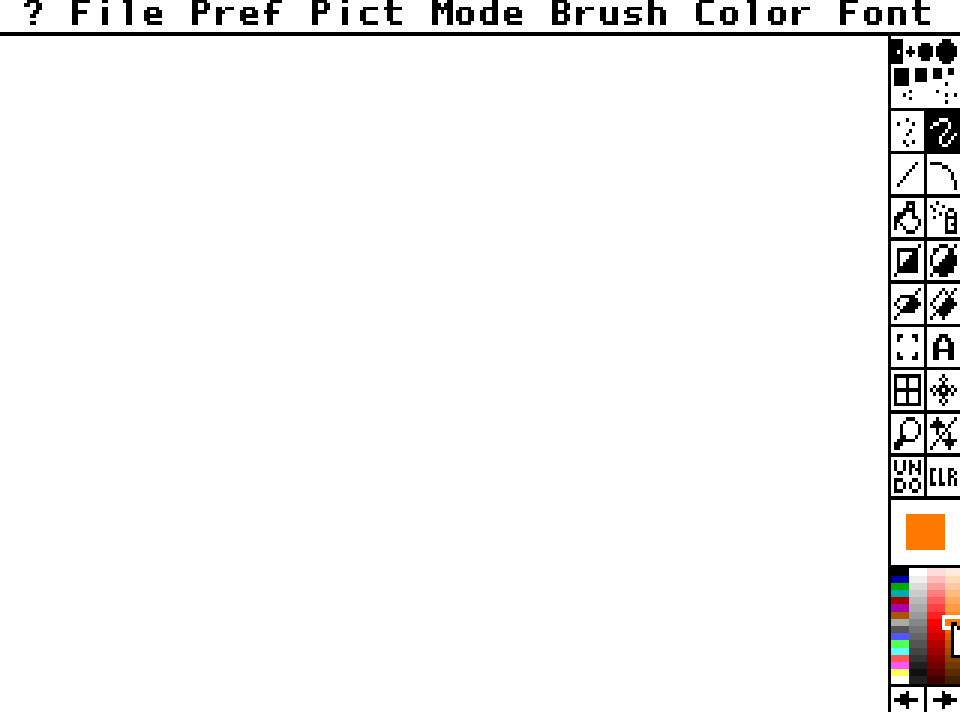

# Deluxe Paint: a sunset painted through the debugger

<!-- demo-motion:begin -->
<p align="center"><picture><source media="(prefers-reduced-motion: reduce)" srcset="screen.png"></picture></p>

1. Each `perform` picks a tool and a colour by name and drags: the sky, then the sun.
2. Two more `perform` calls paint the sea and the boat's hull.
3. The text tool, a click and `send_keys`: SCRY, typed into the picture.

<!-- moments-ms: 2283,1926,1784 -->
<!-- demo-motion:end -->

Electronic Arts' Deluxe Paint II, the 1988 PC version, paints a sunset here, every stroke sent
by the server. Tools and colours are picked by the names of a screen map, a file that names
the program's controls. The picture is checked by reading video memory back, and a value scan
finds the byte that holds the current colour.

## The program

Deluxe Paint II is commercial software, and nothing of it is in this repository. The demo runs
it from a directory you name: version 1.0, the 1988 release on one 720k disk.

It checks `DP.EXE` first and refuses another build, naming its digest. Nothing the run writes
stays in your directory.

## Run it

```sh
uv run python demos/dpaint/demo.py --cwd /path/to/your/dpaint2
```

Each line it prints is one call and its check. The window opens behind the others, so the run
does not take your keyboard; `--watch` brings it in front, for when you want to watch it.

- `--cwd PATH` (absolute or `~`-led) is the directory holding `DP.EXE`. The session runs from
  it, and it reads `<host>` in the transcript.
- `--binary PATH` (absolute or `~`-led) picks the DOSBox-X to start. Left out, it is
  `DOSBOX_X_BINARY`, else the `dosbox-x` on your `PATH`.
- `--display N` opens the window on that display. Left out, it opens on the main one.
- `--watch` shows the run: the window comes in front and takes your keyboard until the run ends.
- `--transcript PATH` moves the whole transcript; the run's other files go beside it.
- `--update-readme` rewrites this page's generated parts, `TRANSCRIPT.md`, `screen.png` and
  `loop.webp`, from a run where every step passed. It needs ffmpeg and `img2webp` on your
  `PATH`.

Exit codes: 0 every step passed, 1 a step failed, 2 a usage error, 3 nothing was demonstrated.
That last one is no program directory, another build of it, a DOSBox-X without relative motion or a
server that did not start.

Deluxe Paint takes the mouse as movement, so it needs a DOSBox-X whose input device carries
relative motion ([`send_mouse`](../../docs/reference/input.md#send_mouse)). On a build without
it the demo stops at its third step and says so.

## Try it yourself

[Add the server to your client](../../README.md#install) and ask it to start DOSBox-X on `demos/dpaint/dpaint.conf` from your copy of the program. Each of these is a step of
the demo, in the order the demo makes them.

<!-- demo-transcript:begin -->
### 1. Click a control by its name

Ask:

> Pick blue on Deluxe Paint's palette.

Call:

```text
send_mouse(target="blue", button="left")
```

Reply, 3 of 26 fields:

```json
{
  "summary": "send_mouse: pointer at 300,179, program's own pointer not re ... (113 characters)",
  "target": "blue",
  "driver_arrived": true
}
```

The screen map says where `blue` sits, so the call holds no coordinates. `driver_arrived` is true when the program's own mouse driver reports the pointer there.

<details><summary>The whole reply</summary>

```json
{
  "summary": "send_mouse: pointer at 300,179, program's own pointer not read; sent, reaction not checked, 21 frames to frame 28",
  "status": "ok",
  "x": 300,
  "y": 179,
  "units": "screen",
  "button": "left",
  "action": "click",
  "route": "guest",
  "pointer": {
    "screen": {"x": 300, "y": 179, "width": 320, "height": 200},
    "mouse": {"x": 2404, "y": 1436, "max_x": 2552, "max_y": 1592},
    "buttons": [],
    "bios_mode": "0x13"
  },
  "driver_arrived": true,
  "polls": 21,
  "pc": "<volatile>",
  "cpu_mode": "real",
  "stop_seq": 23,
  "frame": 28,
  "instruction": "<volatile>",
  "regs": "<volatile>",
  "watches": [],
  "cause": "<volatile>",
  "e9": {"lines_total": 0, "truncated": false, "lines": [], "mark": "<volatile>"},
  "motion": true,
  "verify": {
    "checked": false,
    "why": "no `expect` was given, so the reply says what went into the guest and NOT that the program took it; pass expect=<E9 pattern> to confirm its reaction"
  },
  "target": "blue",
  "screen": "paint",
  "identified_at_stop": 2,
  "session": {"alive": true, "running": false, "altered": false}
}
```

</details>

### 2. Find the byte that holds the colour

Ask:

> Orange is picked now. Keep only the bytes of the scan that hold orange's number.

Call:

```text
scan(method="filter", value=55)
```

Reply, 2 of 10 fields:

```json
{
  "summary": "scan filter: = 55, 7 left",
  "hits_total": 7
}
```

`hits_total` counts the bytes still in the scan: they held blue's number, then orange's. The ones below the stack pointer are the program's own variables.

<details><summary>The whole reply</summary>

```json
{
  "summary": "scan filter: = 55, 7 left",
  "status": "ok",
  "operator": "=",
  "value": "0x37",
  "iterations": 2,
  "closed": false,
  "hits": [
    {"seg_off": "31B2:0000017C", "addr": "0x00031c9c", "value": "0x37"},
    {"seg_off": "31B2:000001AE", "addr": "0x00031cce", "value": "0x37"},
    {"seg_off": "31B2:00000470", "addr": "0x00031f90", "value": "0x37"},
    {"seg_off": "31B2:000010B0", "addr": "0x00032bd0", "value": "0x37"},
    {"seg_off": "31B2:0000A57E", "addr": "0x0003c09e", "value": "0x37"},
    {"seg_off": "31B2:0000A57F", "addr": "0x0003c09f", "value": "0x37"},
    {"seg_off": "31B2:0000A580", "addr": "0x0003c0a0", "value": "0x37"}
  ],
  "hits_total": 7,
  "truncated": false,
  "session": {"alive": true, "running": false, "altered": false}
}
```

</details>

### 3. Read the picture back out of video memory

Ask:

> Read 128 bytes of video memory from row 100, column 160.

Call:

```text
read_memory(ref="A000:7DA0", length=128)
```

Reply, 2 of 7 fields:

```json
{
  "summary": "read_memory A000:7DA0: 128 bytes at A000:00007DA0: 343434343 ... (207 characters)",
  "length": 128
}
```

In this video mode each byte is one pixel's colour number. The row holds 25 pixels of sky, 51 of sun and 52 of sky, as painted.

<details><summary>The whole reply</summary>

```json
{
  "summary": "read_memory A000:7DA0: 128 bytes at A000:00007DA0: 343434343434343434343434343434343434343434343434340e0e0e0e0e0e0e0e0e0e0e0e0e0e0e0e0e0e0e0e0e0e0e0e0e0e0e0e0e0e0e0e0e0e0e0e0e0e0e... (64 more bytes in `hex`)",
  "status": "ok",
  "ref": "A000:7DA0",
  "seg_off": "A000:00007DA0",
  "length": 128,
  "hex": "343434343434343434343434343434343434343434343434340e0e0e0e0e0e0e0e0e0e0e0e0e0e0e0e0e0e0e0e0e0e0e0e0e0e0e0e0e0e0e0e0e0e0e0e0e0e0e0e0e0e0e0e0e0e0e0e0e0e0e34343434343434343434343434343434343434343434343434343434343434343434343434343434343434343434343434343434",
  "session": {"alive": true, "running": false, "altered": false}
}
```

</details>
<!-- demo-transcript:end -->

<details><summary>The whole demo as one prompt</summary>

1. Start DOSBox-X windowed on `demos/dpaint/dpaint.conf`, running from your copy of the
   program, with `DP.EXE f` as the program, recording its video, and the log in a file.
2. Load the screen map `dpaint-screen-map.json` beside the conf and run until it names the
   painting screen.
3. Tell me where DOS loaded the program, and so where its data segment is.
4. Pick blue on the palette, start a value scan of the data segment and keep what holds 9.
5. Pick orange, keep what holds 55, and tell me which of the bytes left are below the stack
   pointer.
6. Close the scan and watch the first of those. Then paint a sunset, one call a shape, and tell
   me what the watched byte shows after each colour.
7. A peach sky as a filled rectangle, a yellow sun as a filled circle on the horizon, a navy
   sea over its lower half.
8. A brown hull with the rectangle tool still in hand, a white sail drawn with lines, and SCRY
   typed with the text tool.
9. Read a row across the sun and one across the boat, show me the screen, clear the watch and
   close.

</details>

## Tools this demo uses

| Group | Tools |
|---|---|
| [Session](../../docs/reference/session.md) | `start`, `close` |
| [Run](../../docs/reference/run.md) | `screen_wait` |
| [Machine](../../docs/reference/machine.md) | `machine_map` |
| [Read](../../docs/reference/read.md) | `screen_map_write`, `screen_map_find`, `read_memory` |
| [Input](../../docs/reference/input.md) | `send_mouse`, `send_keys` |
| [Scan](../../docs/reference/scan.md) | `scan` |
| [Breakpoints](../../docs/reference/breakpoints.md) | `watch_add`, `declaration_clear` |
| [Sequences](../../docs/reference/sequences.md) | `perform` |
| [Screen](../../docs/reference/screen.md) | `screen_view` |

Each group is a page of the reference. Some of the names need a word:

- Run: the tools that let the program run and stop it again.
- Breakpoints: breakpoints and watches.
- Sequences: the tools that run several calls as one.
- Machine: the program's log and the map of what DOS loaded.

## The transcript

[TRANSCRIPT.md](TRANSCRIPT.md) has every call of the run with its reply. Process ids, ports,
wall-clock times and temporary paths read `<volatile>` there, because they change from run to
run.

The moving picture is cut from the video the session records of itself
(`start(capture_video=true)`), because Deluxe Paint draws while each call is still running.

[`demos/dpaint_maps/`](../dpaint_maps/README.md) drives the same program through its menus and
a dialog.
