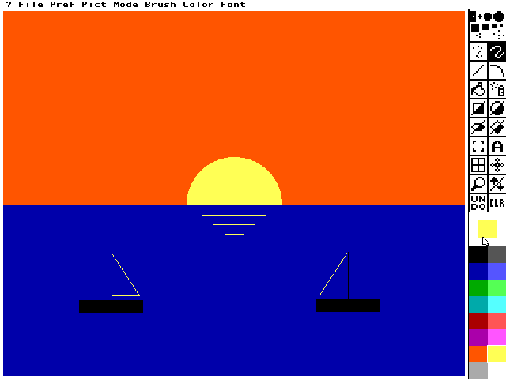

# Deluxe Paint by screen maps: menus, a dialog and the tool in hand, all by name



Electronic Arts' Deluxe Paint II, the 1988 PC version, at VGA 640 x 480 in 16 colours, driven
entirely by the names a screen map gives its interface. Its menus drop only while the button is
held, so the demo opens one with a press on its title and chooses with the release over an item;
before every next name it asks the map which screen this is, and the map knows each menu open,
the Palette dialog, and the painting screen in the state of whichever tool is in hand. In the
dialog it mixes an orange out of the brown slot and reads it back off the VGA DAC; then it paints
a sunset, lifts the boat it drew as a brush, flips it with the Brush menu and stamps the mirror
image across the bay. The picture is checked by reading rows of it back out of the four bit
planes, so a shape a pixel short, or a boat that did not flip, fails the run.

The first Deluxe Paint demo, [`demos/dpaint/`](../dpaint/README.md), paints at 320 x 200 and
stops halfway for a value scan; this one stays on the screen maps.

## The program

Deluxe Paint II is Electronic Arts' commercial software, and nothing of it is in this
repository: the demo carries its prompt, its script, its conf and its screen map, and runs the
program from a directory you name. It needs what the first demo needs: version 1.0, the
1988 release on one 720k disk, copied off the disk into a directory of its own. The demo checks
`DP.EXE` before anything starts and refuses another build, naming its digest, because the
toolbox and the picture are that release's. The session's log and saved states go under this
repository's `tmp/`, and nothing the run writes stays in your directory.

## Run it

```sh
WINDOW_APP=/path/to/your/placement-helper uv run python demos/dpaint_maps/demo.py \
  --cwd /path/to/your/dpaint2
```

The demo opens a window, scaled up twice by its conf, so the menus can be watched as they open;
nothing in it needs the window. Like the first demo it needs a DOSBox-X whose input device
carries relative motion (the repository's REFERENCE.md, *Input and the screen*), named with
`--binary` or `DOSBOX_X_BINARY`; without it the demo stops at its second step, saying so.

Where that window goes is your machine's to say, exactly as for the [bricks
demo](../bricks/README.md): the server asks the placement helper named by `WINDOW_APP`, for the
secondary display on a run nobody watches, and the demo refuses to start rather than open the
window on top of your work when the helper cannot place it.

- `--cwd PATH` (absolute or `~`-led) is the directory holding `DP.EXE`, which the session runs from and mounts
  as C:. It is hidden in the transcript as `<host>`.
- `--shared` says somebody is watching: the window opens on the main display.
- `--binary PATH` (absolute or `~`-led) picks the DOSBox-X to start; left out, `DOSBOX_X_BINARY`, else the
  `dosbox-x` on your `PATH`.
- `--transcript PATH` moves the whole transcript; the run's other files go beside it.
- `--update-readme` rewrites the block below and `screen.png` from a run where every step
  passed.

Each step prints one `OK <step>: <summary>` or `FAIL <step>: <why>` line, then a `DEMO` verdict
line and the paths of the two transcripts. Exit codes: 0 every step passed, 1 a step failed, 2
a usage error, 3 nothing was demonstrated (no copy, another build of it, no placement for the
window, a DOSBox-X without relative motion, a server that did not start).

## The map

`dpaint.scry-map.json` names ten screens of Deluxe Paint at 640 x 480, each known by regions
that stay still on it:

| Screen | Known by | Its names |
|---|---|---|
| `paint: freehand`, `paint: rectangle`, `paint: circle`, `paint: line`, `paint: grab` | the menu bar at rest and that tool's cell, inverted | the three menu titles, the tools, the 16 colour swatches, the one-pixel brush |
| `paint: custom brush` | the same, with no built-in brush lit: a brush lifted off the picture is in hand | the same |
| `color menu`, `brush menu`, `pict menu` | the body of the open menu | `palette`, `flip_horizontal` |
| `palette` | the dialog's title and its buttons | the 16 colour slots, the red, green and blue arrows, `ok`, `cancel` |

The swatches keep the default palette's names, so the slot the dialog mixes to orange is still
`brown`. The pointer is parked over the toolbox before a painting screen is read, because on the
canvas a shape tool draws it as a crosshair across the whole screen, through the regions the
map signs.

## The prompt

Give this to an MCP client with this server connected:

> Start DOSBox-X windowed on `demos/dpaint_maps/dpaint_maps.conf`, placed where my placement
> helper says, running from `/path/to/your/dpaint2`, with
> `DP.EXE k` as the program and the log in a file. Run 400 retraces, load the screen map
> `dpaint.scry-map.json` beside the conf, and from then on use only the names it gives: tell me
> which screen this is before every next name. Hold the button on Color, choose Palette, pick
> the brown slot and hold the red arrow down until red tops out, read that slot off the DAC, and
> press OK. Paint a sunset, one call a shape, each tool and colour picked by name: a sky in the
> brown slot as a filled rectangle, a yellow sun as a filled circle on the horizon, a blue sea
> over its lower half, three yellow glints as lines, a black hull, a black mast and a yellow
> sail. Lift the boat with the brush tool, hold Brush and choose Flip Horizontal, stamp it
> across the bay, then hold Pict and let go over its title. Put down the lifted brush, read
> rows across the sun, the glints, the sails and the hulls, show me the screen and close.

## What it walks

| Family | Calls |
|---|---|
| Session | `start` (windowed, running the program from `cwd`), `close` |
| Advance | `run_for` by retraces on the conf's fixed clock |
| Files | `map_write(method="load")`, `map_find` after every move between screens |
| Input | `send_mouse` by control name off the map (a press to open a menu, a release to choose), at screen pixels, and as drags |
| Read | `palette` for the mixed colour, `screen_view` for rows of the picture and the screen |
| Sequences | `perform` (a tool and its colour with the map's word on the tool in hand; a shape's drags) |

## The transcript

Generated by `demo.py --update-readme` from a run where every step passed. What differs between
two honest runs (process ids, ports, wall-clock times, temporary paths, the host's own DOSBox-X
and where it put the window) is `<volatile>`, and the program's directory is `<host>`.

<!-- demo-transcript:begin -->
**1. `start`**: OK start: DOSBox-X in a window, parked at the debugger before DOS boots

<details><summary>call and reply</summary>

```json
{
  "conf": "./demos/dpaint_maps/dpaint_maps.conf",
  "session_seconds": 900,
  "shared": true,
  "display": "secondary",
  "program": "DP.EXE k",
  "logfile": "./tmp/demos/dpaint_maps/dpaint-maps-e9.log",
  "state_dir": "./tmp/demos/dpaint_maps/dpaint-maps-states",
  "cwd": "<host>"
}
```

```json
{
  "summary": "<volatile>",
  "status": "ok",
  "pid": "<volatile>",
  "conf": "./demos/dpaint_maps/dpaint_maps.conf",
  "conf_digest": "ed93ffa692570e15",
  "watched": true,
  "bound_s": 900,
  "elapsed_s": "<volatile>",
  "captures": "off",
  "state_dir": "./tmp/demos/dpaint_maps/dpaint-maps-states",
  "shared": true,
  "display": "secondary",
  "ready_after_s": "<volatile>",
  "argv": "<volatile>",
  "binary": "<volatile>",
  "binary_origin": "<volatile>",
  "version": "<volatile>",
  "debugger_commands": [
    "BPIF",
    "CAPTURE",
    "DOSTRACE",
    "LOADSTATE",
    "PORTINFO",
    "PRESENCE",
    "RUNSTATE",
    "SAVESTATE",
    "STEPIN",
    "TAP",
    "VGAMEMDUMP"
  ],
  "stub": "./guest/SCRY.COM",
  "input_port": "<volatile>",
  "background": false,
  "presence": true,
  "declarations": {
    "rearm": {
      "rearmed": [],
      "stale": [],
      "unresolved": [],
      "ambiguous": [],
      "unarmable": []
    }
  },
  "session": {
    "alive": true,
    "running": false,
    "altered": false
  }
}
```

</details>

**2. `run_for`**: OK loaded: 400 retraces: Deluxe Paint is up, its data segment at 0x31b0

<details><summary>call and reply</summary>

```json
{
  "frames": 400,
  "seconds": 60
}
```

```json
{
  "summary": "run_for 400 frames: ELAPSED, 400 polls, at 0E83:00000A83",
  "status": "ok",
  "verdict": "ELAPSED",
  "polls": 400,
  "pc": "0E83:00000A83",
  "cpu_mode": "real",
  "frame": 400,
  "regs": {
    "EAX": "0x00006e42",
    "EBX": "0x000003e4",
    "ECX": "0x005b0000",
    "EDX": "0x0000a57c",
    "ESI": "0x00000007",
    "EDI": "0x0000a0ae",
    "EBP": "0x0000a006",
    "ESP": "0x0000a004",
    "EIP": "0x00000a83",
    "CS": "0x0e83",
    "DS": "0x31b0",
    "ES": "0x0000",
    "FS": "0x0000",
    "GS": "0x0000",
    "SS": "0x31b0"
  },
  "watches": [],
  "cause": "the retrace run_for ran to, at 0E83:00000A83",
  "e9": {
    "lines_total": 1,
    "truncated": false,
    "lines": [
      "Bochs port E9h: STUB  . scry device=present proto=6 motion=1"
    ],
    "mark": "<volatile>"
  },
  "stop_seq": 2,
  "instruction": {
    "seg_off": "0E83:00000A83",
    "bytes": "50",
    "text": "push ax",
    "flow": "sequential",
    "code_bits": 16,
    "bytes_from": "memory",
    "symbol": {
      "available": false,
      "why": "no symbol table is loaded"
    },
    "delta": {
      "available": false,
      "why": "no symbol table is loaded"
    }
  },
  "emulated_before_s": 0.0007,
  "emulated_after_s": 6.6465891,
  "frame_before": 0,
  "frame_after": 400,
  "cycles": {
    "available": false,
    "why": "the cycle count counts only what the normal core runs, and which core runs is not something this server can read, so no count is given"
  },
  "session": {
    "alive": true,
    "running": false,
    "altered": false
  }
}
```

</details>

**3. `map_write`**: OK map: 10 screens and 89 controls loaded

<details><summary>call and reply</summary>

```json
{
  "method": "load",
  "path": "./demos/dpaint_maps/dpaint.scry-map.json"
}
```

```json
{
  "summary": "map_write load: 10 screens, 89 controls of dpaint",
  "status": "ok",
  "path": "./demos/dpaint_maps/dpaint.scry-map.json",
  "application": "dpaint",
  "screens": 10,
  "controls": 89,
  "session": {
    "alive": true,
    "running": false,
    "altered": false
  }
}
```

</details>

**4. `map_find`**: OK is paint: the map says: paint: freehand

<details><summary>call and reply</summary>

```json
{}
```

```json
{
  "summary": "map_find: paint: freehand (file), 13 controls",
  "status": "ok",
  "matched": true,
  "screen": "paint: freehand",
  "layer": "file",
  "kind": "pixel",
  "size": [
    640,
    480
  ],
  "controls": [
    {
      "name": "pict",
      "rect": [
        103,
        0,
        33,
        11
      ],
      "centre": [
        119,
        5
      ]
    },
    {
      "name": "brush",
      "rect": [
        183,
        0,
        41,
        11
      ],
      "centre": [
        203,
        5
      ]
    },
    {
      "name": "color",
      "rect": [
        231,
        0,
        41,
        11
      ],
      "centre": [
        251,
        5
      ]
    },
    {
      "name": "brush_dot",
      "rect": [
        598,
        20,
        3,
        3
      ],
      "centre": [
        599,
        21
      ]
    },
    {
      "name": "freehand",
      "rect": [
        618,
        54,
        22,
        22
      ],
      "centre": [
        629,
        65
      ]
    },
    {
      "name": "line",
      "rect": [
        594,
        78,
        22,
        22
      ],
      "centre": [
        605,
        89
      ]
    },
    {
      "name": "rect_filled",
      "rect": [
        606,
        138,
        9,
        9
      ],
      "centre": [
        610,
        142
      ]
    },
    {
      "name": "circle_filled",
      "rect": [
        630,
        138,
        9,
        9
      ],
      "centre": [
        634,
        142
      ]
    },
    {
      "name": "brush_grab",
      "rect": [
        594,
        174,
        22,
        22
      ],
      "centre": [
        605,
        185
      ]
    },
    {
      "name": "black",
      "rect": [
        596,
        315,
        17,
        16
      ],
      "centre": [
        604,
        323
      ]
    },
    {
      "name": "blue",
      "rect": [
        596,
        337,
        17,
        14
      ],
      "centre": [
        604,
        344
      ]
    },
    {
      "name": "brown",
      "rect": [
        596,
        441,
        17,
        15
      ],
      "centre": [
        604,
        448
      ]
    },
    {
      "name": "yellow",
      "rect": [
        620,
        441,
        17,
        15
      ],
      "centre": [
        628,
        448
      ]
    }
  ],
  "session": {
    "alive": true,
    "running": false,
    "altered": false
  }
}
```

</details>

**5. `perform`**: OK open Color: the map named color menu

<details><summary>call and reply</summary>

```json
{
  "steps": [
    {
      "op": "send_mouse",
      "target": "color",
      "button": "left",
      "action": "down"
    },
    {
      "op": "map_find"
    }
  ],
  "summaries": true
}
```

```json
{
  "summary": "perform: 2 of 2 steps",
  "status": "ok",
  "ran": [
    {
      "step": 0,
      "op": "send_mouse",
      "reply": {
        "summary": "send_mouse: pointer at 251,5; posted, unverified, 16 retraces to frame 416",
        "status": "ok",
        "stop_seq": 18,
        "cause": "the retrace the input's post ran to, at 0955:0000035D"
      }
    },
    {
      "step": 1,
      "op": "map_find",
      "reply": {
        "summary": "map_find: color menu (file), 2 controls",
        "status": "ok",
        "matched": true,
        "screen": "color menu",
        "layer": "file",
        "kind": "pixel",
        "size": [
          640,
          480
        ],
        "controls": [
          {
            "name": "palette",
            "rect": [
              232,
              13,
              170,
              11
            ],
            "centre": [
              317,
              18
            ]
          },
          {
            "name": "color",
            "rect": [
              231,
              0,
              41,
              11
            ],
            "centre": [
              251,
              5
            ]
          }
        ],
        "session": {
          "alive": true,
          "running": false,
          "altered": false
        }
      }
    }
  ],
  "steps_total": 2,
  "truncated": false,
  "ran_path": "<volatile>",
  "replies_path": "<volatile>",
  "stops": {
    "stop_seq_first": 3,
    "stop_seq_last": 18,
    "surveyed": 1,
    "by_cause": {
      "the retrace the input's post ran to,": 1
    },
    "unaccounted": 15
  },
  "steps_completed": 2,
  "failed_at": {
    "available": false,
    "why": "no step failed"
  },
  "held": 0,
  "session": {
    "alive": true,
    "running": false,
    "altered": false
  }
}
```

</details>

**6. `perform`**: OK choose Palette: the map named palette

<details><summary>call and reply</summary>

```json
{
  "steps": [
    {
      "op": "send_mouse",
      "target": "palette",
      "button": "left",
      "action": "up"
    },
    {
      "op": "run_for",
      "frames": 20
    },
    {
      "op": "map_find"
    }
  ],
  "summaries": true
}
```

```json
{
  "summary": "perform: 3 of 3 steps",
  "status": "ok",
  "ran": [
    {
      "step": 0,
      "op": "send_mouse",
      "reply": {
        "summary": "send_mouse: pointer at 317,18; posted, unverified, 20 retraces to frame 436",
        "status": "ok",
        "stop_seq": 38,
        "cause": "the retrace the input's post ran to, at 0DA5:000002C1"
      }
    },
    {
      "step": 1,
      "op": "run_for",
      "reply": {
        "summary": "run_for 20 frames: ELAPSED, 20 polls, at F000:0000CFC5",
        "status": "ok",
        "stop_seq": 39,
        "cause": "the retrace run_for ran to, at F000:0000CFC5"
      }
    },
    {
      "step": 2,
      "op": "map_find",
      "reply": {
        "summary": "map_find: palette (file), 6 controls",
        "status": "ok",
        "matched": true,
        "screen": "palette",
        "layer": "file",
        "kind": "pixel",
        "size": [
          640,
          480
        ],
        "controls": [
          {
            "name": "brown",
            "rect": [
              91,
              57,
              18,
              4
            ],
            "centre": [
              100,
              59
            ]
          },
          {
            "name": "red_up",
            "rect": [
              4,
              34,
              7,
              10
            ],
            "centre": [
              7,
              39
            ]
          },
          {
            "name": "green_up",
            "rect": [
              18,
              34,
              7,
              10
            ],
            "centre": [
              21,
              39
            ]
          },
          {
            "name": "blue_up",
            "rect": [
              32,
              34,
              7,
              10
            ],
            "centre": [
              35,
              39
            ]
          },
          {
            "name": "ok",
            "rect": [
              10,
              143,
              55,
              12
            ],
            "centre": [
              37,
              149
            ]
          },
          {
            "name": "cancel",
            "rect": [
              138,
              143,
              60,
              12
            ],
            "centre": [
              168,
              149
            ]
          }
        ],
        "session": {
          "alive": true,
          "running": false,
          "altered": false
        }
      }
    }
  ],
  "steps_total": 3,
  "truncated": false,
  "ran_path": "<volatile>",
  "replies_path": "<volatile>",
  "stops": {
    "stop_seq_first": 19,
    "stop_seq_last": 39,
    "surveyed": 2,
    "by_cause": {
      "the retrace the input's post ran to,": 1,
      "the retrace run_for ran to,": 1
    },
    "unaccounted": 19
  },
  "steps_completed": 3,
  "failed_at": {
    "available": false,
    "why": "no step failed"
  },
  "held": 0,
  "session": {
    "alive": true,
    "running": false,
    "altered": false
  }
}
```

</details>

**7. `perform`**: OK mix: the brown slot picked, and red's arrow held 120 retraces until the channel tops out

<details><summary>call and reply</summary>

```json
{
  "steps": [
    {
      "op": "send_mouse",
      "target": "brown",
      "button": "left"
    },
    {
      "op": "send_mouse",
      "target": "red_up",
      "button": "left",
      "action": "down"
    },
    {
      "op": "run_for",
      "frames": 120
    },
    {
      "op": "send_mouse",
      "button": "left",
      "action": "up"
    }
  ],
  "summaries": true
}
```

```json
{
  "summary": "perform: 4 of 4 steps",
  "status": "ok",
  "ran": [
    {
      "step": 0,
      "op": "send_mouse",
      "reply": {
        "summary": "send_mouse: pointer at 100,59; posted, unverified, 21 retraces to frame 477",
        "status": "ok",
        "stop_seq": 60,
        "cause": "the retrace the input's post ran to, at F000:0000CFC5"
      }
    },
    {
      "step": 1,
      "op": "send_mouse",
      "reply": {
        "summary": "send_mouse: pointer at 7,39; posted, unverified, 20 retraces to frame 497",
        "status": "ok",
        "stop_seq": 80,
        "cause": "the retrace the input's post ran to, at F000:0000CBE5"
      }
    },
    {
      "step": 2,
      "op": "run_for",
      "reply": {
        "summary": "run_for 120 frames: ELAPSED, 120 polls, at 0DA5:000000CD",
        "status": "ok",
        "stop_seq": 81,
        "cause": "the retrace run_for ran to, at 0DA5:000000CD"
      }
    },
    {
      "step": 3,
      "op": "send_mouse",
      "reply": {
        "summary": "send_mouse: pointer at 7,39; posted, unverified, 11 retraces to frame 628",
        "status": "ok",
        "units": "screen",
        "button": "left",
        "action": "up",
        "route": "guest",
        "pointer": {
          "screen": {
            "x": 7,
            "y": 39,
            "width": 640,
            "height": 480
          },
          "mouse": {
            "x": 60,
            "y": 316,
            "max_x": 5112,
            "max_y": 3832
          },
          "buttons": [],
          "bios_mode": "0x12"
        },
        "arrived": true,
        "polls": 11,
        "pc": "F000:0000CFC5",
        "cpu_mode": "real",
        "stop_seq": 92,
        "frame": 628,
        "instruction": {
          "seg_off": "F000:0000CFC5",
          "bytes": "CF",
          "text": "iret",
          "flow": "return",
          "code_bits": 16,
          "bytes_from": "memory",
          "symbol": {
            "available": false,
            "why": "no symbol table is loaded"
          },
          "delta": {
            "available": false,
            "why": "no symbol table is loaded"
          }
        },
        "regs": {
          "EAX": "0x000001b8",
          "EBX": "0x00000178",
          "ECX": "0x005b0003",
          "EDX": "0x00000000",
          "ESI": "0x0000ffff",
          "EDI": "0x00000000",
          "EBP": "0x00009fa8",
          "ESP": "0x00009f94",
          "EIP": "0x0000cfc5",
          "CS": "0xf000",
          "DS": "0x31b0",
          "ES": "0x0000",
          "FS": "0x0000",
          "GS": "0x0000",
          "SS": "0x31b0"
        },
        "watches": [],
        "cause": "the retrace the input's post ran to, at F000:0000CFC5",
        "e9": {
          "lines_total": 0,
          "truncated": false,
          "lines": [],
          "mark": "<volatile>"
        },
        "verify": {
          "checked": false,
          "why": "no `expect` was given, so the reply says what went into the guest and NOT that the program took it; pass expect=<E9 pattern> to confirm its reaction"
        },
        "session": {
          "alive": true,
          "running": false,
          "altered": false
        }
      }
    }
  ],
  "steps_total": 4,
  "truncated": false,
  "ran_path": "<volatile>",
  "replies_path": "<volatile>",
  "stops": {
    "stop_seq_first": 40,
    "stop_seq_last": 92,
    "surveyed": 4,
    "by_cause": {
      "the retrace the input's post ran to,": 3,
      "the retrace run_for ran to,": 1
    },
    "unaccounted": 49
  },
  "steps_completed": 4,
  "failed_at": {
    "available": false,
    "why": "no step failed"
  },
  "held": 0,
  "session": {
    "alive": true,
    "running": false,
    "altered": false
  }
}
```

</details>

**8. `palette`**: OK orange: the brown slot now holds #ff5500, orange

<details><summary>call and reply</summary>

```json
{
  "first": 6,
  "count": 1,
  "dest": "./tmp/demos/dpaint_maps/orange.png"
}
```

```json
{
  "summary": "palette: entry 6 #ff5500 of 256; 128x128 PNG x8, inline",
  "status": "ok",
  "entries": 256,
  "first": 6,
  "count": 1,
  "colors": [
    "#ff5500"
  ],
  "rgb": [
    "3f1500"
  ],
  "bits": 6,
  "pel_mask": "ffh",
  "image": {
    "path": "./tmp/demos/dpaint_maps/orange.png",
    "bytes": 927,
    "sha256": "4f2ecf162576eca795550ef23660053e58ee706814419b700b766c0a5f0bd9f8",
    "width": 128,
    "height": 128,
    "scale": 8,
    "indexed": true,
    "inline": true
  },
  "session": {
    "alive": true,
    "running": false,
    "altered": false
  }
}
```

Also attached: image/png.

</details>

**9. `perform`**: OK sky, sun and sea: the map named paint: freehand, then paint: rectangle, then paint: circle, then paint: rectangle

<details><summary>call and reply</summary>

```json
{
  "steps": [
    {
      "op": "send_mouse",
      "target": "ok",
      "button": "left"
    },
    {
      "op": "run_for",
      "frames": 20
    },
    {
      "op": "map_find"
    },
    {
      "op": "send_mouse",
      "target": "rect_filled",
      "button": "left"
    },
    {
      "op": "send_mouse",
      "target": "brown",
      "button": "left"
    },
    {
      "op": "send_mouse",
      "x": 4,
      "y": 14,
      "button": "left",
      "action": "down"
    },
    {
      "op": "send_mouse",
      "x": 587,
      "y": 259
    },
    {
      "op": "send_mouse",
      "button": "left",
      "action": "up"
    },
    {
      "op": "send_mouse",
      "x": 610,
      "y": 300
    },
    {
      "op": "map_find"
    },
    {
      "op": "send_mouse",
      "target": "circle_filled",
      "button": "left"
    },
    {
      "op": "send_mouse",
      "target": "yellow",
      "button": "left"
    },
    {
      "op": "send_mouse",
      "x": 296,
      "y": 259,
      "button": "left",
      "action": "down"
    },
    {
      "op": "send_mouse",
      "x": 356,
      "y": 259
    },
    {
      "op": "send_mouse",
      "button": "left",
      "action": "up"
    },
    {
      "op": "send_mouse",
      "x": 610,
      "y": 300
    },
    {
      "op": "map_find"
    },
    {
      "op": "send_mouse",
      "target": "rect_filled",
      "button": "left"
    },
    {
      "op": "send_mouse",
      "target": "blue",
      "button": "left"
    },
    {
      "op": "send_mouse",
      "x": 4,
      "y": 260,
      "button": "left",
      "action": "down"
    },
    {
      "op": "send_mouse",
      "x": 587,
      "y": 475
    },
    {
      "op": "send_mouse",
      "button": "left",
      "action": "up"
    },
    {
      "op": "send_mouse",
      "x": 610,
      "y": 300
    },
    {
      "op": "map_find"
    }
  ],
  "summaries": true
}
```

```json
{
  "summary": "perform: 24 of 24 steps",
  "status": "ok",
  "ran": [
    {
      "step": 0,
      "op": "send_mouse",
      "reply": {
        "summary": "send_mouse: pointer at 37,149; posted, unverified, 25 retraces to frame 653",
        "status": "ok",
        "stop_seq": 117,
        "cause": "the retrace the input's post ran to, at 0DA5:000000C9"
      }
    },
    {
      "step": 1,
      "op": "run_for",
      "reply": {
        "summary": "run_for 20 frames: ELAPSED, 20 polls, at 1009:00000363",
        "status": "ok",
        "stop_seq": 118,
        "cause": "the retrace run_for ran to, at 1009:00000363"
      }
    },
    {
      "step": 2,
      "op": "map_find",
      "reply": {
        "summary": "map_find: paint: freehand (file), 13 controls",
        "status": "ok"
      }
    },
    {
      "step": 3,
      "op": "send_mouse",
      "reply": {
        "summary": "send_mouse: pointer at 610,142; posted, unverified, 21 retraces to frame 694",
        "status": "ok",
        "stop_seq": 139,
        "cause": "the retrace the input's post ran to, at 0955:0000002D"
      }
    },
    {
      "step": 4,
      "op": "send_mouse",
      "reply": {
        "summary": "send_mouse: pointer at 604,448; posted, unverified, 25 retraces to frame 719",
        "status": "ok",
        "stop_seq": 164,
        "cause": "the retrace the input's post ran to, at 0955:00000030"
      }
    },
    {
      "step": 5,
      "op": "send_mouse",
      "reply": {
        "summary": "send_mouse: pointer at 4,14; posted, unverified, 20 retraces to frame 739",
        "status": "ok",
        "stop_seq": 184,
        "cause": "the retrace the input's post ran to, at 0E83:00000B2B"
      }
    },
    {
      "step": 6,
      "op": "send_mouse",
      "reply": {
        "summary": "send_mouse: pointer at 587,259; posted, unverified, 15 retraces to frame 754",
        "status": "ok",
        "stop_seq": 199,
        "cause": "the retrace the input's post ran to, at 0B92:00000248"
      }
    },
    {
      "step": 7,
      "op": "send_mouse",
      "reply": {
        "summary": "send_mouse: pointer at 587,259; posted, unverified, 15 retraces to frame 769",
        "status": "ok",
        "stop_seq": 214,
        "cause": "the retrace the input's post ran to, at 0B92:00000200"
      }
    },
    {
      "step": 8,
      "op": "send_mouse",
      "reply": {
        "summary": "send_mouse: pointer at 610,300; posted, unverified, 15 retraces to frame 784",
        "status": "ok",
        "stop_seq": 229,
        "cause": "the retrace the input's post ran to, at F000:0000CFC5"
      }
    },
    {
      "step": 9,
      "op": "map_find",
      "reply": {
        "summary": "map_find: paint: rectangle (file), 13 controls",
        "status": "ok"
      }
    },
    {
      "step": 10,
      "op": "send_mouse",
      "reply": {
        "summary": "send_mouse: pointer at 634,142; posted, unverified, 25 retraces to frame 809",
        "status": "ok",
        "stop_seq": 254,
        "cause": "the retrace the input's post ran to, at 0955:00000030"
      }
    },
    {
      "step": 11,
      "op": "send_mouse",
      "reply": {
        "summary": "send_mouse: pointer at 628,448; posted, unverified, 25 retraces to frame 834",
        "status": "ok",
        "stop_seq": 279,
        "cause": "the retrace the input's post ran to, at 1009:0000023A"
      }
    },
    {
      "step": 12,
      "op": "send_mouse",
      "reply": {
        "summary": "send_mouse: pointer at 296,259; posted, unverified, 20 retraces to frame 854",
        "status": "ok",
        "stop_seq": 299,
        "cause": "the retrace the input's post ran to, at 0E83:0000097A"
      }
    },
    {
      "step": 13,
      "op": "send_mouse",
      "reply": {
        "summary": "send_mouse: pointer at 356,259; posted, unverified, 15 retraces to frame 869",
        "status": "ok",
        "stop_seq": 314,
        "cause": "the retrace the input's post ran to, at 1009:00000320"
      }
    },
    {
      "step": 14,
      "op": "send_mouse",
      "reply": {
        "summary": "send_mouse: pointer at 356,259; posted, unverified, 15 retraces to frame 884",
        "status": "ok",
        "stop_seq": 329,
        "cause": "the retrace the input's post ran to, at 0B92:00000246"
      }
    },
    {
      "step": 15,
      "op": "send_mouse",
      "reply": {
        "summary": "send_mouse: pointer at 610,300; posted, unverified, 15 retraces to frame 899",
        "status": "ok",
        "stop_seq": 344,
        "cause": "the retrace the input's post ran to, at F000:0000CFC5"
      }
    },
    {
      "step": 16,
      "op": "map_find",
      "reply": {
        "summary": "map_find: paint: circle (file), 13 controls",
        "status": "ok"
      }
    },
    {
      "step": 17,
      "op": "send_mouse",
      "reply": {
        "summary": "send_mouse: pointer at 610,142; posted, unverified, 25 retraces to frame 924",
        "status": "ok",
        "stop_seq": 369,
        "cause": "the retrace the input's post ran to, at 13F6:000002DF"
      }
    },
    {
      "step": 18,
      "op": "send_mouse",
      "reply": {
        "summary": "send_mouse: pointer at 604,344; posted, unverified, 25 retraces to frame 949",
        "status": "ok",
        "stop_seq": 394,
        "cause": "the retrace the input's post ran to, at 0955:00000047"
      }
    },
    {
      "step": 19,
      "op": "send_mouse",
      "reply": {
        "summary": "send_mouse: pointer at 4,260; posted, unverified, 20 retraces to frame 969",
        "status": "ok",
        "stop_seq": 414,
        "cause": "the retrace the input's post ran to, at F000:0000CFC5"
      }
    },
    {
      "step": 20,
      "op": "send_mouse",
      "reply": {
        "summary": "send_mouse: pointer at 587,475; posted, unverified, 15 retraces to frame 984",
        "status": "ok",
        "stop_seq": 429,
        "cause": "the retrace the input's post ran to, at F000:0000CFC5"
      }
    },
    {
      "step": 21,
      "op": "send_mouse",
      "reply": {
        "summary": "send_mouse: pointer at 587,475; posted, unverified, 15 retraces to frame 999",
        "status": "ok",
        "stop_seq": 444,
        "cause": "the retrace the input's post ran to, at F000:0000CFC5"
      }
    },
    {
      "step": 22,
      "op": "send_mouse",
      "reply": {
        "summary": "send_mouse: pointer at 610,300; posted, unverified, 15 retraces to frame 1014",
        "status": "ok",
        "stop_seq": 459,
        "cause": "the retrace the input's post ran to, at F000:0000CFC5"
      }
    },
    {
      "step": 23,
      "op": "map_find",
      "reply": {
        "summary": "map_find: paint: rectangle (file), 13 controls",
        "status": "ok",
        "matched": true,
        "screen": "paint: rectangle",
        "layer": "file",
        "kind": "pixel",
        "size": [
          640,
          480
        ],
        "controls": [
          {
            "name": "pict",
            "rect": [
              103,
              0,
              33,
              11
            ],
            "centre": [
              119,
              5
            ]
          },
          {
            "name": "brush",
            "rect": [
              183,
              0,
              41,
              11
            ],
            "centre": [
              203,
              5
            ]
          },
          {
            "name": "color",
            "rect": [
              231,
              0,
              41,
              11
            ],
            "centre": [
              251,
              5
            ]
          },
          {
            "name": "brush_dot",
            "rect": [
              598,
              20,
              3,
              3
            ],
            "centre": [
              599,
              21
            ]
          },
          {
            "name": "freehand",
            "rect": [
              618,
              54,
              22,
              22
            ],
            "centre": [
              629,
              65
            ]
          },
          {
            "name": "line",
            "rect": [
              594,
              78,
              22,
              22
            ],
            "centre": [
              605,
              89
            ]
          },
          {
            "name": "rect_filled",
            "rect": [
              606,
              138,
              9,
              9
            ],
            "centre": [
              610,
              142
            ]
          },
          {
            "name": "circle_filled",
            "rect": [
              630,
              138,
              9,
              9
            ],
            "centre": [
              634,
              142
            ]
          },
          {
            "name": "brush_grab",
            "rect": [
              594,
              174,
              22,
              22
            ],
            "centre": [
              605,
              185
            ]
          },
          {
            "name": "black",
            "rect": [
              596,
              315,
              17,
              16
            ],
            "centre": [
              604,
              323
            ]
          },
          {
            "name": "blue",
            "rect": [
              596,
              337,
              17,
              14
            ],
            "centre": [
              604,
              344
            ]
          },
          {
            "name": "brown",
            "rect": [
              596,
              441,
              17,
              15
            ],
            "centre": [
              604,
              448
            ]
          },
          {
            "name": "yellow",
            "rect": [
              620,
              441,
              17,
              15
            ],
            "centre": [
              628,
              448
            ]
          }
        ],
        "session": {
          "alive": true,
          "running": false,
          "altered": false
        }
      }
    }
  ],
  "steps_total": 24,
  "truncated": false,
  "ran_path": "<volatile>",
  "replies_path": "<volatile>",
  "stops": {
    "stop_seq_first": 93,
    "stop_seq_last": 459,
    "surveyed": 20,
    "by_cause": {
      "the retrace the input's post ran to,": 19,
      "the retrace run_for ran to,": 1
    },
    "unaccounted": 347
  },
  "steps_completed": 24,
  "failed_at": {
    "available": false,
    "why": "no step failed"
  },
  "held": 0,
  "session": {
    "alive": true,
    "running": false,
    "altered": false
  }
}
```

</details>

**10. `perform`**: OK glints and hull: the map named paint: line, then paint: rectangle

<details><summary>call and reply</summary>

```json
{
  "steps": [
    {
      "op": "send_mouse",
      "target": "line",
      "button": "left"
    },
    {
      "op": "send_mouse",
      "target": "yellow",
      "button": "left"
    },
    {
      "op": "send_mouse",
      "x": 256,
      "y": 272,
      "button": "left",
      "action": "down"
    },
    {
      "op": "send_mouse",
      "x": 336,
      "y": 272
    },
    {
      "op": "send_mouse",
      "button": "left",
      "action": "up"
    },
    {
      "op": "send_mouse",
      "x": 270,
      "y": 284,
      "button": "left",
      "action": "down"
    },
    {
      "op": "send_mouse",
      "x": 322,
      "y": 284
    },
    {
      "op": "send_mouse",
      "button": "left",
      "action": "up"
    },
    {
      "op": "send_mouse",
      "x": 284,
      "y": 296,
      "button": "left",
      "action": "down"
    },
    {
      "op": "send_mouse",
      "x": 308,
      "y": 296
    },
    {
      "op": "send_mouse",
      "button": "left",
      "action": "up"
    },
    {
      "op": "send_mouse",
      "x": 610,
      "y": 300
    },
    {
      "op": "map_find"
    },
    {
      "op": "send_mouse",
      "target": "rect_filled",
      "button": "left"
    },
    {
      "op": "send_mouse",
      "target": "black",
      "button": "left"
    },
    {
      "op": "send_mouse",
      "x": 100,
      "y": 380,
      "button": "left",
      "action": "down"
    },
    {
      "op": "send_mouse",
      "x": 180,
      "y": 395
    },
    {
      "op": "send_mouse",
      "button": "left",
      "action": "up"
    },
    {
      "op": "send_mouse",
      "x": 610,
      "y": 300
    },
    {
      "op": "map_find"
    }
  ],
  "summaries": true
}
```

```json
{
  "summary": "perform: 20 of 20 steps",
  "status": "ok",
  "ran": [
    {
      "step": 0,
      "op": "send_mouse",
      "reply": {
        "summary": "send_mouse: pointer at 605,89; posted, unverified, 25 retraces to frame 1039",
        "status": "ok",
        "stop_seq": 484,
        "cause": "the retrace the input's post ran to, at F000:0000CFC5"
      }
    },
    {
      "step": 1,
      "op": "send_mouse",
      "reply": {
        "summary": "send_mouse: pointer at 628,448; posted, unverified, 25 retraces to frame 1064",
        "status": "ok",
        "stop_seq": 509,
        "cause": "the retrace the input's post ran to, at F000:0000CFC1"
      }
    },
    {
      "step": 2,
      "op": "send_mouse",
      "reply": {
        "summary": "send_mouse: pointer at 256,272; posted, unverified, 20 retraces to frame 1084",
        "status": "ok",
        "stop_seq": 529,
        "cause": "the retrace the input's post ran to, at 1009:0000036A"
      }
    },
    {
      "step": 3,
      "op": "send_mouse",
      "reply": {
        "summary": "send_mouse: pointer at 336,272; posted, unverified, 15 retraces to frame 1099",
        "status": "ok",
        "stop_seq": 544,
        "cause": "the retrace the input's post ran to, at 0E83:00000B0F"
      }
    },
    {
      "step": 4,
      "op": "send_mouse",
      "reply": {
        "summary": "send_mouse: pointer at 336,272; posted, unverified, 15 retraces to frame 1114",
        "status": "ok",
        "stop_seq": 559,
        "cause": "the retrace the input's post ran to, at F000:0000CFC5"
      }
    },
    {
      "step": 5,
      "op": "send_mouse",
      "reply": {
        "summary": "send_mouse: pointer at 270,284; posted, unverified, 20 retraces to frame 1134",
        "status": "ok",
        "stop_seq": 579,
        "cause": "the retrace the input's post ran to, at 0E83:000004F0"
      }
    },
    {
      "step": 6,
      "op": "send_mouse",
      "reply": {
        "summary": "send_mouse: pointer at 322,284; posted, unverified, 15 retraces to frame 1149",
        "status": "ok",
        "stop_seq": 594,
        "cause": "the retrace the input's post ran to, at 1009:0000026B"
      }
    },
    {
      "step": 7,
      "op": "send_mouse",
      "reply": {
        "summary": "send_mouse: pointer at 322,284; posted, unverified, 15 retraces to frame 1164",
        "status": "ok",
        "stop_seq": 609,
        "cause": "the retrace the input's post ran to, at 0E83:00000B1C"
      }
    },
    {
      "step": 8,
      "op": "send_mouse",
      "reply": {
        "summary": "send_mouse: pointer at 284,296; posted, unverified, 20 retraces to frame 1184",
        "status": "ok",
        "stop_seq": 629,
        "cause": "the retrace the input's post ran to, at F000:0000CFC5"
      }
    },
    {
      "step": 9,
      "op": "send_mouse",
      "reply": {
        "summary": "send_mouse: pointer at 308,296; posted, unverified, 15 retraces to frame 1199",
        "status": "ok",
        "stop_seq": 644,
        "cause": "the retrace the input's post ran to, at 0E83:00000153"
      }
    },
    {
      "step": 10,
      "op": "send_mouse",
      "reply": {
        "summary": "send_mouse: pointer at 308,296; posted, unverified, 15 retraces to frame 1214",
        "status": "ok",
        "stop_seq": 659,
        "cause": "the retrace the input's post ran to, at 1009:0000025E"
      }
    },
    {
      "step": 11,
      "op": "send_mouse",
      "reply": {
        "summary": "send_mouse: pointer at 610,300; posted, unverified, 15 retraces to frame 1229",
        "status": "ok",
        "stop_seq": 674,
        "cause": "the retrace the input's post ran to, at 1009:000002A6"
      }
    },
    {
      "step": 12,
      "op": "map_find",
      "reply": {
        "summary": "map_find: paint: line (file), 13 controls",
        "status": "ok"
      }
    },
    {
      "step": 13,
      "op": "send_mouse",
      "reply": {
        "summary": "send_mouse: pointer at 610,142; posted, unverified, 25 retraces to frame 1254",
        "status": "ok",
        "stop_seq": 699,
        "cause": "the retrace the input's post ran to, at F000:0000CFC5"
      }
    },
    {
      "step": 14,
      "op": "send_mouse",
      "reply": {
        "summary": "send_mouse: pointer at 604,323; posted, unverified, 25 retraces to frame 1279",
        "status": "ok",
        "stop_seq": 724,
        "cause": "the retrace the input's post ran to, at F000:0000CFC5"
      }
    },
    {
      "step": 15,
      "op": "send_mouse",
      "reply": {
        "summary": "send_mouse: pointer at 100,380; posted, unverified, 20 retraces to frame 1299",
        "status": "ok",
        "stop_seq": 744,
        "cause": "the retrace the input's post ran to, at F000:0000CFC5"
      }
    },
    {
      "step": 16,
      "op": "send_mouse",
      "reply": {
        "summary": "send_mouse: pointer at 180,395; posted, unverified, 15 retraces to frame 1314",
        "status": "ok",
        "stop_seq": 759,
        "cause": "the retrace the input's post ran to, at 1009:000001B5"
      }
    },
    {
      "step": 17,
      "op": "send_mouse",
      "reply": {
        "summary": "send_mouse: pointer at 180,395; posted, unverified, 15 retraces to frame 1329",
        "status": "ok",
        "stop_seq": 774,
        "cause": "the retrace the input's post ran to, at 0E83:0000036E"
      }
    },
    {
      "step": 18,
      "op": "send_mouse",
      "reply": {
        "summary": "send_mouse: pointer at 610,300; posted, unverified, 15 retraces to frame 1344",
        "status": "ok",
        "stop_seq": 789,
        "cause": "the retrace the input's post ran to, at F000:0000CFC5"
      }
    },
    {
      "step": 19,
      "op": "map_find",
      "reply": {
        "summary": "map_find: paint: rectangle (file), 13 controls",
        "status": "ok",
        "matched": true,
        "screen": "paint: rectangle",
        "layer": "file",
        "kind": "pixel",
        "size": [
          640,
          480
        ],
        "controls": [
          {
            "name": "pict",
            "rect": [
              103,
              0,
              33,
              11
            ],
            "centre": [
              119,
              5
            ]
          },
          {
            "name": "brush",
            "rect": [
              183,
              0,
              41,
              11
            ],
            "centre": [
              203,
              5
            ]
          },
          {
            "name": "color",
            "rect": [
              231,
              0,
              41,
              11
            ],
            "centre": [
              251,
              5
            ]
          },
          {
            "name": "brush_dot",
            "rect": [
              598,
              20,
              3,
              3
            ],
            "centre": [
              599,
              21
            ]
          },
          {
            "name": "freehand",
            "rect": [
              618,
              54,
              22,
              22
            ],
            "centre": [
              629,
              65
            ]
          },
          {
            "name": "line",
            "rect": [
              594,
              78,
              22,
              22
            ],
            "centre": [
              605,
              89
            ]
          },
          {
            "name": "rect_filled",
            "rect": [
              606,
              138,
              9,
              9
            ],
            "centre": [
              610,
              142
            ]
          },
          {
            "name": "circle_filled",
            "rect": [
              630,
              138,
              9,
              9
            ],
            "centre": [
              634,
              142
            ]
          },
          {
            "name": "brush_grab",
            "rect": [
              594,
              174,
              22,
              22
            ],
            "centre": [
              605,
              185
            ]
          },
          {
            "name": "black",
            "rect": [
              596,
              315,
              17,
              16
            ],
            "centre": [
              604,
              323
            ]
          },
          {
            "name": "blue",
            "rect": [
              596,
              337,
              17,
              14
            ],
            "centre": [
              604,
              344
            ]
          },
          {
            "name": "brown",
            "rect": [
              596,
              441,
              17,
              15
            ],
            "centre": [
              604,
              448
            ]
          },
          {
            "name": "yellow",
            "rect": [
              620,
              441,
              17,
              15
            ],
            "centre": [
              628,
              448
            ]
          }
        ],
        "session": {
          "alive": true,
          "running": false,
          "altered": false
        }
      }
    }
  ],
  "steps_total": 20,
  "truncated": false,
  "ran_path": "<volatile>",
  "replies_path": "<volatile>",
  "stops": {
    "stop_seq_first": 460,
    "stop_seq_last": 789,
    "surveyed": 18,
    "by_cause": {
      "the retrace the input's post ran to,": 18
    },
    "unaccounted": 312
  },
  "steps_completed": 20,
  "failed_at": {
    "available": false,
    "why": "no step failed"
  },
  "held": 0,
  "session": {
    "alive": true,
    "running": false,
    "altered": false
  }
}
```

</details>

**11. `perform`**: OK mast and sail: the map named paint: line, then paint: line

<details><summary>call and reply</summary>

```json
{
  "steps": [
    {
      "op": "send_mouse",
      "target": "line",
      "button": "left"
    },
    {
      "op": "send_mouse",
      "target": "black",
      "button": "left"
    },
    {
      "op": "send_mouse",
      "x": 140,
      "y": 379,
      "button": "left",
      "action": "down"
    },
    {
      "op": "send_mouse",
      "x": 140,
      "y": 320
    },
    {
      "op": "send_mouse",
      "button": "left",
      "action": "up"
    },
    {
      "op": "send_mouse",
      "x": 610,
      "y": 300
    },
    {
      "op": "map_find"
    },
    {
      "op": "send_mouse",
      "target": "yellow",
      "button": "left"
    },
    {
      "op": "send_mouse",
      "x": 142,
      "y": 322,
      "button": "left",
      "action": "down"
    },
    {
      "op": "send_mouse",
      "x": 176,
      "y": 374
    },
    {
      "op": "send_mouse",
      "button": "left",
      "action": "up"
    },
    {
      "op": "send_mouse",
      "x": 176,
      "y": 374,
      "button": "left",
      "action": "down"
    },
    {
      "op": "send_mouse",
      "x": 142,
      "y": 374
    },
    {
      "op": "send_mouse",
      "button": "left",
      "action": "up"
    },
    {
      "op": "send_mouse",
      "x": 610,
      "y": 300
    },
    {
      "op": "map_find"
    }
  ],
  "summaries": true
}
```

```json
{
  "summary": "perform: 16 of 16 steps",
  "status": "ok",
  "ran": [
    {
      "step": 0,
      "op": "send_mouse",
      "reply": {
        "summary": "send_mouse: pointer at 605,89; posted, unverified, 25 retraces to frame 1369",
        "status": "ok",
        "stop_seq": 814,
        "cause": "the retrace the input's post ran to, at F000:0000CFC5"
      }
    },
    {
      "step": 1,
      "op": "send_mouse",
      "reply": {
        "summary": "send_mouse: pointer at 604,323; posted, unverified, 25 retraces to frame 1394",
        "status": "ok",
        "stop_seq": 839,
        "cause": "the retrace the input's post ran to, at 1009:00000380"
      }
    },
    {
      "step": 2,
      "op": "send_mouse",
      "reply": {
        "summary": "send_mouse: pointer at 140,379; posted, unverified, 20 retraces to frame 1414",
        "status": "ok",
        "stop_seq": 859,
        "cause": "the retrace the input's post ran to, at 0B92:0000020C"
      }
    },
    {
      "step": 3,
      "op": "send_mouse",
      "reply": {
        "summary": "send_mouse: pointer at 140,320; posted, unverified, 15 retraces to frame 1429",
        "status": "ok",
        "stop_seq": 874,
        "cause": "the retrace the input's post ran to, at 0E83:000004EE"
      }
    },
    {
      "step": 4,
      "op": "send_mouse",
      "reply": {
        "summary": "send_mouse: pointer at 140,320; posted, unverified, 15 retraces to frame 1444",
        "status": "ok",
        "stop_seq": 889,
        "cause": "the retrace the input's post ran to, at F000:0000CFC5"
      }
    },
    {
      "step": 5,
      "op": "send_mouse",
      "reply": {
        "summary": "send_mouse: pointer at 610,300; posted, unverified, 15 retraces to frame 1459",
        "status": "ok",
        "stop_seq": 904,
        "cause": "the retrace the input's post ran to, at F000:0000CFC5"
      }
    },
    {
      "step": 6,
      "op": "map_find",
      "reply": {
        "summary": "map_find: paint: line (file), 13 controls",
        "status": "ok"
      }
    },
    {
      "step": 7,
      "op": "send_mouse",
      "reply": {
        "summary": "send_mouse: pointer at 628,448; posted, unverified, 25 retraces to frame 1484",
        "status": "ok",
        "stop_seq": 929,
        "cause": "the retrace the input's post ran to, at F000:0000CFC5"
      }
    },
    {
      "step": 8,
      "op": "send_mouse",
      "reply": {
        "summary": "send_mouse: pointer at 142,322; posted, unverified, 20 retraces to frame 1504",
        "status": "ok",
        "stop_seq": 949,
        "cause": "the retrace the input's post ran to, at F000:0000CFC5"
      }
    },
    {
      "step": 9,
      "op": "send_mouse",
      "reply": {
        "summary": "send_mouse: pointer at 176,374; posted, unverified, 15 retraces to frame 1519",
        "status": "ok",
        "stop_seq": 964,
        "cause": "the retrace the input's post ran to, at F000:0000CFC5"
      }
    },
    {
      "step": 10,
      "op": "send_mouse",
      "reply": {
        "summary": "send_mouse: pointer at 176,374; posted, unverified, 15 retraces to frame 1534",
        "status": "ok",
        "stop_seq": 979,
        "cause": "the retrace the input's post ran to, at 1009:000002A7"
      }
    },
    {
      "step": 11,
      "op": "send_mouse",
      "reply": {
        "summary": "send_mouse: pointer at 176,374; posted, unverified, 20 retraces to frame 1554",
        "status": "ok",
        "stop_seq": 999,
        "cause": "the retrace the input's post ran to, at 0E83:00000B2F"
      }
    },
    {
      "step": 12,
      "op": "send_mouse",
      "reply": {
        "summary": "send_mouse: pointer at 142,374; posted, unverified, 15 retraces to frame 1569",
        "status": "ok",
        "stop_seq": 1014,
        "cause": "the retrace the input's post ran to, at 1009:0000030D"
      }
    },
    {
      "step": 13,
      "op": "send_mouse",
      "reply": {
        "summary": "send_mouse: pointer at 142,374; posted, unverified, 15 retraces to frame 1584",
        "status": "ok",
        "stop_seq": 1029,
        "cause": "the retrace the input's post ran to, at 0E83:00000153"
      }
    },
    {
      "step": 14,
      "op": "send_mouse",
      "reply": {
        "summary": "send_mouse: pointer at 610,300; posted, unverified, 15 retraces to frame 1599",
        "status": "ok",
        "stop_seq": 1044,
        "cause": "the retrace the input's post ran to, at F000:0000CFC5"
      }
    },
    {
      "step": 15,
      "op": "map_find",
      "reply": {
        "summary": "map_find: paint: line (file), 13 controls",
        "status": "ok",
        "matched": true,
        "screen": "paint: line",
        "layer": "file",
        "kind": "pixel",
        "size": [
          640,
          480
        ],
        "controls": [
          {
            "name": "pict",
            "rect": [
              103,
              0,
              33,
              11
            ],
            "centre": [
              119,
              5
            ]
          },
          {
            "name": "brush",
            "rect": [
              183,
              0,
              41,
              11
            ],
            "centre": [
              203,
              5
            ]
          },
          {
            "name": "color",
            "rect": [
              231,
              0,
              41,
              11
            ],
            "centre": [
              251,
              5
            ]
          },
          {
            "name": "brush_dot",
            "rect": [
              598,
              20,
              3,
              3
            ],
            "centre": [
              599,
              21
            ]
          },
          {
            "name": "freehand",
            "rect": [
              618,
              54,
              22,
              22
            ],
            "centre": [
              629,
              65
            ]
          },
          {
            "name": "line",
            "rect": [
              594,
              78,
              22,
              22
            ],
            "centre": [
              605,
              89
            ]
          },
          {
            "name": "rect_filled",
            "rect": [
              606,
              138,
              9,
              9
            ],
            "centre": [
              610,
              142
            ]
          },
          {
            "name": "circle_filled",
            "rect": [
              630,
              138,
              9,
              9
            ],
            "centre": [
              634,
              142
            ]
          },
          {
            "name": "brush_grab",
            "rect": [
              594,
              174,
              22,
              22
            ],
            "centre": [
              605,
              185
            ]
          },
          {
            "name": "black",
            "rect": [
              596,
              315,
              17,
              16
            ],
            "centre": [
              604,
              323
            ]
          },
          {
            "name": "blue",
            "rect": [
              596,
              337,
              17,
              14
            ],
            "centre": [
              604,
              344
            ]
          },
          {
            "name": "brown",
            "rect": [
              596,
              441,
              17,
              15
            ],
            "centre": [
              604,
              448
            ]
          },
          {
            "name": "yellow",
            "rect": [
              620,
              441,
              17,
              15
            ],
            "centre": [
              628,
              448
            ]
          }
        ],
        "session": {
          "alive": true,
          "running": false,
          "altered": false
        }
      }
    }
  ],
  "steps_total": 16,
  "truncated": false,
  "ran_path": "<volatile>",
  "replies_path": "<volatile>",
  "stops": {
    "stop_seq_first": 790,
    "stop_seq_last": 1044,
    "surveyed": 14,
    "by_cause": {
      "the retrace the input's post ran to,": 14
    },
    "unaccounted": 241
  },
  "steps_completed": 16,
  "failed_at": {
    "available": false,
    "why": "no step failed"
  },
  "held": 0,
  "session": {
    "alive": true,
    "running": false,
    "altered": false
  }
}
```

</details>

**12. `perform`**: OK flip the boat: the map named paint: grab, then paint: custom brush, then brush menu, then paint: custom brush, then paint: custom brush

<details><summary>call and reply</summary>

```json
{
  "steps": [
    {
      "op": "send_mouse",
      "target": "brush_grab",
      "button": "left"
    },
    {
      "op": "send_mouse",
      "x": 610,
      "y": 300
    },
    {
      "op": "map_find"
    },
    {
      "op": "send_mouse",
      "x": 96,
      "y": 316,
      "button": "left",
      "action": "down"
    },
    {
      "op": "send_mouse",
      "x": 184,
      "y": 399
    },
    {
      "op": "send_mouse",
      "button": "left",
      "action": "up"
    },
    {
      "op": "run_for",
      "frames": 10
    },
    {
      "op": "send_mouse",
      "x": 610,
      "y": 300
    },
    {
      "op": "map_find"
    },
    {
      "op": "send_mouse",
      "target": "brush",
      "button": "left",
      "action": "down"
    },
    {
      "op": "map_find"
    },
    {
      "op": "send_mouse",
      "target": "flip_horizontal",
      "button": "left",
      "action": "up"
    },
    {
      "op": "run_for",
      "frames": 20
    },
    {
      "op": "send_mouse",
      "x": 610,
      "y": 300
    },
    {
      "op": "map_find"
    },
    {
      "op": "send_mouse",
      "x": 440,
      "y": 357,
      "button": "left"
    },
    {
      "op": "run_for",
      "frames": 10
    },
    {
      "op": "send_mouse",
      "x": 610,
      "y": 300
    },
    {
      "op": "map_find"
    }
  ],
  "summaries": true
}
```

```json
{
  "summary": "perform: 19 of 19 steps",
  "status": "ok",
  "ran": [
    {
      "step": 0,
      "op": "send_mouse",
      "reply": {
        "summary": "send_mouse: pointer at 605,185; posted, unverified, 25 retraces to frame 1624",
        "status": "ok",
        "stop_seq": 1069,
        "cause": "the retrace the input's post ran to, at F000:0000CFC5"
      }
    },
    {
      "step": 1,
      "op": "send_mouse",
      "reply": {
        "summary": "send_mouse: pointer at 610,300; posted, unverified, 15 retraces to frame 1639",
        "status": "ok",
        "stop_seq": 1084,
        "cause": "the retrace the input's post ran to, at F000:0000CFC5"
      }
    },
    {
      "step": 2,
      "op": "map_find",
      "reply": {
        "summary": "map_find: paint: grab (file), 13 controls",
        "status": "ok"
      }
    },
    {
      "step": 3,
      "op": "send_mouse",
      "reply": {
        "summary": "send_mouse: pointer at 96,316; posted, unverified, 20 retraces to frame 1659",
        "status": "ok",
        "stop_seq": 1104,
        "cause": "the retrace the input's post ran to, at 0E83:000004EA"
      }
    },
    {
      "step": 4,
      "op": "send_mouse",
      "reply": {
        "summary": "send_mouse: pointer at 184,399; posted, unverified, 15 retraces to frame 1674",
        "status": "ok",
        "stop_seq": 1119,
        "cause": "the retrace the input's post ran to, at F000:0000CFC5"
      }
    },
    {
      "step": 5,
      "op": "send_mouse",
      "reply": {
        "summary": "send_mouse: pointer at 184,399; posted, unverified, 15 retraces to frame 1689",
        "status": "ok",
        "stop_seq": 1134,
        "cause": "the retrace the input's post ran to, at F000:0000CFC5"
      }
    },
    {
      "step": 6,
      "op": "run_for",
      "reply": {
        "summary": "run_for 10 frames: ELAPSED, 10 polls, at F000:0000CFC5",
        "status": "ok",
        "stop_seq": 1135,
        "cause": "the retrace run_for ran to, at F000:0000CFC5"
      }
    },
    {
      "step": 7,
      "op": "send_mouse",
      "reply": {
        "summary": "send_mouse: pointer at 610,300; posted, unverified, 11 retraces to frame 1710",
        "status": "ok",
        "stop_seq": 1146,
        "cause": "the retrace the input's post ran to, at 13F6:0000023B"
      }
    },
    {
      "step": 8,
      "op": "map_find",
      "reply": {
        "summary": "map_find: paint: custom brush (file), 13 controls",
        "status": "ok"
      }
    },
    {
      "step": 9,
      "op": "send_mouse",
      "reply": {
        "summary": "send_mouse: pointer at 203,5; posted, unverified, 20 retraces to frame 1730",
        "status": "ok",
        "stop_seq": 1166,
        "cause": "the retrace the input's post ran to, at 1697:000002EE"
      }
    },
    {
      "step": 10,
      "op": "map_find",
      "reply": {
        "summary": "map_find: brush menu (file), 2 controls",
        "status": "ok"
      }
    },
    {
      "step": 11,
      "op": "send_mouse",
      "reply": {
        "summary": "send_mouse: pointer at 269,18; posted, unverified, 20 retraces to frame 1750",
        "status": "ok",
        "stop_seq": 1186,
        "cause": "the retrace the input's post ran to, at 19A5:000001B8"
      }
    },
    {
      "step": 12,
      "op": "run_for",
      "reply": {
        "summary": "run_for 20 frames: ELAPSED, 20 polls, at 0DA5:00000345",
        "status": "ok",
        "stop_seq": 1187,
        "cause": "the retrace run_for ran to, at 0DA5:00000345"
      }
    },
    {
      "step": 13,
      "op": "send_mouse",
      "reply": {
        "summary": "send_mouse: pointer at 610,300; posted, unverified, 11 retraces to frame 1781",
        "status": "ok",
        "stop_seq": 1198,
        "cause": "the retrace the input's post ran to, at 1009:000002A6"
      }
    },
    {
      "step": 14,
      "op": "map_find",
      "reply": {
        "summary": "map_find: paint: custom brush (file), 13 controls",
        "status": "ok"
      }
    },
    {
      "step": 15,
      "op": "send_mouse",
      "reply": {
        "summary": "send_mouse: pointer at 440,357; posted, unverified, 25 retraces to frame 1806",
        "status": "ok",
        "stop_seq": 1223,
        "cause": "the retrace the input's post ran to, at 0955:00000058"
      }
    },
    {
      "step": 16,
      "op": "run_for",
      "reply": {
        "summary": "run_for 10 frames: ELAPSED, 10 polls, at 0955:0000005A",
        "status": "ok",
        "stop_seq": 1224,
        "cause": "the retrace run_for ran to, at 0955:0000005A"
      }
    },
    {
      "step": 17,
      "op": "send_mouse",
      "reply": {
        "summary": "send_mouse: pointer at 610,300; posted, unverified, 11 retraces to frame 1827",
        "status": "ok",
        "stop_seq": 1235,
        "cause": "the retrace the input's post ran to, at F000:0000CFC5"
      }
    },
    {
      "step": 18,
      "op": "map_find",
      "reply": {
        "summary": "map_find: paint: custom brush (file), 13 controls",
        "status": "ok",
        "matched": true,
        "screen": "paint: custom brush",
        "layer": "file",
        "kind": "pixel",
        "size": [
          640,
          480
        ],
        "controls": [
          {
            "name": "pict",
            "rect": [
              103,
              0,
              33,
              11
            ],
            "centre": [
              119,
              5
            ]
          },
          {
            "name": "brush",
            "rect": [
              183,
              0,
              41,
              11
            ],
            "centre": [
              203,
              5
            ]
          },
          {
            "name": "color",
            "rect": [
              231,
              0,
              41,
              11
            ],
            "centre": [
              251,
              5
            ]
          },
          {
            "name": "brush_dot",
            "rect": [
              598,
              20,
              3,
              3
            ],
            "centre": [
              599,
              21
            ]
          },
          {
            "name": "freehand",
            "rect": [
              618,
              54,
              22,
              22
            ],
            "centre": [
              629,
              65
            ]
          },
          {
            "name": "line",
            "rect": [
              594,
              78,
              22,
              22
            ],
            "centre": [
              605,
              89
            ]
          },
          {
            "name": "rect_filled",
            "rect": [
              606,
              138,
              9,
              9
            ],
            "centre": [
              610,
              142
            ]
          },
          {
            "name": "circle_filled",
            "rect": [
              630,
              138,
              9,
              9
            ],
            "centre": [
              634,
              142
            ]
          },
          {
            "name": "brush_grab",
            "rect": [
              594,
              174,
              22,
              22
            ],
            "centre": [
              605,
              185
            ]
          },
          {
            "name": "black",
            "rect": [
              596,
              315,
              17,
              16
            ],
            "centre": [
              604,
              323
            ]
          },
          {
            "name": "blue",
            "rect": [
              596,
              337,
              17,
              14
            ],
            "centre": [
              604,
              344
            ]
          },
          {
            "name": "brown",
            "rect": [
              596,
              441,
              17,
              15
            ],
            "centre": [
              604,
              448
            ]
          },
          {
            "name": "yellow",
            "rect": [
              620,
              441,
              17,
              15
            ],
            "centre": [
              628,
              448
            ]
          }
        ],
        "session": {
          "alive": true,
          "running": false,
          "altered": false
        }
      }
    }
  ],
  "steps_total": 19,
  "truncated": false,
  "ran_path": "<volatile>",
  "replies_path": "<volatile>",
  "stops": {
    "stop_seq_first": 1045,
    "stop_seq_last": 1235,
    "surveyed": 14,
    "by_cause": {
      "the retrace the input's post ran to,": 11,
      "the retrace run_for ran to,": 3
    },
    "unaccounted": 177
  },
  "steps_completed": 19,
  "failed_at": {
    "available": false,
    "why": "no step failed"
  },
  "held": 0,
  "session": {
    "alive": true,
    "running": false,
    "altered": false
  }
}
```

</details>

**13. `perform`**: OK Pict, and the brush put down: the map named pict menu, then paint: custom brush, then paint: freehand

<details><summary>call and reply</summary>

```json
{
  "steps": [
    {
      "op": "send_mouse",
      "target": "pict",
      "button": "left",
      "action": "down"
    },
    {
      "op": "map_find"
    },
    {
      "op": "send_mouse",
      "button": "left",
      "action": "up"
    },
    {
      "op": "run_for",
      "frames": 10
    },
    {
      "op": "send_mouse",
      "x": 610,
      "y": 300
    },
    {
      "op": "map_find"
    },
    {
      "op": "send_mouse",
      "target": "brush_dot",
      "button": "left"
    },
    {
      "op": "send_mouse",
      "target": "freehand",
      "button": "left"
    },
    {
      "op": "send_mouse",
      "x": 610,
      "y": 300
    },
    {
      "op": "map_find"
    }
  ],
  "summaries": true
}
```

```json
{
  "summary": "perform: 10 of 10 steps",
  "status": "ok",
  "ran": [
    {
      "step": 0,
      "op": "send_mouse",
      "reply": {
        "summary": "send_mouse: pointer at 119,5; posted, unverified, 20 retraces to frame 1847",
        "status": "ok",
        "stop_seq": 1255,
        "cause": "the retrace the input's post ran to, at 1697:000002EA"
      }
    },
    {
      "step": 1,
      "op": "map_find",
      "reply": {
        "summary": "map_find: pict menu (file), 1 control",
        "status": "ok"
      }
    },
    {
      "step": 2,
      "op": "send_mouse",
      "reply": {
        "summary": "send_mouse: pointer at 119,5; posted, unverified, 15 retraces to frame 1862",
        "status": "ok",
        "stop_seq": 1270,
        "cause": "the retrace the input's post ran to, at F000:0000CFC5"
      }
    },
    {
      "step": 3,
      "op": "run_for",
      "reply": {
        "summary": "run_for 10 frames: ELAPSED, 10 polls, at 1009:00000367",
        "status": "ok",
        "stop_seq": 1271,
        "cause": "the retrace run_for ran to, at 1009:00000367"
      }
    },
    {
      "step": 4,
      "op": "send_mouse",
      "reply": {
        "summary": "send_mouse: pointer at 610,300; posted, unverified, 11 retraces to frame 1883",
        "status": "ok",
        "stop_seq": 1282,
        "cause": "the retrace the input's post ran to, at F000:0000CFC5"
      }
    },
    {
      "step": 5,
      "op": "map_find",
      "reply": {
        "summary": "map_find: paint: custom brush (file), 13 controls",
        "status": "ok"
      }
    },
    {
      "step": 6,
      "op": "send_mouse",
      "reply": {
        "summary": "send_mouse: pointer at 599,21; posted, unverified, 25 retraces to frame 1908",
        "status": "ok",
        "stop_seq": 1307,
        "cause": "the retrace the input's post ran to, at F000:0000CFC5"
      }
    },
    {
      "step": 7,
      "op": "send_mouse",
      "reply": {
        "summary": "send_mouse: pointer at 629,65; posted, unverified, 25 retraces to frame 1933",
        "status": "ok",
        "stop_seq": 1332,
        "cause": "the retrace the input's post ran to, at F000:0000CFC5"
      }
    },
    {
      "step": 8,
      "op": "send_mouse",
      "reply": {
        "summary": "send_mouse: pointer at 610,300; posted, unverified, 15 retraces to frame 1948",
        "status": "ok",
        "stop_seq": 1347,
        "cause": "the retrace the input's post ran to, at F000:0000CFC5"
      }
    },
    {
      "step": 9,
      "op": "map_find",
      "reply": {
        "summary": "map_find: paint: freehand (file), 13 controls",
        "status": "ok",
        "matched": true,
        "screen": "paint: freehand",
        "layer": "file",
        "kind": "pixel",
        "size": [
          640,
          480
        ],
        "controls": [
          {
            "name": "pict",
            "rect": [
              103,
              0,
              33,
              11
            ],
            "centre": [
              119,
              5
            ]
          },
          {
            "name": "brush",
            "rect": [
              183,
              0,
              41,
              11
            ],
            "centre": [
              203,
              5
            ]
          },
          {
            "name": "color",
            "rect": [
              231,
              0,
              41,
              11
            ],
            "centre": [
              251,
              5
            ]
          },
          {
            "name": "brush_dot",
            "rect": [
              598,
              20,
              3,
              3
            ],
            "centre": [
              599,
              21
            ]
          },
          {
            "name": "freehand",
            "rect": [
              618,
              54,
              22,
              22
            ],
            "centre": [
              629,
              65
            ]
          },
          {
            "name": "line",
            "rect": [
              594,
              78,
              22,
              22
            ],
            "centre": [
              605,
              89
            ]
          },
          {
            "name": "rect_filled",
            "rect": [
              606,
              138,
              9,
              9
            ],
            "centre": [
              610,
              142
            ]
          },
          {
            "name": "circle_filled",
            "rect": [
              630,
              138,
              9,
              9
            ],
            "centre": [
              634,
              142
            ]
          },
          {
            "name": "brush_grab",
            "rect": [
              594,
              174,
              22,
              22
            ],
            "centre": [
              605,
              185
            ]
          },
          {
            "name": "black",
            "rect": [
              596,
              315,
              17,
              16
            ],
            "centre": [
              604,
              323
            ]
          },
          {
            "name": "blue",
            "rect": [
              596,
              337,
              17,
              14
            ],
            "centre": [
              604,
              344
            ]
          },
          {
            "name": "brown",
            "rect": [
              596,
              441,
              17,
              15
            ],
            "centre": [
              604,
              448
            ]
          },
          {
            "name": "yellow",
            "rect": [
              620,
              441,
              17,
              15
            ],
            "centre": [
              628,
              448
            ]
          }
        ],
        "session": {
          "alive": true,
          "running": false,
          "altered": false
        }
      }
    }
  ],
  "steps_total": 10,
  "truncated": false,
  "ran_path": "<volatile>",
  "replies_path": "<volatile>",
  "stops": {
    "stop_seq_first": 1236,
    "stop_seq_last": 1347,
    "surveyed": 7,
    "by_cause": {
      "the retrace the input's post ran to,": 6,
      "the retrace run_for ran to,": 1
    },
    "unaccounted": 105
  },
  "steps_completed": 10,
  "failed_at": {
    "available": false,
    "why": "no step failed"
  },
  "held": 0,
  "session": {
    "alive": true,
    "running": false,
    "altered": false
  }
}
```

</details>

**14. `screen_view`**: OK sun row: the row reads frame x 4, then orange x 239, then yellow x 107, then orange x 238, then frame x 4

<details><summary>call and reply</summary>

```json
{
  "crop": [
    0,
    230,
    592,
    1
  ],
  "scale": 1,
  "dest": "./tmp/demos/dpaint_maps/row-230.png",
  "attach": false
}
```

```json
{
  "summary": "screen_view M_EGA: 592x1 at [0, 230] pixels; 592x1 PNG x1, not inlined",
  "status": "ok",
  "vga_mode": "M_EGA",
  "kind": "pixel",
  "width": 640,
  "height": 480,
  "crop": [
    0,
    230,
    592,
    1
  ],
  "image": {
    "path": "./tmp/demos/dpaint_maps/row-230.png",
    "bytes": 862,
    "sha256": "bfe6a11d2b399d1cdf990309472e3e7a319dd0189e1d9d4e6b92038a2fa738fb",
    "width": 592,
    "height": 1,
    "scale": 1,
    "indexed": true,
    "inline": false,
    "not_inlined": "attach=false"
  },
  "display_start": "0h",
  "session": {
    "alive": true,
    "running": false,
    "altered": false
  }
}
```

</details>

**15. `screen_view`**: OK glint row: the row reads frame x 4, then blue x 252, then yellow x 81, then blue x 251, then frame x 4

<details><summary>call and reply</summary>

```json
{
  "crop": [
    0,
    272,
    592,
    1
  ],
  "scale": 1,
  "dest": "./tmp/demos/dpaint_maps/row-272.png",
  "attach": false
}
```

```json
{
  "summary": "screen_view M_EGA: 592x1 at [0, 272] pixels; 592x1 PNG x1, not inlined",
  "status": "ok",
  "vga_mode": "M_EGA",
  "kind": "pixel",
  "width": 640,
  "height": 480,
  "crop": [
    0,
    272,
    592,
    1
  ],
  "image": {
    "path": "./tmp/demos/dpaint_maps/row-272.png",
    "bytes": 862,
    "sha256": "374cb4507607384f48ae431769a8f6e8b5eb9bbbccd82e1efc1dd34324ea8338",
    "width": 592,
    "height": 1,
    "scale": 1,
    "indexed": true,
    "inline": false,
    "not_inlined": "attach=false"
  },
  "display_start": "0h",
  "session": {
    "alive": true,
    "running": false,
    "altered": false
  }
}
```

</details>

**16. `screen_view`**: OK sail row: the row reads frame x 4, then blue x 136, then black x 1, then blue x 19, then yellow x 1, then blue x 258, then yellow x 1, then blue x 20, then black x 1, then blue x 147, then frame x 4

<details><summary>call and reply</summary>

```json
{
  "crop": [
    0,
    350,
    592,
    1
  ],
  "scale": 1,
  "dest": "./tmp/demos/dpaint_maps/row-350.png",
  "attach": false
}
```

```json
{
  "summary": "screen_view M_EGA: 592x1 at [0, 350] pixels; 592x1 PNG x1, not inlined",
  "status": "ok",
  "vga_mode": "M_EGA",
  "kind": "pixel",
  "width": 640,
  "height": 480,
  "crop": [
    0,
    350,
    592,
    1
  ],
  "image": {
    "path": "./tmp/demos/dpaint_maps/row-350.png",
    "bytes": 870,
    "sha256": "7f67bd1cbb6676a90f1e71a5f7e425c7fce85cdd9ea47569d54a0f95b623ebba",
    "width": 592,
    "height": 1,
    "scale": 1,
    "indexed": true,
    "inline": false,
    "not_inlined": "attach=false"
  },
  "display_start": "0h",
  "session": {
    "alive": true,
    "running": false,
    "altered": false
  }
}
```

</details>

**17. `screen_view`**: OK hull row: the row reads frame x 4, then blue x 96, then black x 81, then blue x 219, then black x 81, then blue x 107, then frame x 4

<details><summary>call and reply</summary>

```json
{
  "crop": [
    0,
    388,
    592,
    1
  ],
  "scale": 1,
  "dest": "./tmp/demos/dpaint_maps/row-388.png",
  "attach": false
}
```

```json
{
  "summary": "screen_view M_EGA: 592x1 at [0, 388] pixels; 592x1 PNG x1, not inlined",
  "status": "ok",
  "vga_mode": "M_EGA",
  "kind": "pixel",
  "width": 640,
  "height": 480,
  "crop": [
    0,
    388,
    592,
    1
  ],
  "image": {
    "path": "./tmp/demos/dpaint_maps/row-388.png",
    "bytes": 865,
    "sha256": "0c6260b94b81920b1dfb89b6a5be77c7c9189dd446187bab6b6218814634051f",
    "width": 592,
    "height": 1,
    "scale": 1,
    "indexed": true,
    "inline": false,
    "not_inlined": "attach=false"
  },
  "display_start": "0h",
  "session": {
    "alive": true,
    "running": false,
    "altered": false
  }
}
```

</details>

**18. `screen_view`**: OK screen: mode M_EGA, 640x480 by palette index

<details><summary>call and reply</summary>

```json
{
  "dest": "./tmp/demos/dpaint_maps/screen.png"
}
```

```json
{
  "summary": "screen_view M_EGA: 640x480 at [0, 0] pixels; 640x480 PNG x1, inline",
  "status": "ok",
  "vga_mode": "M_EGA",
  "kind": "pixel",
  "width": 640,
  "height": 480,
  "crop": [
    0,
    0,
    640,
    480
  ],
  "image": {
    "path": "./tmp/demos/dpaint_maps/screen.png",
    "bytes": 3972,
    "sha256": "80223dd3d17a991d7ab2955494daba067f756c3483be660d31877ef65a259b24",
    "width": 640,
    "height": 480,
    "scale": 1,
    "indexed": true,
    "inline": true
  },
  "display_start": "0h",
  "session": {
    "alive": true,
    "running": false,
    "altered": false
  }
}
```

Also attached: image/png.

</details>

**19. `close`**: OK close: closed: quit

<details><summary>call and reply</summary>

```json
{}
```

```json
{
  "summary": "close: quit, exit code 0",
  "status": "ok",
  "closed": true,
  "pid": "<volatile>",
  "conf": "./demos/dpaint_maps/dpaint_maps.conf",
  "conf_digest": "ed93ffa692570e15",
  "watched": true,
  "bound_s": 900,
  "elapsed_s": "<volatile>",
  "captures": "off",
  "state_dir": "./tmp/demos/dpaint_maps/dpaint-maps-states",
  "ended_by": "quit",
  "exit_code": 0,
  "omitted": [
    "stdout_tail",
    "errorlog_tail"
  ],
  "how": "close(detail=True) keeps the emulator's last words on a clean quit too; once a close has answered its output is gone (the logfile stays at its path)",
  "session": {
    "alive": true,
    "running": false,
    "altered": false
  }
}
```

</details>
<!-- demo-transcript:end -->
