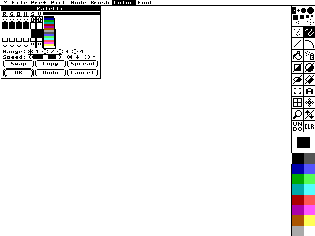

# Deluxe Paint by its menus: a dialog, a colour mixed, a boat flipped

<!-- demo-motion:begin -->
<p align="center"><picture><source media="(prefers-reduced-motion: reduce)" srcset="screen.png"></picture></p>

1. `send_mouse` holds the red arrow of the Palette dialog until the brown slot is orange.
2. One `perform` lifts the boat as a brush, flips it from the Brush menu and stamps it.

<!-- moments-ms: 1084,2836 -->
<!-- demo-motion:end -->

Electronic Arts' Deluxe Paint II, the 1988 PC version, at 640 x 480 in 16 colours. Every menu,
dialog button, tool and colour is picked by the name a screen map gives it: a file that names
the program's controls. The demo mixes an orange in the Palette dialog, paints a sunset, then
flips the boat as a brush.

## The program

Deluxe Paint II is commercial software, and nothing of it is in this repository. The demo runs
it from a directory you name: version 1.0, the 1988 release on one 720k disk.

It checks `DP.EXE` first and refuses another build, naming its digest. Nothing the run writes
stays in your directory.

## Run it

```sh
uv run python demos/dpaint_maps/demo.py --cwd /path/to/your/dpaint2
```

Each line it prints is one call and its check. The window opens behind the others, so the run
does not take your keyboard; `--watch` brings it in front, for when you want to watch it.

- `--cwd PATH` (absolute or `~`-led) is the directory holding `DP.EXE`. The session runs from
  it, and it reads `<host>` in the transcript.
- `--binary PATH` (absolute or `~`-led) picks the DOSBox-X to start. Left out, it is
  `DOSBOX_X_BINARY`, else the `dosbox-x` on your `PATH`.
- `--display N` opens the window on that display. Left out, it opens on the main one.
- `--watch` shows the run: the window comes in front and takes your keyboard until the run ends.
- `--transcript PATH` moves the whole transcript; the run's other files go beside it.
- `--update-readme` rewrites this page's generated parts, `TRANSCRIPT.md`, `screen.png` and
  `loop.webp`, from a run where every step passed. It needs ffmpeg and `img2webp` on your
  `PATH`, and Pillow and numpy (the `decorate` extra), which draw the call captions, the keys and the pointer over the loop.

Exit codes: 0 every step passed, 1 a step failed, 2 a usage error, 3 nothing was demonstrated.
That last one is no program directory, another build of it, a DOSBox-X without relative motion or a
server that did not start.

Deluxe Paint takes the mouse as movement, so it needs a DOSBox-X whose input device carries
relative motion ([`send_mouse`](../../docs/reference/input.md#send_mouse)). On a build without
it the demo stops at its third step and says so.

## Try it yourself

[Add the server to your client](../../README.md#install) and ask it to start DOSBox-X on `demos/dpaint_maps/dpaint-maps.conf` from your copy of the
program. Each of these is a step of
the demo, in the order the demo makes them.

<!-- demo-transcript:begin -->
### 1. Hold a button until a value is reached

Ask:

> Pick brown, hold the red arrow of the Palette dialog until brown's red reaches the top, then release.

Call:

```text
perform(steps=[{"op": "send_mouse", "target": "brown", "button": "left"}, "… 5 more"],
    summaries=true)
```

Reply, 2 of 12 fields:

```json
{
  "summary": "perform: 6 of 6 steps",
  "steps_completed": 6
}
```

`send_mouse` presses and releases as two steps. Between them `screen_wait` looks only when a watch on the program's copy of brown's red fires, so the arrow is held exactly long enough.

<details><summary>The whole reply</summary>

```json
{
  "summary": "perform: 6 of 6 steps",
  "status": "ok",
  "ran": [
    {
      "step": 0,
      "op": "send_mouse",
      "reply": {
        "summary": "send_mouse: pointer at 100,59, program's own pointer not read; sent, reaction not checked, 23 frames to frame 74",
        "status": "ok",
        "stop_seq": 63,
        "cause": "<volatile>"
      }
    },
    {
      "step": 1,
      "op": "watch_add",
      "reply": {"summary": "watch_add 31B2:31BC: armed", "status": "ok"}
    },
    {
      "step": 2,
      "op": "send_mouse",
      "reply": {
        "summary": "send_mouse: pointer at 7,39, program's own pointer not read; sent, reaction not checked, 22 frames to frame 94",
        "status": "ok",
        "stop_seq": 85,
        "cause": "<volatile>"
      }
    },
    {
      "step": 3,
      "op": "screen_wait",
      "reply": {
        "summary": "screen_wait screen 'palette': found after 28 firings of watch '31B2:31BC'",
        "status": "ok",
        "stop_seq": 86,
        "cause": "<volatile>"
      }
    },
    {
      "step": 4,
      "op": "send_mouse",
      "reply": {
        "summary": "send_mouse: pointer at 7,39; sent, reaction not checked, 76 frames to frame 115",
        "status": "ok",
        "stop_seq": 162,
        "cause": "<volatile>"
      }
    },
    {
      "step": 5,
      "op": "declaration_clear",
      "reply": {
        "summary": "declaration_clear watch all: 1 cleared",
        "status": "ok",
        "declarations_cleared": 1,
        "disarmed": ["BPMEM 31B2:31BC (3F)"],
        "session": {"alive": true, "running": false, "altered": false}
      }
    }
  ],
  "steps_total": 6,
  "truncated": false,
  "ran_path": "<volatile>",
  "replies_path": "<volatile>",
  "stops": {
    "stop_seq_first": 41,
    "stop_seq_last": 162,
    "surveyed": 4,
    "by_cause": {
      "the retrace the input's post ran to,": 1,
      "no declared code breakpoint, and the debugger does not say which row stopped the machine, so what made this stop cannot be told": 3
    },
    "unaccounted": 118
  },
  "steps_completed": 6,
  "failed_at": {"available": false, "why": "no step failed"},
  "held": 0,
  "session": {"alive": true, "running": false, "altered": false}
}
```

</details>

### 2. Read a colour back from the video card

Ask:

> Read the palette entry the dialog just mixed, and save a swatch of it.

Call:

```text
palette(first=6, count=1, dest="./tmp/demos/dpaint_maps/orange.png")
```

Reply, 3 of 11 fields:

```json
{
  "summary": "palette: entry 6 #ff5500 of 256; 128x128 PNG x8, inline",
  "rgb": ["3f1500"],
  "colors": ["#ff5500"]
}
```

`palette` reads the video card's own colour table: `rgb` as its six-bit values, `colors` as the colour the screen shows. Only the program's dialog changed it.

<details><summary>The whole reply</summary>

```json
{
  "summary": "palette: entry 6 #ff5500 of 256; 128x128 PNG x8, inline",
  "status": "ok",
  "entries": 256,
  "first": 6,
  "count": 1,
  "colors": ["#ff5500"],
  "rgb": ["3f1500"],
  "bits": 6,
  "pel_mask": "ffh",
  "image": {
    "path": "./tmp/demos/dpaint_maps/orange.png",
    "bytes": "<volatile>",
    "sha256": "<volatile>",
    "width": 128,
    "height": 128,
    "scale": 8,
    "indexed": true,
    "inline": true
  },
  "session": {"alive": true, "running": false, "altered": false}
}
```

</details>

### 3. Chain menus, drags and clicks in one call

Ask:

> Lift the boat as a brush, flip it from the Brush menu and stamp the mirror image.

Call:

```text
perform(steps=[{"op": "send_mouse", "target": "brush_grab", "button": "left"}, "… 18 more"],
    summaries=true)
```

Reply, 2 of 12 fields:

```json
{
  "summary": "perform: 19 of 19 steps",
  "steps_completed": 19
}
```

After each move the screen map is asked which screen is showing, because the same pixels mean another tool in hand. The whole reply lists the screens it named.

<details><summary>The whole reply</summary>

```json
{
  "summary": "perform: 19 of 19 steps",
  "status": "ok",
  "ran": [
    {
      "step": 0,
      "op": "send_mouse",
      "reply": {
        "summary": "send_mouse: pointer at 605,185, program's own pointer not read; sent, reaction not checked, 24 frames to frame 1075",
        "status": "ok",
        "stop_seq": 1121,
        "cause": "<volatile>"
      }
    },
    {
      "step": 1,
      "op": "send_mouse",
      "reply": {
        "summary": "send_mouse: pointer at 610,300, program's own pointer not read; no button pressed; sent, reaction not checked, 15 frames to frame 1090",
        "status": "ok",
        "stop_seq": 1136,
        "cause": "<volatile>"
      }
    },
    {
      "step": 2,
      "op": "screen_wait",
      "reply": {"summary": "screen_wait screen 'paint: grab': already on screen", "status": "ok"}
    },
    {
      "step": 3,
      "op": "screen_map_find",
      "reply": {"summary": "screen_map_find: paint: grab (file), 14 controls", "status": "ok"}
    },
    {
      "step": 4,
      "op": "send_mouse",
      "reply": {
        "summary": "send_mouse: pointer at 184,399, program's own pointer not read; sent, reaction not checked, 30 frames to frame 1120",
        "status": "ok",
        "stop_seq": 1166,
        "cause": "<volatile>"
      }
    },
    {
      "step": 5,
      "op": "send_mouse",
      "reply": {
        "summary": "send_mouse: pointer at 610,300, program's own pointer not read; no button pressed; sent, reaction not checked, 15 frames to frame 1135",
        "status": "ok",
        "stop_seq": 1181,
        "cause": "<volatile>"
      }
    },
    {
      "step": 6,
      "op": "screen_wait",
      "reply": {"summary": "screen_wait screen 'paint: custom brush': already on screen", "status": "ok"}
    },
    {
      "step": 7,
      "op": "screen_map_find",
      "reply": {"summary": "screen_map_find: paint: custom brush (file), 14 controls", "status": "ok"}
    },
    {
      "step": 8,
      "op": "send_mouse",
      "reply": {
        "summary": "send_mouse: pointer at 203,5, program's own pointer not read; sent, reaction not checked, 20 frames to frame 1155",
        "status": "ok",
        "stop_seq": 1201,
        "cause": "<volatile>"
      }
    },
    {
      "step": 9,
      "op": "screen_wait",
      "reply": {"summary": "screen_wait screen 'brush menu': already on screen", "status": "ok"}
    },
    {
      "step": 10,
      "op": "screen_map_find",
      "reply": {"summary": "screen_map_find: brush menu (file), 2 controls", "status": "ok"}
    },
    {
      "step": 11,
      "op": "send_mouse",
      "reply": {
        "summary": "send_mouse: pointer at 269,18, program's own pointer not read; sent, reaction not checked, 20 frames to frame 1175",
        "status": "ok",
        "stop_seq": 1221,
        "cause": "<volatile>"
      }
    },
    {
      "step": 12,
      "op": "send_mouse",
      "reply": {
        "summary": "send_mouse: pointer at 610,300, program's own pointer not read; no button pressed; sent, reaction not checked, 15 frames to frame 1190",
        "status": "ok",
        "stop_seq": 1236,
        "cause": "<volatile>"
      }
    },
    {
      "step": 13,
      "op": "screen_wait",
      "reply": {
        "summary": "screen_wait screen 'paint: custom brush': found after 10 frames",
        "status": "ok",
        "stop_seq": 1237,
        "cause": "<volatile>"
      }
    },
    {
      "step": 14,
      "op": "screen_map_find",
      "reply": {"summary": "screen_map_find: paint: custom brush (file), 14 controls", "status": "ok"}
    },
    {
      "step": 15,
      "op": "send_mouse",
      "reply": {
        "summary": "send_mouse: pointer at 440,357, program's own pointer not read; sent, reaction not checked, 21 frames to frame 1221",
        "status": "ok",
        "stop_seq": 1258,
        "cause": "<volatile>"
      }
    },
    {
      "step": 16,
      "op": "send_mouse",
      "reply": {
        "summary": "send_mouse: pointer at 610,300, program's own pointer not read; no button pressed; sent, reaction not checked, 15 frames to frame 1236",
        "status": "ok",
        "stop_seq": 1273,
        "cause": "<volatile>"
      }
    },
    {
      "step": 17,
      "op": "screen_wait",
      "reply": {"summary": "screen_wait screen 'paint: custom brush': already on screen", "status": "ok"}
    },
    {
      "step": 18,
      "op": "screen_map_find",
      "reply": {
        "summary": "screen_map_find: paint: custom brush (file), 14 controls",
        "status": "ok",
        "matched": true,
        "screen": "paint: custom brush",
        "layer": "file",
        "kind": "pixel",
        "size": [640, 480],
        "controls": [
          {"name": "pict", "rect": [103, 0, 33, 11], "centre": [119, 5]},
          {"name": "brush", "rect": [183, 0, 41, 11], "centre": [203, 5]},
          {"name": "color", "rect": [231, 0, 41, 11], "centre": [251, 5]},
          {"name": "brush_dot", "rect": [598, 20, 3, 3], "centre": [599, 21]},
          {"name": "freehand", "rect": [618, 54, 22, 22], "centre": [629, 65]},
          {"name": "line", "rect": [594, 78, 22, 22], "centre": [605, 89]},
          {"name": "rect_filled", "rect": [606, 138, 9, 9], "centre": [610, 142]},
          {"name": "circle_filled", "rect": [630, 138, 9, 9], "centre": [634, 142]},
          {"name": "brush_grab", "rect": [594, 174, 22, 22], "centre": [605, 185]},
          {"name": "text", "rect": [618, 174, 22, 22], "centre": [629, 185]},
          {"name": "black", "rect": [596, 315, 17, 16], "centre": [604, 323]},
          {"name": "blue", "rect": [596, 337, 17, 14], "centre": [604, 344]},
          {"name": "brown", "rect": [596, 441, 17, 15], "centre": [604, 448]},
          {"name": "yellow", "rect": [620, 441, 17, 15], "centre": [628, 448]}
        ],
        "session": {"alive": true, "running": false, "altered": false}
      }
    }
  ],
  "steps_total": 19,
  "truncated": false,
  "ran_path": "<volatile>",
  "replies_path": "<volatile>",
  "stops": {
    "stop_seq_first": 1098,
    "stop_seq_last": 1273,
    "surveyed": 10,
    "by_cause": {
      "the retrace the input's post ran to,": 9,
      "no declared code breakpoint, and the debugger does not say which row stopped the machine, so what made this stop cannot be told": 1
    },
    "unaccounted": 166
  },
  "steps_completed": 19,
  "failed_at": {"available": false, "why": "no step failed"},
  "held": 0,
  "session": {"alive": true, "running": false, "altered": false}
}
```

</details>
<!-- demo-transcript:end -->

<details><summary>The whole demo as one prompt</summary>

1. Start DOSBox-X windowed on `demos/dpaint_maps/dpaint-maps.conf`, running from your copy of
   the program, with `DP.EXE k` as the program, recording its video.
2. Load the screen map beside the conf, run until it names the painting screen and tell me
   which screen this is.
3. Open the Color menu with a press on its title and choose Palette by letting go over it;
   after each move tell me which screen the map names.
4. Pick the brown slot, hold the red arrow until brown's red reaches the top, release, and read
   that palette entry back.
5. Click OK. Paint an orange sky, a yellow sun and a blue sea as filled shapes, then the sun's
   glints and a black hull.
6. Draw a mast and a yellow sail with lines, and type SCRY in the sky with the text tool.
7. Lift the boat as a brush, flip it from the Brush menu and stamp the mirror image across the
   bay.
8. Open the Pict menu and release over its title, put the one-pixel brush back, and read five
   rows of the picture.
9. Show me the screen and close.

</details>

## Tools this demo uses

| Group | Tools |
|---|---|
| [Session](../../docs/reference/session.md) | `start`, `close` |
| [Run](../../docs/reference/run.md) | `screen_wait`, `run_to`, `run_for` |
| [Machine](../../docs/reference/machine.md) | `machine_map` |
| [Read](../../docs/reference/read.md) | `screen_map_write`, `screen_map_find` |
| [Input](../../docs/reference/input.md) | `send_mouse`, `send_keys` |
| [Breakpoints](../../docs/reference/breakpoints.md) | `watch_add`, `declaration_clear` |
| [Sequences](../../docs/reference/sequences.md) | `perform` |
| [Screen](../../docs/reference/screen.md) | `palette`, `screen_view` |

Each group is a page of the reference. Some of the names need a word:

- Run: the tools that let the program run and stop it again.
- Breakpoints: breakpoints and watches.
- Sequences: the tools that run several calls as one.
- Machine: the program's log and the map of what DOS loaded.

## The screen map

`dpaint-screen-map.json` names eleven screens of Deluxe Paint at 640 x 480. Each is recognised
by regions of the screen that stay still on it:

| Screen | Known by | Its names |
|---|---|---|
| `paint: freehand`, `paint: rectangle`, `paint: circle`, `paint: line`, `paint: grab`, `paint: text` | the menu bar at rest and that tool's cell, inverted | `pict`, `brush`, `color`; `freehand`, `line`, `rect_filled`, `circle_filled`, `brush_grab`, `text`; `black`, `blue`, `brown`, `yellow`; `brush_dot`, the one-pixel brush |
| `paint: custom brush` | the menu bar at rest, the dotted freehand tool lit and no built-in brush lit: a brush lifted off the picture is in hand | the same |
| `color menu` | the body of the open menu | `palette`, `color` |
| `brush menu` | the body of the open menu | `flip_horizontal`, `brush` |
| `pict menu` | the body of the open menu | `pict` |
| `palette` | the dialog's title and its buttons | `brown`, the slot; `red_up`, `green_up`, `blue_up`; `ok`, `cancel` |

The colours keep the default palette's names, so the slot the dialog mixes to orange is still
`brown`. Before a painting screen is read the pointer is moved over the toolbox: on the canvas
a shape tool draws it as a crosshair across the whole screen.

## The transcript

[TRANSCRIPT.md](TRANSCRIPT.md) has every call of the run with its reply. Process ids, ports,
wall-clock times and temporary paths read `<volatile>` there, because they change from run to
run.

The moving picture is cut from the video the session records of itself
(`start(capture_video=true)`), because Deluxe Paint draws while each call is still running.

The first Deluxe Paint demo, [`demos/dpaint/`](../dpaint/README.md), uses one screen at
320 x 200 and stops halfway for a value scan.
