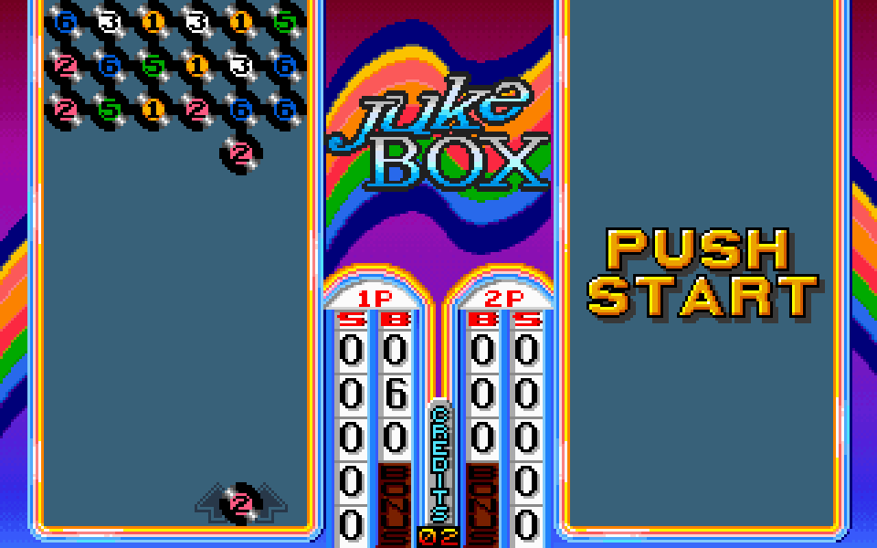

# LineUp: the game's own list of steps, replayed on its DOS version

<!-- demo-motion:begin -->
<p align="center"><picture><source media="(prefers-reduced-motion: reduce)" srcset="screen.png"></picture></p>

1. `send_keys` presses fire, and `record` films the shot.
2. `send_keys` moves the player one column right and fires again.
3. `send_keys` raises the next colour and fires a third time.

<!-- moments-ms: 1013,1013,1013 -->
<!-- demo-motion:end -->

*LineUp* (Eco-Games / GAMART, 1994) was an arcade game, and its team ported the same source to
MS-DOS. This demo starts the DOS version from a file in the game's own repository. Then it
replays the list of steps that repository keeps: a coin, a game started, a move, a colour, a
shot.

## The program

LineUp is not distributed with this repository. The demo runs a copy of the DOS version: a
directory with `EXES/LINEUP.EXE`, its symbol map `EXES/LINEUP.MAP`, `AUDIO/`, `GFX/`, `.scry/`
and `SCRIPTS/dosbox-x-mcp-conf.sh`.
[The game's own repository](https://github.com/MS-DOS-Club/lineup-msdos) builds them.

Its `.scry/` folder holds what the game keeps for SCRY: a start profile (saved `start`
arguments), a screen map (a file naming its screens) and the list of steps.

## Run it

```sh
uv run python demos/lineup/demo.py --cwd /path/to/game
```

Each line it prints is one call and its check. The window opens behind the others, so the run
does not take your keyboard.

- `--cwd PATH` (absolute or `~`-led) is the copy of the game DOSBox-X runs from.
- `--binary PATH` (absolute or `~`-led) picks the DOSBox-X to start. Left out, it is
  `DOSBOX_X_BINARY`, else the `dosbox-x` on your `PATH`.
- `--display N` opens the window on that display. Left out, it opens on the main one.
- `--transcript PATH` moves the whole transcript; the run's other files go beside it.
- `--update-readme` rewrites this page's generated parts, `TRANSCRIPT.md`, `screen.png` and
  `loop.webp`, from a run where every step passed. It needs ffmpeg and `img2webp` on your
  `PATH`.

Exit codes: 0 every step passed, 1 a step failed, 2 a usage error, 3 nothing was demonstrated.
That last one is no copy of the game or a server that did not start.

Nothing in the run waits a fixed time. The steps run to the game's own routines by name, and
each screen is waited for at a breakpoint on the game's own tick.

The two seconds of music it records must equal [`music.wav`](music.wav) sample for sample
(`win32/music.wav` on Windows, where the sound is mixed differently).

## Try it yourself

[Add the server to your client](../../README.md#install) and open it in your copy of the game. Each of these is a step of
the demo, in the order the demo makes them.

<!-- demo-transcript:begin -->
### 1. Replay a saved list of steps

Ask:

> Replay the list of steps the game's repository keeps in `.scry/perform/`.

Call:

```text
perform(path="<host>", summaries=true)
```

Reply, 3 of 12 fields:

```json
{
  "summary": "perform: 34 of 34 steps",
  "steps_completed": 34,
  "held": 21
}
```

One call runs the whole game script: a coin, a start, a move, a colour and a shot. `held` counts the steps whose values matched the ones the file recorded.

<details><summary>The whole reply</summary>

```json
{
  "summary": "perform: 34 of 34 steps",
  "status": "ok",
  "ran": [
    {
      "step": 0,
      "op": "run_to",
      "reply": {
        "summary": "run_to Draw_High_Scores_Screen: TARGET at 08EB:00001DF6, control counted 250",
        "status": "ok",
        "stop_seq": 3,
        "cause": "<volatile>"
      }
    },
    {
      "step": 1,
      "op": "breakpoint_at",
      "reply": {"summary": "breakpoint_at Check_Money100: armed", "status": "ok"}
    },
    {
      "step": 2,
      "op": "screen_wait",
      "reply": {
        "summary": "screen_wait screen 'hiscores': found after 2 firings of breakpoint 'Check_Money100'",
        "status": "ok",
        "stop_seq": 4,
        "cause": "<volatile>"
      }
    },
    {
      "step": 3,
      "op": "declaration_clear",
      "reply": {"summary": "declaration_clear breakpoint all: 1 cleared", "status": "ok"}
    },
    {
      "step": 4,
      "op": "screen_map_find",
      "reply": {"summary": "screen_map_find: hiscores (file), 2 controls", "status": "ok"}
    },
    {
      "step": 5,
      "op": "read_memory",
      "reply": {"summary": "read_memory Credits: 2 bytes at 08EB:0000BC04: 0000", "status": "ok"}
    },
    {
      "step": 6,
      "op": "send_keys",
      "reply": {
        "summary": "send_keys (guest): posted, unverified, 6 retraces to frame 361",
        "status": "ok",
        "stop_seq": 10,
        "cause": "<volatile>"
      }
    },
    {
      "step": 7,
      "op": "breakpoint_at",
      "reply": {"summary": "breakpoint_at Check_Money100: armed", "status": "ok"}
    },
    {
      "step": 8,
      "op": "screen_wait",
      "reply": {
        "summary": "screen_wait screen 'insert': found after 1 firing of breakpoint 'Check_Money100'",
        "status": "ok",
        "stop_seq": 11,
        "cause": "<volatile>"
      }
    },
    {
      "step": 9,
      "op": "declaration_clear",
      "reply": {"summary": "declaration_clear breakpoint all: 1 cleared", "status": "ok"}
    },
    {
      "step": 10,
      "op": "screen_map_find",
      "reply": {"summary": "screen_map_find: insert (file), 2 controls", "status": "ok"}
    },
    {
      "step": 11,
      "op": "read_memory",
      "reply": {"summary": "read_memory Credits: 2 bytes at 08EB:0000BC04: 0300", "status": "ok"}
    },
    {
      "step": 12,
      "op": "send_keys",
      "reply": {
        "summary": "send_keys (guest): posted, unverified, 9 retraces to frame 371",
        "status": "ok",
        "stop_seq": 20,
        "cause": "<volatile>"
      }
    },
    {
      "step": 13,
      "op": "run_to",
      "reply": {
        "summary": "run_to Level_Write: TARGET at 08EB:000058FE, control counted 7",
        "status": "ok",
        "stop_seq": 21,
        "cause": "<volatile>"
      }
    },
    {
      "step": 14,
      "op": "breakpoint_at",
      "reply": {"summary": "breakpoint_at Check_Money100: armed", "status": "ok"}
    },
    {
      "step": 15,
      "op": "screen_wait",
      "reply": {
        "summary": "screen_wait screen 'level': found after 1 firing of breakpoint 'Check_Money100'",
        "status": "ok",
        "stop_seq": 22,
        "cause": "<volatile>"
      }
    },
    {
      "step": 16,
      "op": "declaration_clear",
      "reply": {"summary": "declaration_clear breakpoint all: 1 cleared", "status": "ok"}
    },
    {
      "step": 17,
      "op": "screen_map_find",
      "reply": {"summary": "screen_map_find: level (file), 3 controls", "status": "ok"}
    },
    {
      "step": 18,
      "op": "read_memory",
      "reply": {"summary": "read_memory Credits: 2 bytes at 08EB:0000BC04: 0200", "status": "ok"}
    },
    {
      "step": 19,
      "op": "read_memory",
      "reply": {"summary": "read_memory Stage_Act: 2 bytes at 08EB:0000B0D8: 0000", "status": "ok"}
    },
    {
      "step": 20,
      "op": "breakpoint_at",
      "reply": {"summary": "breakpoint_at Check_Money100: armed", "status": "ok"}
    },
    {
      "step": 21,
      "op": "screen_wait",
      "reply": {
        "summary": "screen_wait screen 'play': found after 150 firings of breakpoint 'Check_Money100'",
        "status": "ok",
        "stop_seq": 23,
        "cause": "<volatile>"
      }
    },
    {
      "step": 22,
      "op": "declaration_clear",
      "reply": {"summary": "declaration_clear breakpoint all: 1 cleared", "status": "ok"}
    },
    {
      "step": 23,
      "op": "screen_map_find",
      "reply": {"summary": "screen_map_find: play (file), 3 controls", "status": "ok"}
    },
    {
      "step": 33,
      "op": "read_memory",
      "reply": {
        "summary": "read_memory Player1: 12 bytes at 08EB:0000AE32: 010004000200040003000200",
        "status": "ok",
        "ref": "Player1",
        "seg_off": "08EB:0000AE32",
        "length": 12,
        "hex": "010004000200040003000200",
        "session": {"alive": true, "running": false, "altered": false}
      }
    }
  ],
  "steps_total": 34,
  "truncated": true,
  "ran_path": "<volatile>",
  "replies_path": "<volatile>",
  "stops": {
    "stop_seq_first": 3,
    "stop_seq_last": 72,
    "surveyed": 14,
    "by_cause": {
      "run_to's target Draw_High_Scores_Screen": 1,
      "no declared code breakpoint: the debugger keeps no hit flag and a memory watch stops at the instruction that wrote, so which declaration fired cannot be told": 4,
      "the retrace the input's post ran to,": 5,
      "run_to's target Level_Write": 1,
      "run_to's target Gest_Scores": 3
    },
    "unaccounted": 56
  },
  "steps_completed": 34,
  "failed_at": {"available": false, "why": "no step failed"},
  "held": 21,
  "session": {"alive": true, "running": false, "altered": false}
}
```

</details>

### 2. Compare a recording with its reference

Ask:

> Compare the music you just recorded with the reference recording, sample by sample.

Call:

```text
audio_compare(method="diff", a="./tmp/demos/lineup/music.wav", b="<host>", align=false)
```

Reply, 2 of 12 fields:

```json
{
  "summary": "audio_compare diff: exact, equal, envelope 1.0",
  "exact": true
}
```

`exact` is true only when every sample is equal, so a changed sound, a different mixer or a late start fails the run.

<details><summary>The whole reply</summary>

```json
{
  "summary": "audio_compare diff: exact, equal, envelope 1.0",
  "status": "ok",
  "exact": true,
  "snr_db": {
    "available": false,
    "why": "the two are equal after alignment: there is no error to measure the signal against"
  },
  "class": "exact",
  "envelope_correlation": 1.0,
  "onset_delta_ms": 0.0,
  "length_delta_samples": 0,
  "aligned_by_samples": 0,
  "a": "./tmp/demos/lineup/music.wav",
  "b": "<volatile>",
  "session": {"alive": true, "running": false, "altered": false}
}
```

</details>
<!-- demo-transcript:end -->

<details><summary>The whole demo as one prompt</summary>

1. Start DOSBox-X from the start profile `.scry/start/dos.json` of the game's copy, with a
   window, on the normal core.
2. Put a breakpoint on the game's first DOS call of its own, `INT 21h AH=62h`, let it run there
   and clear it.
3. Load the game's screen map, `.scry/maps/lineup-screen-map.json`.
4. Replay the list of steps in `.scry/perform/dos.json` in one call.
5. Record two seconds of sound, measure it and compare it with `music.wav` without aligning.
6. Fire three more shots: where the player stands, one column to the right, and with the next
   colour. Record a second of video from each key going down.
7. Take a picture of the screen and close.

</details>

## Tools this demo uses

| Group | Tools |
|---|---|
| [Session](../../docs/reference/session.md) | `start`, `close` |
| [Breakpoints](../../docs/reference/breakpoints.md) | `breakpoint_interrupt`, `declaration_clear` |
| [Run](../../docs/reference/run.md) | `resume`, `run_to` |
| [Read](../../docs/reference/read.md) | `screen_map_write` |
| [Sequences](../../docs/reference/sequences.md) | `perform` |
| [Input](../../docs/reference/input.md) | `send_keys` |
| [Captures](../../docs/reference/captures.md) | `record`, `audio_record` |
| [Files](../../docs/reference/files.md) | `audio_compare` |
| [Screen](../../docs/reference/screen.md) | `screen_view` |

Each group is a page of the reference. Some of the names need a word:

- Advance: the tools that let the program run and stop it again.
- Declarations: breakpoints and watches.
- Lists: the tools that run several calls as one.

## The transcript

[TRANSCRIPT.md](TRANSCRIPT.md) has every call of the run with its reply. The paths of your copy
of the game read `<host>` there, because they are your computer's.
