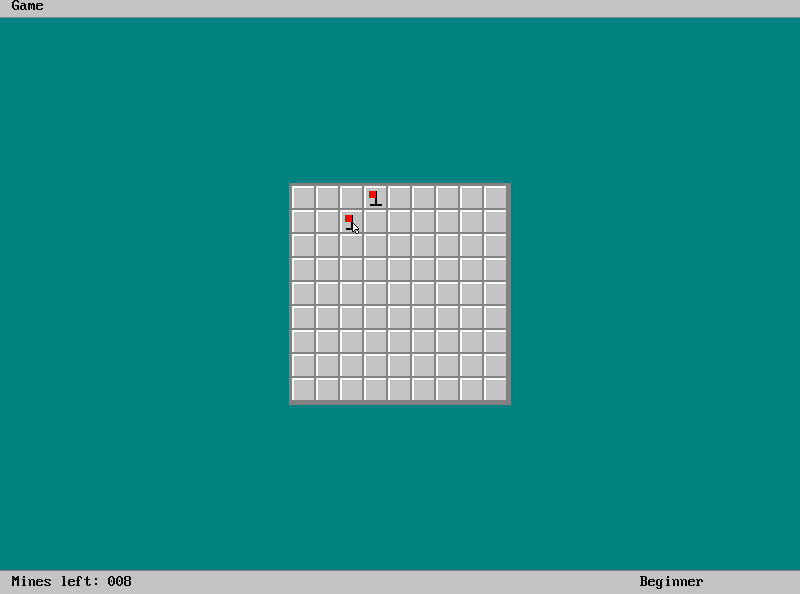

# Minesweeper: the board read out of memory and cleared without a miss

<!-- demo-motion:begin -->
<p align="center"><picture><source media="(prefers-reduced-motion: reduce)" srcset="screen.png"></picture></p>

1. One `perform` sends the clicks the game's memory says are safe, and the board opens.
2. On the next board `send_mouse` clicks a cell the memory says holds a mine.

<!-- moments-ms: 2993,1154 -->
<!-- demo-motion:end -->

`MINES.COM` is a Minesweeper this repository builds, at 800 x 600 in 256 colours. The demo
plays it with the mouse, by the names its screen map gives its buttons: a file that names the
game's controls. Then it reads where the mines are out of the game's memory, clears the board,
and steps on a mine on purpose.

## The program

The game is `mines.asm`, in this folder with the program built from it, its symbol table, its
conf and its screen map. Its header says how to build it and what it logs for a debugger.

To play it yourself: `cd demos/mines && dosbox-x -conf mines.conf`, then type `MINES`.

## Run it

```sh
uv run python demos/mines/demo.py
```

Each line it prints is one call and its check. The window opens behind the others, so the run
does not take your keyboard.

- `--binary PATH` (absolute or `~`-led) picks the DOSBox-X to start. Left out, it is
  `DOSBOX_X_BINARY`, else the `dosbox-x` on your `PATH`.
- `--display N` opens the window on that display. Left out, it opens on the main one.
- `--transcript PATH` moves the whole transcript; the run's other files go beside it.
- `--update-readme` rewrites this page's generated parts, `TRANSCRIPT.md`, `screen.png` and
  `loop.webp`, from a run where every step passed. It needs ffmpeg and `img2webp` on your
  `PATH`.

Exit codes: 0 every step passed, 1 a step failed, 2 a usage error, 3 nothing was demonstrated.
That last one is a server that did not start.

The explosion is recorded from the emulated Sound Blaster and must equal [`boom.wav`](boom.wav)
sample for sample. A change to the game's sound or timing makes that file out of date: the
run's own `boom.wav`, beside its transcript, is then the one to copy over it.

The session records its own video (`capture_video`), because the board changes inside the
calls that click it. The clip above is two stretches of that video.

## Try it yourself

[Add the server to your client](../../README.md#install) and ask it to start DOSBox-X on `demos/mines/mines.conf` with `MINES.COM` as its program, run to
the program's own `int 3` and load `mines.sym` there. Each of these is a step of
the demo, in the order the demo makes them.

<!-- demo-transcript:begin -->
### 1. Run to a routine by its name

Ask:

> Run the game until it reaches `main_loop`.

Call:

```text
run_to(ref="main_loop", control="retrace", seconds=60)
```

Reply, 2 of 18 fields:

```json
{
  "summary": "run_to main_loop: TARGET at 08DF:00000131, control counted 0",
  "verdict": "TARGET"
}
```

`TARGET` means the run stopped at `main_loop`, where the game goes once its title is drawn. So the screen read next is whole on any computer.

<details><summary>The whole reply</summary>

```json
{
  "summary": "run_to main_loop: TARGET at 08DF:00000131, control counted 0",
  "status": "ok",
  "verdict": "TARGET",
  "target": "08DF:0131",
  "ref": "main_loop",
  "pc": "08DF:00000131",
  "cpu_mode": "real",
  "target_disarmed": true,
  "control_hits": 0,
  "controls": [
    {"ref": "retrace", "at": "08DF:0DFF", "hits_in_run": 0, "removed": true}
  ],
  "frame": 2,
  "regs": {
    "EAX": "0x00000000",
    "EBX": "0x0002010f",
    "ECX": "0x00000148",
    "EDX": "0x00000180",
    "ESI": "0x000017d5",
    "EDI": "0x00001835",
    "EBP": "0x0000091c",
    "ESP": "0x0000fffe",
    "EIP": "0x00000131",
    "CS": "0x08df",
    "DS": "0x08df",
    "ES": "0x08df",
    "FS": "0x0000",
    "GS": "0x0000",
    "SS": "0x08df"
  },
  "watches": [],
  "cause": "run_to's target main_loop at 08DF:00000131",
  "e9": {"lines_total": 1, "truncated": false, "lines": ["Bochs port E9h: TITLE"], "mark": "<volatile>"},
  "stop_seq": 3,
  "instruction": {
    "address": "08DF:00000131",
    "bytes": "E8CB0C",
    "text": "call 0xdff",
    "flow": "call",
    "code_bits": 16,
    "bytes_from": "memory",
    "symbol": "main_loop",
    "delta": 0
  },
  "session": {"alive": true, "running": false, "altered": false}
}
```

</details>

### 2. Read the board out of memory

Ask:

> Read the 81 bytes at `mines`, the game's own table of where the mines are.

Call:

```text
read_memory(ref="mines", length=81)
```

Reply, 2 of 7 fields:

```json
{
  "summary": "read_memory mines: 81 bytes at 08DF:00001030: 00000001000000 ... (202 characters)",
  "length": 81
}
```

`mines` is a symbol of the build, one byte per cell. Where the mines are is data the server can read and a player cannot.

<details><summary>The whole reply</summary>

```json
{
  "summary": "read_memory mines: 81 bytes at 08DF:00001030: 00000001000000000000000100010000000001000000000000000000000000000000000000000000000000000000000000010000000000000000000100000100... (17 more bytes in `hex`)",
  "status": "ok",
  "ref": "mines",
  "seg_off": "08DF:00001030",
  "length": 81,
  "hex": "000000010000000000000001000100000000010000000000000000000000000000000000000000000000000000000000000100000000000000000001000001000001000000000000010000010000000000",
  "session": {"alive": true, "running": false, "altered": false}
}
```

</details>

### 3. Clear the board in one call

Ask:

> Open every safe cell with as few clicks as the game's flood fill allows, waiting for the game to log each reveal.

Call:

```text
perform(steps=[… 19 items], summaries=…)
```

Reply, 2 of 12 fields:

```json
{
  "summary": "perform: 19 of 19 steps",
  "steps_completed": 19
}
```

Each click waits for the line the game logs when it reveals that cell, so a click that missed fails at once. `perform` sends them all as one call.

<details><summary>The whole reply</summary>

```json
{
  "summary": "perform: 19 of 19 steps",
  "status": "ok",
  "ran": [
    {
      "step": 0,
      "op": "send_mouse",
      "reply": {
        "summary": "send_mouse: pointer at 304,204, program's own pointer not read; effect seen, 25 retraces to frame 149",
        "status": "ok",
        "stop_seq": 153,
        "cause": "no declared code breakpoint at 08DF:00000E08: the debugger keeps no hit flag and a memory watch stops at the instruction that wrote, so which declaration fired cannot be told"
      }
    },
    {
      "step": 1,
      "op": "send_mouse",
      "reply": {
        "summary": "send_mouse: pointer at 352,204, program's own pointer not read; effect seen, 25 retraces to frame 174",
        "status": "ok",
        "stop_seq": 178,
        "cause": "no declared code breakpoint at 08DF:00000E08: the debugger keeps no hit flag and a memory watch stops at the instruction that wrote, so which declaration fired cannot be told"
      }
    },
    {
      "step": 2,
      "op": "send_mouse",
      "reply": {
        "summary": "send_mouse: pointer at 400,204, program's own pointer not read; effect seen, 25 retraces to frame 199",
        "status": "ok",
        "stop_seq": 203,
        "cause": "no declared code breakpoint at 08DF:00000E08: the debugger keeps no hit flag and a memory watch stops at the instruction that wrote, so which declaration fired cannot be told"
      }
    },
    {
      "step": 3,
      "op": "send_mouse",
      "reply": {
        "summary": "send_mouse: pointer at 424,204, program's own pointer not read; effect seen, 25 retraces to frame 224",
        "status": "ok",
        "stop_seq": 228,
        "cause": "no declared code breakpoint at 08DF:00000E08: the debugger keeps no hit flag and a memory watch stops at the instruction that wrote, so which declaration fired cannot be told"
      }
    },
    {
      "step": 4,
      "op": "send_mouse",
      "reply": {
        "summary": "send_mouse: pointer at 448,204, program's own pointer not read; effect seen, 25 retraces to frame 249",
        "status": "ok",
        "stop_seq": 253,
        "cause": "no declared code breakpoint at 08DF:00000E08: the debugger keeps no hit flag and a memory watch stops at the instruction that wrote, so which declaration fired cannot be told"
      }
    },
    {
      "step": 5,
      "op": "send_mouse",
      "reply": {
        "summary": "send_mouse: pointer at 376,228, program's own pointer not read; effect seen, 25 retraces to frame 274",
        "status": "ok",
        "stop_seq": 278,
        "cause": "no declared code breakpoint at 08DF:00000E08: the debugger keeps no hit flag and a memory watch stops at the instruction that wrote, so which declaration fired cannot be told"
      }
    },
    {
      "step": 6,
      "op": "send_mouse",
      "reply": {
        "summary": "send_mouse: pointer at 400,348, program's own pointer not read; effect seen, 25 retraces to frame 299",
        "status": "ok",
        "stop_seq": 303,
        "cause": "no declared code breakpoint at 08DF:00000E08: the debugger keeps no hit flag and a memory watch stops at the instruction that wrote, so which declaration fired cannot be told"
      }
    },
    {
      "step": 7,
      "op": "send_mouse",
      "reply": {
        "summary": "send_mouse: pointer at 448,348, program's own pointer not read; effect seen, 25 retraces to frame 324",
        "status": "ok",
        "stop_seq": 328,
        "cause": "no declared code breakpoint at 08DF:00000E08: the debugger keeps no hit flag and a memory watch stops at the instruction that wrote, so which declaration fired cannot be told"
      }
    },
    {
      "step": 8,
      "op": "send_mouse",
      "reply": {
        "summary": "send_mouse: pointer at 472,348, program's own pointer not read; effect seen, 25 retraces to frame 349",
        "status": "ok",
        "stop_seq": 353,
        "cause": "no declared code breakpoint at 08DF:00000E08: the debugger keeps no hit flag and a memory watch stops at the instruction that wrote, so which declaration fired cannot be told"
      }
    },
    {
      "step": 9,
      "op": "send_mouse",
      "reply": {
        "summary": "send_mouse: pointer at 376,372, program's own pointer not read; effect seen, 25 retraces to frame 374",
        "status": "ok",
        "stop_seq": 378,
        "cause": "no declared code breakpoint at 08DF:00000E08: the debugger keeps no hit flag and a memory watch stops at the instruction that wrote, so which declaration fired cannot be told"
      }
    },
    {
      "step": 10,
      "op": "send_mouse",
      "reply": {
        "summary": "send_mouse: pointer at 400,372, program's own pointer not read; effect seen, 25 retraces to frame 399",
        "status": "ok",
        "stop_seq": 403,
        "cause": "no declared code breakpoint at 08DF:00000E08: the debugger keeps no hit flag and a memory watch stops at the instruction that wrote, so which declaration fired cannot be told"
      }
    },
    {
      "step": 11,
      "op": "send_mouse",
      "reply": {
        "summary": "send_mouse: pointer at 424,372, program's own pointer not read; effect seen, 25 retraces to frame 424",
        "status": "ok",
        "stop_seq": 428,
        "cause": "no declared code breakpoint at 08DF:00000E08: the debugger keeps no hit flag and a memory watch stops at the instruction that wrote, so which declaration fired cannot be told"
      }
    },
    {
      "step": 12,
      "op": "send_mouse",
      "reply": {
        "summary": "send_mouse: pointer at 448,372, program's own pointer not read; effect seen, 25 retraces to frame 449",
        "status": "ok",
        "stop_seq": 453,
        "cause": "no declared code breakpoint at 08DF:00000E08: the debugger keeps no hit flag and a memory watch stops at the instruction that wrote, so which declaration fired cannot be told"
      }
    },
    {
      "step": 13,
      "op": "send_mouse",
      "reply": {
        "summary": "send_mouse: pointer at 472,372, program's own pointer not read; effect seen, 25 retraces to frame 474",
        "status": "ok",
        "stop_seq": 478,
        "cause": "no declared code breakpoint at 08DF:00000E08: the debugger keeps no hit flag and a memory watch stops at the instruction that wrote, so which declaration fired cannot be told"
      }
    },
    {
      "step": 14,
      "op": "send_mouse",
      "reply": {
        "summary": "send_mouse: pointer at 496,372, program's own pointer not read; effect seen, 25 retraces to frame 499",
        "status": "ok",
        "stop_seq": 503,
        "cause": "no declared code breakpoint at 08DF:00000E08: the debugger keeps no hit flag and a memory watch stops at the instruction that wrote, so which declaration fired cannot be told"
      }
    },
    {
      "step": 15,
      "op": "send_mouse",
      "reply": {
        "summary": "send_mouse: pointer at 328,396, program's own pointer not read; effect seen, 25 retraces to frame 524",
        "status": "ok",
        "stop_seq": 528,
        "cause": "no declared code breakpoint at 08DF:00000E08: the debugger keeps no hit flag and a memory watch stops at the instruction that wrote, so which declaration fired cannot be told"
      }
    },
    {
      "step": 16,
      "op": "send_mouse",
      "reply": {
        "summary": "send_mouse: pointer at 352,396, program's own pointer not read; effect seen, 25 retraces to frame 549",
        "status": "ok",
        "stop_seq": 553,
        "cause": "no declared code breakpoint at 08DF:00000E08: the debugger keeps no hit flag and a memory watch stops at the instruction that wrote, so which declaration fired cannot be told"
      }
    },
    {
      "step": 17,
      "op": "send_mouse",
      "reply": {
        "summary": "send_mouse: pointer at 400,396, program's own pointer not read; effect seen, 25 retraces to frame 574",
        "status": "ok",
        "stop_seq": 578,
        "cause": "no declared code breakpoint at 08DF:00000E08: the debugger keeps no hit flag and a memory watch stops at the instruction that wrote, so which declaration fired cannot be told"
      }
    },
    {
      "step": 18,
      "op": "send_mouse",
      "reply": {
        "summary": "send_mouse: pointer at 424,396, program's own pointer not read; effect seen, 25 retraces to frame 599",
        "status": "ok",
        "x": 424,
        "y": 396,
        "units": "screen",
        "button": "left",
        "action": "click",
        "route": "guest",
        "pointer": {
          "screen": {"x": 424, "y": 396, "width": 800, "height": 600},
          "mouse": {"x": 424, "y": 396, "max_x": 799, "max_y": 599},
          "buttons": [],
          "bios_mode": "0x6b",
          "vbe_mode": "0x103"
        },
        "driver_arrived": true,
        "polls": 25,
        "pc": "08DF:00000E0A",
        "cpu_mode": "real",
        "stop_seq": 603,
        "frame": 599,
        "instruction": {
          "address": "08DF:00000E0A",
          "bytes": "74FB",
          "text": "je 0xe07",
          "flow": "branch",
          "code_bits": 16,
          "bytes_from": "memory",
          "symbol": "retrace",
          "delta": 11
        },
        "regs": {
          "EAX": "0x00000004",
          "EBX": "0x00000000",
          "ECX": "0x00000160",
          "EDX": "0x000003da",
          "ESI": "0x000017d5",
          "EDI": "0x00000fc4",
          "EBP": "0x0000091c",
          "ESP": "0x0000fffc",
          "EIP": "0x00000e0a",
          "CS": "0x08df",
          "DS": "0x08df",
          "ES": "0x08df",
          "FS": "0x0000",
          "GS": "0x0000",
          "SS": "0x08df"
        },
        "watches": [],
        "cause": "no declared code breakpoint at 08DF:00000E0A: the debugger keeps no hit flag and a memory watch stops at the instruction that wrote, so which declaration fired cannot be told",
        "e9": {
          "lines_total": 2,
          "truncated": false,
          "lines": ["Bochs port E9h: REVEAL 8 5 4", "Bochs port E9h: WIN"],
          "mark": "<volatile>"
        },
        "motion": true,
        "verify": {
          "checked": true,
          "seen": true,
          "expected": "REVEAL 8 5 ",
          "verdict": "TARGET",
          "line": "Bochs port E9h: REVEAL 8 5 4",
          "seen_before_waiting": true,
          "lines_before": 0,
          "waited_s": "<volatile>",
          "lines_total": 1
        },
        "session": {"alive": true, "running": false, "altered": false}
      }
    }
  ],
  "steps_total": 19,
  "truncated": false,
  "ran_path": "<volatile>",
  "replies_path": "<volatile>",
  "stops": {
    "stop_seq_first": 129,
    "stop_seq_last": 603,
    "surveyed": 19,
    "by_cause": {
      "no declared code breakpoint: the debugger keeps no hit flag and a memory watch stops at the instruction that wrote, so which declaration fired cannot be told": 19
    },
    "unaccounted": 456
  },
  "steps_completed": 19,
  "failed_at": {"available": false, "why": "no step failed"},
  "held": 0,
  "session": {"alive": true, "running": false, "altered": false}
}
```

</details>

### 4. Compare a sound with its reference

Ask:

> Compare the explosion you recorded with `boom.wav`, sample by sample.

Call:

```text
audio_compare(method="diff", a="./tmp/demos/mines/boom.wav", b="./demos/mines/boom.wav",
    align=false)
```

Reply, 2 of 12 fields:

```json
{
  "summary": "audio_compare diff: exact, equal, envelope 1.0",
  "exact": true
}
```

`exact` is true only when every sample is equal. The recording comes from the emulated Sound Blaster's digital output, not from the speakers.

<details><summary>The whole reply</summary>

```json
{
  "summary": "audio_compare diff: exact, equal, envelope 1.0",
  "status": "ok",
  "exact": true,
  "snr_db": {
    "available": false,
    "why": "the two are equal after alignment: there is no error to measure the signal against"
  },
  "class": "exact",
  "envelope_correlation": 1.0,
  "onset_delta_ms": 0.0,
  "length_delta_samples": 0,
  "aligned_by_samples": 0,
  "a": "<volatile>",
  "b": "./demos/mines/boom.wav",
  "session": {"alive": true, "running": false, "altered": false}
}
```

</details>
<!-- demo-transcript:end -->

<details><summary>The whole demo as one prompt</summary>

1. Start DOSBox-X windowed on `demos/mines/mines.conf` with `MINES.COM` as its program,
   recording its own video, stopping at the program's own `int 3`, with the log in a file.
2. Run to that `int 3`, load `mines.sym` at the segment it stopped in, and load the screen map
   `mines-screen-map.json` beside the conf.
3. Run to `main_loop` and tell me which screen this is; click its start, run to `main_loop`
   again and tell me again.
4. Open the Game menu by name, run to `main_loop`, check it is the menu, pick Beginner and run
   to `main_loop`.
5. Read the board's size, where its mines are and the pixel of its top-left corner, all by
   symbol.
6. Flag two of the mines with the right button, then open every safe cell and show me the game
   says WIN.
7. Move the pointer off the board, tell me which screen this is, show it to me and run 240
   frames.
8. Click OK, run to `main_loop`, read the new board's mines and click on the first one until
   the game logs BOOM.
9. Record 45 frames of sound from there, measure them and compare them with `boom.wav` without
   aligning.
10. Move the pointer away, tell me which screen this is, and close.

</details>

## Tools this demo uses

| Group | Tools |
|---|---|
| [Session](../../docs/reference/session.md) | `start`, `close` |
| [Run](../../docs/reference/run.md) | `resume`, `run_to`, `run_for` |
| [Names](../../docs/reference/names.md) | `symbols_load` |
| [Read](../../docs/reference/read.md) | `screen_map_write`, `screen_map_find`, `read_memory` |
| [Input](../../docs/reference/input.md) | `send_mouse` |
| [Sequences](../../docs/reference/sequences.md) | `perform` |
| [Machine](../../docs/reference/machine.md) | `log` |
| [Files](../../docs/reference/files.md) | `audio_compare` |
| [Screen](../../docs/reference/screen.md) | `screen_view` |
| [Captures](../../docs/reference/captures.md) | `audio_record` |

Each group is a page of the reference. Some of the names need a word:

- Advance: the tools that let the program run and stop it again.
- Lists: the tools that run several calls as one.
- Machine: the program's log and the map of what DOS loaded.
- Names: the tool that loads a symbol table.

## The transcript

[TRANSCRIPT.md](TRANSCRIPT.md) has every call of the run with its reply. Process ids, ports,
wall-clock times and temporary paths read `<volatile>` there, because they change from run to
run.
