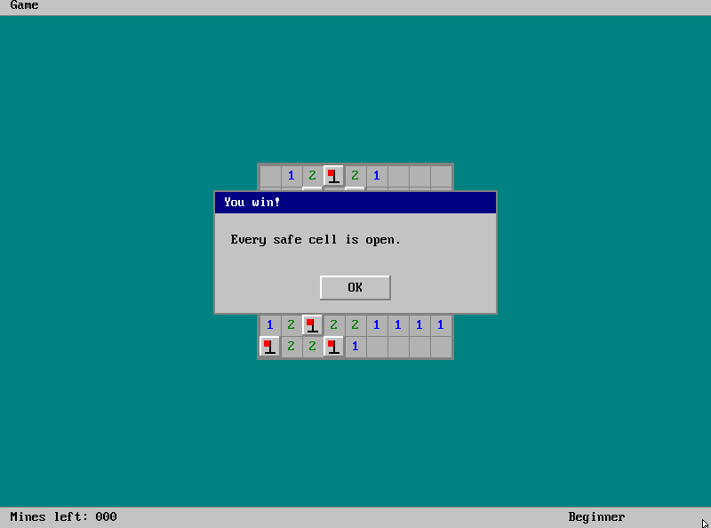

# Minesweeper: five screens, a board read out of memory, and an explosion held to the sample



`MINES.COM` is a Minesweeper this repository builds, at VESA 800 x 600 in 256 colours: a title,
a board, a menu that drops over it and two dialogs, all played with the mouse. The demo plays it
the way a model would through the server. Every screen is recognised off a screen map before a
click lands on it, and the menu and the dialogs are clicked by name. Then the demo does what no
player can: it reads where the mines are out of the game's memory, by symbol, and clears the
board without a miss. Last, it steps on a mine on purpose and records the explosion off the
Sound Blaster's digital output, which has to come out sample for sample as the recording beside
this file.

## Run it

```sh
uv run python demos/mines/demo.py
```

The demo opens a window, its 800 x 600 screen drawn at seven quarters by its conf, so the game can
be watched; nothing in it needs the window.

- `--binary PATH` (absolute or `~`-led) picks the DOSBox-X to start; left out, `DOSBOX_X_BINARY`,
  else the `dosbox-x` on your `PATH`.
- `--display N` opens the window on that display; left out, on the host's main one. The
  window opens behind, so the run takes nobody's focus.
- `--transcript PATH` moves the whole transcript; the run's other files go beside it.
- `--update-readme` rewrites the block below, `TRANSCRIPT.md`, `screen.png` and `loop.mp4` from a run where every step
  passed.

Each step prints one `OK <step>: <summary>` or `FAIL <step>: <why>` line, then a `DEMO` verdict
line and the paths of the two transcripts. Exit codes: 0 every step passed, 1 a step failed, 2
a usage error, 3 nothing was demonstrated (a server that did not start, a loop that could not be converted).

The explosion is held against [`boom.wav`](boom.wav) here. The recording starts where the click's
post leaves the machine, a few retraces after the game took the click, so it holds the explosion
from there on, and a change to the game's sound or timing or to the input route's pacing makes it stale:
the run's own `boom.wav`, beside its transcript, is then the one to copy over it.

The game itself is `mines.asm`, whose header says how to build it and what it tells a debugger.

## The prompt

Give this to an MCP client with this server connected:

> Start DOSBox-X windowed on `demos/mines/mines.conf`,
> stopping at the program's own `int 3`, with the log in a file and the captures in my run's
> directory. Load `mines.sym` at the segment it stopped in, and the screen map
> `mines-screen-map.json` beside the conf. Run to `main_loop`, where the game goes once its title
> is drawn, and tell me which screen this is; click its start, run to `main_loop` again and tell me
> again. Open the Game menu by name, run to the loop, check it is the menu, pick Beginner and run
> to the loop. Read the board's size, where its mines are and the pixel of its top-left corner, all
> by symbol. Flag two of the mines with the right button, then open every safe cell with as few
> left clicks as the game's flood fill allows, run to the loop, and show me it says WIN. Park the pointer off the
> screen's signed regions, tell me which screen this is and show it to me. Click OK and run to the
> loop, read the new board's mines, click on the first one until the game logs BOOM, and record
> 45 retraces of sound from there. Show me the
> game said BOOM, measure the recording, and compare it with `boom.wav` beside the conf without
> aligning them. Park the pointer, tell me which screen this is, and close.

## What it walks

| Family | Calls |
|---|---|
| Session | `start` (windowed, stopping at the program's `int 3`), `close` |
| Advance | `resume` to the `int 3`, `run_to` the game's loop by its symbol |
| Names | `symbols_load` at the load segment |
| Files | `audio_compare` (`measure`, `diff`) |
| Input | `send_mouse` by control name off the map and at pixels, both buttons |
| Lists | `perform` (the flags in one call, the clicks that clear the board in another) |
| Read | `screen_map_write(method="load")`, `screen_map_find` on every screen, `read_memory` by symbol |
| Machine | `log` |
| Screen | `screen_view` |
| Captures | `record` (the loop), `audio_record` of the Sound Blaster's output |

## The transcript

Generated by `demo.py --update-readme` from a run where every step passed. What differs between
two honest runs (process ids, ports, wall-clock times, temporary paths, the host's own DOSBox-X
and its own arguments) is `<volatile>`.

<!-- demo-transcript:begin -->
The run is 37 calls; these are the ones that show how it is done, and every call with its reply is in [TRANSCRIPT.md](TRANSCRIPT.md).

**5. `run_to`**: OK title: the game's loop reached: the title drawn and the pointer up

The run arrives by a symbol, not by time: `main_loop` is where the game goes once the title is drawn, so the screen read next is whole on any host.

<details><summary>call and reply</summary>

```json
{
  "ref": "main_loop",
  "control": "retrace",
  "seconds": 60
}
```

```json
{
  "summary": "run_to main_loop: TARGET at 08DF:00000131, control counted 0",
  "status": "ok",
  "verdict": "TARGET",
  "target": "08DF:0131",
  "ref": "main_loop",
  "pc": "08DF:00000131",
  "cpu_mode": "real",
  "target_disarmed": true,
  "control_hits": 0,
  "controls": [
    {"ref": "retrace", "at": "08DF:0DFF", "hits_in_run": 0, "removed": true}
  ],
  "frame": 2,
  "regs": {
    "EAX": "0x00000000",
    "EBX": "0x0002010f",
    "ECX": "0x00000148",
    "EDX": "0x00000180",
    "ESI": "0x000017d5",
    "EDI": "0x00001835",
    "EBP": "0x0000091c",
    "ESP": "0x0000fffe",
    "EIP": "0x00000131",
    "CS": "0x08df",
    "DS": "0x08df",
    "ES": "0x08df",
    "FS": "0x0000",
    "GS": "0x0000",
    "SS": "0x08df"
  },
  "watches": [],
  "cause": "run_to's target main_loop at 08DF:00000131",
  "e9": {"lines_total": 1, "truncated": false, "lines": ["Bochs port E9h: TITLE"], "mark": "<volatile>"},
  "stop_seq": 3,
  "instruction": {
    "address": "08DF:00000131",
    "bytes": "E8CB0C",
    "text": "call 0xdff",
    "flow": "call",
    "code_bits": 16,
    "bytes_from": "memory",
    "symbol": "main_loop",
    "delta": 0
  },
  "session": {"alive": true, "running": false, "altered": false}
}
```

</details>

**17. `read_memory`**: OK mines: mines at 0,3, 1,2, 1,4, 2,0, 5,4, 6,5, 6,8, 7,2, 8,0, 8,3

The board is read out of the game's memory by name: `mines` is a symbol of the build, one byte per cell. Where the mines are is data, and what the server can read, a player cannot.

<details><summary>call and reply</summary>

```json
{
  "ref": "mines",
  "length": 81
}
```

```json
{
  "summary": "read_memory mines: 81 bytes at 08DF:00001030: 00000001000000000000000100010000000001000000000000000000000000000000000000000000000000000000000000010000000000000000000100000100... (17 more bytes in `hex`)",
  "status": "ok",
  "ref": "mines",
  "seg_off": "08DF:00001030",
  "length": 81,
  "hex": "000000010000000000000001000100000000010000000000000000000000000000000000000000000000000000000000000100000000000000000001000001000001000000000000010000010000000000",
  "session": {"alive": true, "running": false, "altered": false}
}
```

</details>

**20. `perform`**: OK clear: 19 clicks opened every safe cell, none on a mine

Each click is a `send_mouse` with an `expect`: the call returns only when the game's own log shows the reveal the click was meant to cause (`REVEAL row col`), so a click that missed fails at once instead of three clicks later. `perform` sends them all as one call.

<details><summary>call and reply</summary>

```json
{
  "steps": [
    {"op": "send_mouse", "x": 304, "y": 204, "button": "left", "expect": "REVEAL 0 0 ", "seconds": 10},
    {"op": "send_mouse", "x": 352, "y": 204, "button": "left", "expect": "REVEAL 0 2 ", "seconds": 10},
    {"op": "send_mouse", "x": 400, "y": 204, "button": "left", "expect": "REVEAL 0 4 ", "seconds": 10},
    {"op": "send_mouse", "x": 424, "y": 204, "button": "left", "expect": "REVEAL 0 5 ", "seconds": 10},
    {"op": "send_mouse", "x": 448, "y": 204, "button": "left", "expect": "REVEAL 0 6 ", "seconds": 10},
    {"op": "send_mouse", "x": 376, "y": 228, "button": "left", "expect": "REVEAL 1 3 ", "seconds": 10},
    {"op": "send_mouse", "x": 400, "y": 348, "button": "left", "expect": "REVEAL 6 4 ", "seconds": 10},
    {"op": "send_mouse", "x": 448, "y": 348, "button": "left", "expect": "REVEAL 6 6 ", "seconds": 10},
    {"op": "send_mouse", "x": 472, "y": 348, "button": "left", "expect": "REVEAL 6 7 ", "seconds": 10},
    {"op": "send_mouse", "x": 376, "y": 372, "button": "left", "expect": "REVEAL 7 3 ", "seconds": 10},
    {"op": "send_mouse", "x": 400, "y": 372, "button": "left", "expect": "REVEAL 7 4 ", "seconds": 10},
    {"op": "send_mouse", "x": 424, "y": 372, "button": "left", "expect": "REVEAL 7 5 ", "seconds": 10},
    {"op": "send_mouse", "x": 448, "y": 372, "button": "left", "expect": "REVEAL 7 6 ", "seconds": 10},
    {"op": "send_mouse", "x": 472, "y": 372, "button": "left", "expect": "REVEAL 7 7 ", "seconds": 10},
    {"op": "send_mouse", "x": 496, "y": 372, "button": "left", "expect": "REVEAL 7 8 ", "seconds": 10},
    {"op": "send_mouse", "x": 328, "y": 396, "button": "left", "expect": "REVEAL 8 1 ", "seconds": 10},
    {"op": "send_mouse", "x": 352, "y": 396, "button": "left", "expect": "REVEAL 8 2 ", "seconds": 10},
    {"op": "send_mouse", "x": 400, "y": 396, "button": "left", "expect": "REVEAL 8 4 ", "seconds": 10},
    {"op": "send_mouse", "x": 424, "y": 396, "button": "left", "expect": "REVEAL 8 5 ", "seconds": 10}
  ],
  "summaries": true
}
```

```json
{
  "summary": "perform: 19 of 19 steps",
  "status": "ok",
  "ran": [
    {
      "step": 0,
      "op": "send_mouse",
      "reply": {
        "summary": "send_mouse: pointer at 304,204, program's own pointer not read; effect seen, 25 retraces to frame 149",
        "status": "ok",
        "stop_seq": 153,
        "cause": "no declared code breakpoint at 08DF:00000E08: the debugger keeps no hit flag and a memory watch stops at the instruction that wrote, so which declaration fired cannot be told"
      }
    },
    {
      "step": 1,
      "op": "send_mouse",
      "reply": {
        "summary": "send_mouse: pointer at 352,204, program's own pointer not read; effect seen, 25 retraces to frame 174",
        "status": "ok",
        "stop_seq": 178,
        "cause": "no declared code breakpoint at 08DF:00000E08: the debugger keeps no hit flag and a memory watch stops at the instruction that wrote, so which declaration fired cannot be told"
      }
    },
    {
      "step": 2,
      "op": "send_mouse",
      "reply": {
        "summary": "send_mouse: pointer at 400,204, program's own pointer not read; effect seen, 25 retraces to frame 199",
        "status": "ok",
        "stop_seq": 203,
        "cause": "no declared code breakpoint at 08DF:00000E08: the debugger keeps no hit flag and a memory watch stops at the instruction that wrote, so which declaration fired cannot be told"
      }
    },
    {
      "step": 3,
      "op": "send_mouse",
      "reply": {
        "summary": "send_mouse: pointer at 424,204, program's own pointer not read; effect seen, 25 retraces to frame 224",
        "status": "ok",
        "stop_seq": 228,
        "cause": "no declared code breakpoint at 08DF:00000E08: the debugger keeps no hit flag and a memory watch stops at the instruction that wrote, so which declaration fired cannot be told"
      }
    },
    {
      "step": 4,
      "op": "send_mouse",
      "reply": {
        "summary": "send_mouse: pointer at 448,204, program's own pointer not read; effect seen, 25 retraces to frame 249",
        "status": "ok",
        "stop_seq": 253,
        "cause": "no declared code breakpoint at 08DF:00000E08: the debugger keeps no hit flag and a memory watch stops at the instruction that wrote, so which declaration fired cannot be told"
      }
    },
    {
      "step": 5,
      "op": "send_mouse",
      "reply": {
        "summary": "send_mouse: pointer at 376,228, program's own pointer not read; effect seen, 25 retraces to frame 274",
        "status": "ok",
        "stop_seq": 278,
        "cause": "no declared code breakpoint at 08DF:00000E08: the debugger keeps no hit flag and a memory watch stops at the instruction that wrote, so which declaration fired cannot be told"
      }
    },
    {
      "step": 6,
      "op": "send_mouse",
      "reply": {
        "summary": "send_mouse: pointer at 400,348, program's own pointer not read; effect seen, 25 retraces to frame 299",
        "status": "ok",
        "stop_seq": 303,
        "cause": "no declared code breakpoint at 08DF:00000E08: the debugger keeps no hit flag and a memory watch stops at the instruction that wrote, so which declaration fired cannot be told"
      }
    },
    {
      "step": 7,
      "op": "send_mouse",
      "reply": {
        "summary": "send_mouse: pointer at 448,348, program's own pointer not read; effect seen, 25 retraces to frame 324",
        "status": "ok",
        "stop_seq": 328,
        "cause": "no declared code breakpoint at 08DF:00000E08: the debugger keeps no hit flag and a memory watch stops at the instruction that wrote, so which declaration fired cannot be told"
      }
    },
    {
      "step": 8,
      "op": "send_mouse",
      "reply": {
        "summary": "send_mouse: pointer at 472,348, program's own pointer not read; effect seen, 25 retraces to frame 349",
        "status": "ok",
        "stop_seq": 353,
        "cause": "no declared code breakpoint at 08DF:00000E08: the debugger keeps no hit flag and a memory watch stops at the instruction that wrote, so which declaration fired cannot be told"
      }
    },
    {
      "step": 9,
      "op": "send_mouse",
      "reply": {
        "summary": "send_mouse: pointer at 376,372, program's own pointer not read; effect seen, 25 retraces to frame 374",
        "status": "ok",
        "stop_seq": 378,
        "cause": "no declared code breakpoint at 08DF:00000E08: the debugger keeps no hit flag and a memory watch stops at the instruction that wrote, so which declaration fired cannot be told"
      }
    },
    {
      "step": 10,
      "op": "send_mouse",
      "reply": {
        "summary": "send_mouse: pointer at 400,372, program's own pointer not read; effect seen, 25 retraces to frame 399",
        "status": "ok",
        "stop_seq": 403,
        "cause": "no declared code breakpoint at 08DF:00000E08: the debugger keeps no hit flag and a memory watch stops at the instruction that wrote, so which declaration fired cannot be told"
      }
    },
    {
      "step": 11,
      "op": "send_mouse",
      "reply": {
        "summary": "send_mouse: pointer at 424,372, program's own pointer not read; effect seen, 25 retraces to frame 424",
        "status": "ok",
        "stop_seq": 428,
        "cause": "no declared code breakpoint at 08DF:00000E08: the debugger keeps no hit flag and a memory watch stops at the instruction that wrote, so which declaration fired cannot be told"
      }
    },
    {
      "step": 12,
      "op": "send_mouse",
      "reply": {
        "summary": "send_mouse: pointer at 448,372, program's own pointer not read; effect seen, 25 retraces to frame 449",
        "status": "ok",
        "stop_seq": 453,
        "cause": "no declared code breakpoint at 08DF:00000E08: the debugger keeps no hit flag and a memory watch stops at the instruction that wrote, so which declaration fired cannot be told"
      }
    },
    {
      "step": 13,
      "op": "send_mouse",
      "reply": {
        "summary": "send_mouse: pointer at 472,372, program's own pointer not read; effect seen, 25 retraces to frame 474",
        "status": "ok",
        "stop_seq": 478,
        "cause": "no declared code breakpoint at 08DF:00000E08: the debugger keeps no hit flag and a memory watch stops at the instruction that wrote, so which declaration fired cannot be told"
      }
    },
    {
      "step": 14,
      "op": "send_mouse",
      "reply": {
        "summary": "send_mouse: pointer at 496,372, program's own pointer not read; effect seen, 25 retraces to frame 499",
        "status": "ok",
        "stop_seq": 503,
        "cause": "no declared code breakpoint at 08DF:00000E08: the debugger keeps no hit flag and a memory watch stops at the instruction that wrote, so which declaration fired cannot be told"
      }
    },
    {
      "step": 15,
      "op": "send_mouse",
      "reply": {
        "summary": "send_mouse: pointer at 328,396, program's own pointer not read; effect seen, 25 retraces to frame 524",
        "status": "ok",
        "stop_seq": 528,
        "cause": "no declared code breakpoint at 08DF:00000E08: the debugger keeps no hit flag and a memory watch stops at the instruction that wrote, so which declaration fired cannot be told"
      }
    },
    {
      "step": 16,
      "op": "send_mouse",
      "reply": {
        "summary": "send_mouse: pointer at 352,396, program's own pointer not read; effect seen, 25 retraces to frame 549",
        "status": "ok",
        "stop_seq": 553,
        "cause": "no declared code breakpoint at 08DF:00000E08: the debugger keeps no hit flag and a memory watch stops at the instruction that wrote, so which declaration fired cannot be told"
      }
    },
    {
      "step": 17,
      "op": "send_mouse",
      "reply": {
        "summary": "send_mouse: pointer at 400,396, program's own pointer not read; effect seen, 25 retraces to frame 574",
        "status": "ok",
        "stop_seq": 578,
        "cause": "no declared code breakpoint at 08DF:00000E08: the debugger keeps no hit flag and a memory watch stops at the instruction that wrote, so which declaration fired cannot be told"
      }
    },
    {
      "step": 18,
      "op": "send_mouse",
      "reply": {
        "summary": "send_mouse: pointer at 424,396, program's own pointer not read; effect seen, 25 retraces to frame 599",
        "status": "ok",
        "x": 424,
        "y": 396,
        "units": "screen",
        "button": "left",
        "action": "click",
        "route": "guest",
        "pointer": {
          "screen": {"x": 424, "y": 396, "width": 800, "height": 600},
          "mouse": {"x": 424, "y": 396, "max_x": 799, "max_y": 599},
          "buttons": [],
          "bios_mode": "0x6b",
          "vbe_mode": "0x103"
        },
        "driver_arrived": true,
        "polls": 25,
        "pc": "08DF:00000E0A",
        "cpu_mode": "real",
        "stop_seq": 603,
        "frame": 599,
        "instruction": {
          "address": "08DF:00000E0A",
          "bytes": "74FB",
          "text": "je 0xe07",
          "flow": "branch",
          "code_bits": 16,
          "bytes_from": "memory",
          "symbol": "retrace",
          "delta": 11
        },
        "regs": {
          "EAX": "0x00000004",
          "EBX": "0x00000000",
          "ECX": "0x00000160",
          "EDX": "0x000003da",
          "ESI": "0x000017d5",
          "EDI": "0x00000fc4",
          "EBP": "0x0000091c",
          "ESP": "0x0000fffc",
          "EIP": "0x00000e0a",
          "CS": "0x08df",
          "DS": "0x08df",
          "ES": "0x08df",
          "FS": "0x0000",
          "GS": "0x0000",
          "SS": "0x08df"
        },
        "watches": [],
        "cause": "no declared code breakpoint at 08DF:00000E0A: the debugger keeps no hit flag and a memory watch stops at the instruction that wrote, so which declaration fired cannot be told",
        "e9": {
          "lines_total": 2,
          "truncated": false,
          "lines": ["Bochs port E9h: REVEAL 8 5 4", "Bochs port E9h: WIN"],
          "mark": "<volatile>"
        },
        "motion": true,
        "verify": {
          "checked": true,
          "seen": true,
          "expected": "REVEAL 8 5 ",
          "verdict": "TARGET",
          "line": "Bochs port E9h: REVEAL 8 5 4",
          "seen_before_waiting": true,
          "lines_before": 0,
          "waited_s": "<volatile>",
          "lines_total": 1
        },
        "session": {"alive": true, "running": false, "altered": false}
      }
    }
  ],
  "steps_total": 19,
  "truncated": false,
  "ran_path": "<volatile>",
  "replies_path": "<volatile>",
  "stops": {
    "stop_seq_first": 129,
    "stop_seq_last": 603,
    "surveyed": 19,
    "by_cause": {
      "no declared code breakpoint: the debugger keeps no hit flag and a memory watch stops at the instruction that wrote, so which declaration fired cannot be told": 19
    },
    "unaccounted": 456
  },
  "steps_completed": 19,
  "failed_at": {"available": false, "why": "no step failed"},
  "held": 0,
  "session": {"alive": true, "running": false, "altered": false}
}
```

</details>

**34. `audio_compare`**: OK exact: the explosion is boom.wav, sample for sample

The explosion was recorded off the emulated Sound Blaster's digital output, not off the speakers, and the comparison is a `diff` with alignment off: the two recordings are equal sample for sample, which is what `exact` says.

<details><summary>call and reply</summary>

```json
{
  "method": "diff",
  "a": "./tmp/demos/mines/boom.wav",
  "b": "./demos/mines/boom.wav",
  "align": false
}
```

```json
{
  "summary": "audio_compare diff: exact, equal, envelope 1.0",
  "status": "ok",
  "exact": true,
  "snr_db": {
    "available": false,
    "why": "the two are equal after alignment: there is no error to measure the signal against"
  },
  "class": "exact",
  "envelope_correlation": 1.0,
  "onset_delta_ms": 0.0,
  "length_delta_samples": 0,
  "aligned_by_samples": 0,
  "a": "<volatile>",
  "b": "./demos/mines/boom.wav",
  "session": {"alive": true, "running": false, "altered": false}
}
```

</details>
<!-- demo-transcript:end -->
