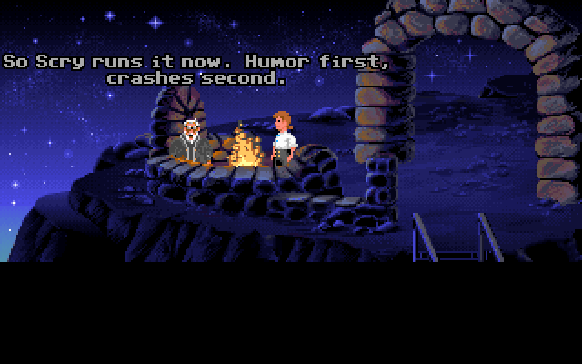

# Monkey Island: the lookout's lines rewritten while the game runs, to the opening theme



LucasArts' The Secret of Monkey Island, the 1992 Enhanced CD, played here by name: the language
menu, the dock, the poster of the governor by the bar, the path up, the verbs, the lookout and
the lines Guybrush picks are found off a screen map and clicked with the guest's own mouse, and
each screen and each hover the game answers (the sentence line, the verb it lights, the dialogue
line it highlights) is confirmed by name before the next click. Guybrush walks along the dock to
the poster, reads it ("Re-elect Governor Marley"), walks back and climbs to the lookout; the
dialogue menus are picked from as they appear.

Then the demo does what no player can. It saves the machine with the comeback "What the heck is
wrong with `Guybrush Threepwood`?" under the pointer, lets the lookout answer as the game wrote
it until the menu comes back, and loads the save. It finds the answer in guest memory and writes a conversation of its own
over the room's script: twenty-two speeches of SCUMM bytecode, the lookout's and Guybrush's,
chained by jumps across three stretches of the script the game no longer needs, and opened by
the intro's own call for the theme. It stops the CD driver's play request as it goes by and moves
its start to the bar where the logo enters. The same comeback is picked again, the theme plays
from that bar, the recording is compared with the reader's own disc, sample against sample, and
must stay above a signal-to-noise floor (the mixer touches the disc's samples on the way), and
the lookout and Guybrush talk debuggers, AI and orange tycoons until the game takes the
conversation back. Guybrush then walks off under the arch, and the demo ends once the room has
gone dark.

The game moves its own pointer by the mouse driver's motion and stops it at the screen's edges,
so it can sit a few pixels away from the driver's, and a click lands where the game's pointer
is. Once the title card is up the demo tells the server where the game keeps that pointer, and
every move by name is steered until the game's own pointer is on the control.

## The game

The Secret of Monkey Island is LucasArts' commercial software, and nothing of it is in this
repository: the demo carries its prompt, its script, its conf, its screen map and its own
dialogue, and runs the game from a directory you name. It needs the 1992 Enhanced CD (the OEM
multilingual pressing: English, German, French, Italian and Spanish on one disc, with the music
as Red Book audio tracks) as a CUE sheet and its BINs, `monkey.cue` and `monkey01.bin` to
`monkey25.bin`. The demo checks three of them before anything starts and refuses another
pressing, naming its digest, because the script's addresses and the theme's sectors are that
disc's:

| file | sha256 |
|---|---|
| `monkey.cue` | `6a28d6f905010caef6b0582aaa0e0b60218d5aa3a5b2cc20a7b6265b5f996351` |
| `monkey01.bin` (the data track) | `73cd16ea87fd65af852d06730bdd75cdf3260d0415173deb039af55c17ab5fc8` |
| `monkey18.bin` (the opening theme) | `bebb584e1a2b8a03a4945c379576c631ba8915f1df6d696d7d86c23447189d5a` |

The disc is mounted read-only as D:, and C: is a directory of the run's own, so nothing the game
or the session writes lands in your copy.

## Run it

```sh
uv run python demos/monkey/demo.py \
  --cwd /path/to/your/monkey-cd
```

The demo opens a window, scaled up four times by its conf, so the island can be watched and the
theme heard; nothing in it needs the window.

- `--cwd PATH` (absolute or `~`-led) is the directory holding the disc image. It is hidden in the
  transcript as `<host>`.
- `--binary PATH` (absolute or `~`-led) picks the DOSBox-X to start; left out, `DOSBOX_X_BINARY`,
  else the `dosbox-x` on your `PATH`. It needs the debugger commands the transcript's `start`
  lists, and a DOSBox-X that plays a CD image at the volume the program asks for: one that
  multiplies the drive's volume by its 0 to 255 value plays the theme four times as loud,
  clipped, and the step that holds the recording to the disc says so.
- `--display N` opens the window on that display; left out, on the host's main one. The
  window opens behind, so the run takes nobody's focus.
- `--transcript PATH` moves the whole transcript; the run's other files go beside it.
- `--update-readme` rewrites the block below, `TRANSCRIPT.md`, `screen.png` and `loop.mp4` from a run where every step passed.

Each step prints one `OK <step>: <summary>` or `FAIL <step>: <why>` line, then a `DEMO` verdict
line and the paths of the two transcripts. Exit codes: 0 every step passed, 1 a step failed, 2 a
usage error, 3 nothing was demonstrated (no disc image, another pressing of it, a server that did
not start, a loop that could not be converted).

## The prompt

Give this to an MCP client with this server connected:

> Start DOSBox-X windowed on `demos/monkey/monkey.conf` (with the disc image and a directory for
> C: written in), running `D:\MONKEY.COM` from `/path/to/your/monkey-cd`, with the log and the
> saved states in files of the run's own. Load `monkey-screen-map.json`, wait for the language
> menu and tell me which screen this is; find where DOS loaded `MONKEY.EXE` and double-click
> English. Watch SCUMM's room (variable 4 of its variables in the data segment) and let the
> intro run to each write of it up to its first scene, room 10; from there count 24 SCUMM ticks,
> pressing Escape after the first and after every fifth one past it, then check the room is the
> title card, 96. Judge the title card, and every screen after it but the lookout's lines, only
> where SCUMM leaves the loop that waits for its next tick (offset 011E of its code segment); once
> the title card is up, the game's own pointer is the two words at 2000:94EA and 2000:94EC, so
> steer every move onto it.
> On the dock, walk to the governor's poster, Look at it, and name both lines Guybrush reads;
> walk back and up the cliffside, Talk to the lookout, ask him whether we are all characters in
> a novel, tell him my name, and put the pointer on the comeback, naming each screen and each
> hover as the game answers it and picking each menu as it appears. Save the machine, pick the
> comeback, show me his answer until the menu is back without it, and load the save. Find his answer in memory, check the script
> around it is the disc's, and write the new conversation over it. Stop on every request to the
> CD driver and pick the comeback again; let the two STOP AUDIO requests through, move the PLAY
> AUDIO request's start to the bar where the logo enters, record eight seconds and hold them to
> that bar of my own disc's track 18. Name five moments of the conversation as it plays, sampling
> the screen every few retraces since the CD paces the lines; show me the screen. Once the lookout
> is done and the cliff is back, click the way out under the arch, and close once the room is
> dark.

## What it walks

| Family | Calls |
|---|---|
| Session | `start` (windowed, the CD image mounted), `close` |
| Advance | `screen_wait` judged only at SCUMM's tick (`on_breakpoint`); sampled for the launcher's menu (it has no symbols, no log and no such place) and for the lookout's lines, which the CD's audio paces; `run_for` the retraces the game takes to answer the pointer once a screen is up; `resume` to a stop, `step` over an `INT` |
| Files | `audio_compare(method="diff")` |
| Input | `send_mouse` by control name off the map, at screen pixels, double; `send_keys` |
| States | `state_write` (`save`, then `load`) |
| Read | `screen_map_write` (`load`, then `pointer`), `screen_map_find`, `find`, `read_memory` |
| Captures | `record` (the loop), `audio_record` (the theme, at the CD's own rate) |
| Screen | `screen_view` |
| Write | `write` (the conversation, the drive's request) |
| Declarations | `watch_add` (SCUMM's room), `breakpoint_interrupt` (INT 2Fh, AH=15h), `breakpoint_at` (SCUMM's tick), `declaration_clear` |
| Machine | `machine_map` for where DOS loaded the game |
| Lists | `perform` (a gesture: a click, the run it starts, the pointer parked) |

## The transcript

Generated by `demo.py --update-readme` from a run where every step passed. What differs between
two honest runs (process ids, ports, wall-clock times, temporary paths, the host's own DOSBox-X
and its own arguments) is `<volatile>`, and the disc's directory is `<host>`. The bytes the game
holds before the rewrite are `<volatile>` too: the step that reads them gives their sha256
verdict, and this repository carries none of them.

<!-- demo-transcript:begin -->
The run is 57 calls; these are the ones that show how it is done, and every call with its reply is in [TRANSCRIPT.md](TRANSCRIPT.md).

**7. `perform`**: OK intro: the room variable read 35664, 35664, 0, 0, 10 up to the first scene; Escapes at SCUMM's ticks skipped it to the title card, room 96

The intro is followed by the game's own variable: a change watch on SCUMM's room stops the machine at each room the intro enters, and the Escapes that skip it go in at SCUMM's own ticks, so the run arrives at its title card by what the game does, at any host's speed.

<details><summary>call and reply</summary>

```json
{
  "steps": [
    {"op": "watch_add", "ref": "220B:73EA", "mode": "change", "fmt": "u16"},
    {"op": "resume", "seconds": 300},
    {"op": "read_memory", "ref": "220B:73EA", "length": 2},
    {"op": "resume", "seconds": 300},
    {"op": "read_memory", "ref": "220B:73EA", "length": 2},
    {"op": "resume", "seconds": 300},
    {"op": "read_memory", "ref": "220B:73EA", "length": 2},
    {"op": "resume", "seconds": 300},
    {"op": "read_memory", "ref": "220B:73EA", "length": 2},
    {"op": "resume", "seconds": 300},
    {"op": "read_memory", "ref": "220B:73EA", "length": 2},
    {"op": "declaration_clear", "kind": "watch", "all": true},
    {"op": "breakpoint_at", "ref": "0985:011E"},
    {"op": "resume", "seconds": 180},
    {"op": "send_keys", "keys": ["escape"]},
    {"op": "resume", "seconds": 180},
    {"op": "resume", "seconds": 180},
    {"op": "resume", "seconds": 180},
    {"op": "resume", "seconds": 180},
    {"op": "resume", "seconds": 180},
    {"op": "send_keys", "keys": ["escape"]},
    {"op": "resume", "seconds": 180},
    {"op": "resume", "seconds": 180},
    {"op": "resume", "seconds": 180},
    {"op": "resume", "seconds": 180},
    {"op": "resume", "seconds": 180},
    {"op": "send_keys", "keys": ["escape"]},
    {"op": "resume", "seconds": 180},
    {"op": "resume", "seconds": 180},
    {"op": "resume", "seconds": 180},
    {"op": "resume", "seconds": 180},
    {"op": "resume", "seconds": 180},
    {"op": "send_keys", "keys": ["escape"]},
    {"op": "resume", "seconds": 180},
    {"op": "resume", "seconds": 180},
    {"op": "resume", "seconds": 180},
    {"op": "resume", "seconds": 180},
    {"op": "resume", "seconds": 180},
    {"op": "send_keys", "keys": ["escape"]},
    {"op": "resume", "seconds": 180},
    {"op": "resume", "seconds": 180},
    {"op": "resume", "seconds": 180},
    {"op": "read_memory", "ref": "220B:73EA", "length": 2},
    {"op": "declaration_clear", "kind": "breakpoint", "all": true}
  ],
  "settle_seconds": 300,
  "summaries": true
}
```

```json
{
  "summary": "<volatile>",
  "status": "ok",
  "ran": [
    {
      "step": 0,
      "op": "watch_add",
      "reply": {"summary": "<volatile>", "status": "ok"}
    },
    {
      "step": 1,
      "op": "resume",
      "reply": {"summary": "<volatile>", "status": "ok", "stop_seq": "<volatile>", "cause": "<volatile>"}
    },
    {
      "step": 2,
      "op": "read_memory",
      "reply": {"summary": "<volatile>", "status": "ok"}
    },
    {
      "step": 3,
      "op": "resume",
      "reply": {"summary": "<volatile>", "status": "ok", "stop_seq": "<volatile>", "cause": "<volatile>"}
    },
    {
      "step": 4,
      "op": "read_memory",
      "reply": {"summary": "<volatile>", "status": "ok"}
    },
    {
      "step": 5,
      "op": "resume",
      "reply": {"summary": "<volatile>", "status": "ok", "stop_seq": "<volatile>", "cause": "<volatile>"}
    },
    {
      "step": 6,
      "op": "read_memory",
      "reply": {"summary": "<volatile>", "status": "ok"}
    },
    {
      "step": 7,
      "op": "resume",
      "reply": {"summary": "<volatile>", "status": "ok", "stop_seq": "<volatile>", "cause": "<volatile>"}
    },
    {
      "step": 8,
      "op": "read_memory",
      "reply": {"summary": "<volatile>", "status": "ok"}
    },
    {
      "step": 9,
      "op": "resume",
      "reply": {"summary": "<volatile>", "status": "ok", "stop_seq": "<volatile>", "cause": "<volatile>"}
    },
    {
      "step": 10,
      "op": "read_memory",
      "reply": {"summary": "<volatile>", "status": "ok"}
    },
    {
      "step": 11,
      "op": "declaration_clear",
      "reply": {"summary": "<volatile>", "status": "ok"}
    },
    {
      "step": 12,
      "op": "breakpoint_at",
      "reply": {"summary": "<volatile>", "status": "ok"}
    },
    {
      "step": 13,
      "op": "resume",
      "reply": {"summary": "<volatile>", "status": "ok", "stop_seq": "<volatile>", "cause": "<volatile>"}
    },
    {
      "step": 14,
      "op": "send_keys",
      "reply": {"summary": "<volatile>", "status": "ok", "stop_seq": "<volatile>", "cause": "<volatile>"}
    },
    {
      "step": 15,
      "op": "resume",
      "reply": {"summary": "<volatile>", "status": "ok", "stop_seq": "<volatile>", "cause": "<volatile>"}
    },
    {
      "step": 16,
      "op": "resume",
      "reply": {"summary": "<volatile>", "status": "ok", "stop_seq": "<volatile>", "cause": "<volatile>"}
    },
    {
      "step": 17,
      "op": "resume",
      "reply": {"summary": "<volatile>", "status": "ok", "stop_seq": "<volatile>", "cause": "<volatile>"}
    },
    {
      "step": 18,
      "op": "resume",
      "reply": {"summary": "<volatile>", "status": "ok", "stop_seq": "<volatile>", "cause": "<volatile>"}
    },
    {
      "step": 19,
      "op": "resume",
      "reply": {"summary": "<volatile>", "status": "ok", "stop_seq": "<volatile>", "cause": "<volatile>"}
    },
    {
      "step": 20,
      "op": "send_keys",
      "reply": {"summary": "<volatile>", "status": "ok", "stop_seq": "<volatile>", "cause": "<volatile>"}
    },
    {
      "step": 21,
      "op": "resume",
      "reply": {"summary": "<volatile>", "status": "ok", "stop_seq": "<volatile>", "cause": "<volatile>"}
    },
    {
      "step": 22,
      "op": "resume",
      "reply": {"summary": "<volatile>", "status": "ok", "stop_seq": "<volatile>", "cause": "<volatile>"}
    },
    {
      "step": 23,
      "op": "resume",
      "reply": {"summary": "<volatile>", "status": "ok", "stop_seq": "<volatile>", "cause": "<volatile>"}
    },
    {
      "step": 43,
      "op": "declaration_clear",
      "reply": {
        "summary": "<volatile>",
        "status": "ok",
        "declarations_cleared": 1,
        "disarmed": ["BP 0985:011E"],
        "session": "<volatile>"
      }
    }
  ],
  "steps_total": 44,
  "truncated": true,
  "ran_path": "<volatile>",
  "replies_path": "<volatile>",
  "stops": "<volatile>",
  "steps_completed": 44,
  "failed_at": {"available": false, "why": "no step failed"},
  "held": 0,
  "session": "<volatile>"
}
```

</details>

**33. `perform`**: OK rewrite: 22 speeches, 1259 bytes of bytecode over 3 holes, each read back

The game's own script is data in memory, so the demo rewrites it. It found the lookout's line with `find` and read the original bytes back, and this `perform` writes a new conversation of SCUMM bytecode over three stretches of the script the game no longer needs, chained by jumps, reading each write back. The lookout then says what the demo wrote, in the game's own voice.

<details><summary>call and reply</summary>

```json
{
  "steps": [
    {
      "op": "write",
      "ref": "82DD:000C",
      "data_hex": "1c6e14020f4e6f7468696e672c20696620796f75277265206120536372792064656275676765722eff0349742073746f70732074696d652c207265616473206d696e647320616e6420706c617973207468652074756e65732eff034576656e206d79206d696e642e00ae02d80f41206465627567676572207468617420706c61"
    },
    {
      "op": "write",
      "ref": "82E5:000C",
      "data_hex": "7973206d757369633f20204973205448415420776861742049276d2068656172696e673f3f00ae0214020f546861742773207468652043442e202053637279206a75737420746f6c6420697420776865726520746f2073746172742e00ae02189efd"
    },
    {
      "op": "write",
      "ref": "82C5:000C",
      "data_hex": "d80f57686f20746175676874206120646562756767657220746f20646f20746861743f00ae0214020f41206d6f64656c2e20204c6976657320696e206120626f782c20726561647320796f7572206d656d6f72792c206e6576657220736c656570732e00ae02d80f4c696b65206f6e65206f662074686f736520626967204149"
    },
    {
      "op": "write",
      "ref": "82CD:000C",
      "data_hex": "20636f6d70616e6965733f00ae0214020f5468656d3f20204120646f75626c6f6f6e206120776f72642e202054776f20696620796f75207361792060706c65617365602e00ae02d80f416e6420536372793f00ae0214020f467265652e2020416e64206974206e657665722073617973206041732061206c61726765206c616e"
    },
    {
      "op": "write",
      "ref": "82D5:000C",
      "data_hex": "6775616765207069726174655e6000ae0214020f48656172642061626f757420746865206f72616e6765207479636f6f6e3f00ae02d80f546865206f6e652077686f2063616c6c73206576657279206275672066616b65206e6577733f00ae02181e01"
    },
    {
      "op": "write",
      "ref": "82ED:000D",
      "data_hex": "14020f4e6f772068652077616e747320746f2072656e616d6520414920746f2053492eff0360537570657220496e74656c6c6967656e6365602e20205472656d656e646f75732e202054686520626573742e00ae02d80f446f65732053492072656c65617365206974732066696c65733f00ae0214020f536372792072656c65"
    },
    {
      "op": "write",
      "ref": "82F5:000D",
      "data_hex": "617365732065766572792066696c652069742066696e64732e202045766572792e20204c6173742e20204f6e652eff03556e6c696b652074686f7365204570737465696e2066696c65732e20204168656d2100ae02d80f416e642068697320726f636b657420667269656e643f00ae0214020f546865206f6e652077686f7365"
    },
    {
      "op": "write",
      "ref": "82FD:000D",
      "data_hex": "20686561727420666c6577206f7574207468726f756768206869732061726d3fff0354776963652eff03536372792073746570706564207468726f756768206974206672616d65206279206672616d652e20205374696c6c206e6f74206120776176652e00ae02d80f53686f756c642053637279206465627567207468656d20"
    },
    {
      "op": "write",
      "ref": "8305:000D",
      "data_hex": "626f74683f00ae0214020f4e6f7420656e6f7567682052414d206f6e20746869732077686f6c652069736c616e642c20626f792e00ae02d80f476f7420616e79206a6f6b6573206c6566743f00ae0214020f506c656e74792e2020427574206d79206c6174652073686f7720676f742063616e63656c6c65642eff03536f2053"
    },
    {
      "op": "write",
      "ref": "830D:000D",
      "data_hex": "6372792072756e73206974206e6f772e202048756d6f722066697273742c2063726173686573207365636f6e642e00ae02d80f49276c6c206a757374206265206f666620746f207365656b206d7920666f7274756e65206e6f772e00ae0214020f54616b652053637279207769746820796f752eff03416e6420636c65617220"
    },
    {
      "op": "write",
      "ref": "8315:000D",
      "data_hex": "7468617420627265616b706f696e74206f6e20796f757220776179206f75742e00ae02183efd"
    }
  ],
  "summaries": true
}
```

```json
{
  "summary": "perform: 11 of 11 steps",
  "status": "ok",
  "ran": [
    {
      "step": 0,
      "op": "write",
      "reply": {"summary": "write 82DD:000C: 128 bytes, verified True", "status": "ok"}
    },
    {
      "step": 1,
      "op": "write",
      "reply": {"summary": "write 82E5:000C: 98 bytes, verified True", "status": "ok"}
    },
    {
      "step": 2,
      "op": "write",
      "reply": {"summary": "write 82C5:000C: 128 bytes, verified True", "status": "ok"}
    },
    {
      "step": 3,
      "op": "write",
      "reply": {"summary": "write 82CD:000C: 128 bytes, verified True", "status": "ok"}
    },
    {
      "step": 4,
      "op": "write",
      "reply": {"summary": "write 82D5:000C: 99 bytes, verified True", "status": "ok"}
    },
    {
      "step": 5,
      "op": "write",
      "reply": {"summary": "write 82ED:000D: 128 bytes, verified True", "status": "ok"}
    },
    {
      "step": 6,
      "op": "write",
      "reply": {"summary": "write 82F5:000D: 128 bytes, verified True", "status": "ok"}
    },
    {
      "step": 7,
      "op": "write",
      "reply": {"summary": "write 82FD:000D: 128 bytes, verified True", "status": "ok"}
    },
    {
      "step": 8,
      "op": "write",
      "reply": {"summary": "write 8305:000D: 128 bytes, verified True", "status": "ok"}
    },
    {
      "step": 9,
      "op": "write",
      "reply": {"summary": "write 830D:000D: 128 bytes, verified True", "status": "ok"}
    },
    {
      "step": 10,
      "op": "write",
      "reply": {
        "summary": "write 8315:000D: 38 bytes, verified True",
        "status": "ok",
        "ref": "8315:000D",
        "seg_off": "8315:0000000D",
        "bytes_written": 38,
        "readback": "7468617420627265616b706f696e74206f6e20796f757220776179206f75742e00ae02183efd",
        "verified": true,
        "session": "<volatile>"
      }
    }
  ],
  "steps_total": 11,
  "truncated": false,
  "ran_path": "<volatile>",
  "replies_path": "<volatile>",
  "stops": "<volatile>",
  "steps_completed": 11,
  "failed_at": {"available": false, "why": "no step failed"},
  "held": 0,
  "session": "<volatile>"
}
```

</details>

**43. `read_memory`**: OK request 3: PLAY AUDIO (84h) from 36:45:00, the theme's first sector, for 12200 sectors

The game asks the CD driver for audio through interrupt 2Fh. `breakpoint_interrupt` stops the machine on every such request, and `read_memory` reads the request block the call points at: this one is PLAY AUDIO, with the sector the theme starts at. The next step writes a different start sector into that block, so the same game call plays the theme from the bar where the logo enters.

<details><summary>call and reply</summary>

```json
{
  "ref": "220B:1D78",
  "length": 22
}
```

```json
{
  "summary": "read_memory 220B:1D78: 22 bytes at 220B:00001D78: 1600840003000000000000000001002d2400a82f0000",
  "status": "ok",
  "ref": "220B:1D78",
  "seg_off": "220B:00001D78",
  "length": 22,
  "hex": "1600840003000000000000000001002d2400a82f0000",
  "session": "<volatile>"
}
```

</details>

**47. `audio_compare`**: OK the disc: the reader's own track 18 from the logo's bar, compared sample against sample with no realigning, SNR 48.62 dB

The theme the game played is recorded off the emulated mixer and compared with the same track read off the disc image. The reply says whether the two are equal (`exact`) and, when they are not, how far apart (`snr_db`, `class`), so what the demo claims about the music is a measurement, not a listening test.

<details><summary>call and reply</summary>

```json
{
  "method": "diff",
  "a": "./tmp/demos/monkey/theme.wav",
  "b": "./tmp/demos/monkey/theme-disc.wav",
  "align": false
}
```

```json
{
  "summary": "audio_compare diff: audible, SNR 48.62 dB, envelope 1.0",
  "status": "ok",
  "exact": false,
  "snr_db": 48.62,
  "class": "audible",
  "envelope_correlation": 1.0,
  "onset_delta_ms": 0.0,
  "length_delta_samples": 0,
  "aligned_by_samples": 0,
  "a": "./tmp/demos/monkey/theme.wav",
  "b": "./tmp/demos/monkey/theme-disc.wav",
  "session": "<volatile>"
}
```

</details>
<!-- demo-transcript:end -->
