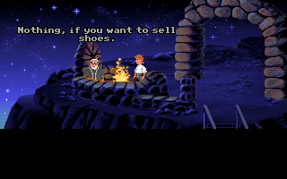

# Monkey Island: the lookout's lines, rewritten while the game runs

<!-- demo-motion:begin -->
<p align="center"><picture><source media="(prefers-reduced-motion: reduce)" srcset="screen.png"></picture></p>

1. `record` films the lookout answering a comeback as the game wrote him.
2. After `write` puts new bytecode over his script, he says a line the game never had.

<!-- moments-ms: 2140,2568 -->
<!-- demo-motion:end -->

LucasArts' *The Secret of Monkey Island* keeps its dialogue as a script in memory. This demo
plays the game up to the lookout, saves the machine, and lets him answer as written.
Then it loads the save, writes a conversation of its own over that script, and the same click
gets a new answer.

## The program

The game is commercial software, and nothing of it is in this repository. The demo runs it
from a directory you name, holding the 1992 Enhanced CD as `monkey.cue` and `monkey01.bin` to
`monkey25.bin`.

It checks three of them before anything starts and refuses another edition, naming its digest:

| file | sha256 |
|---|---|
| `monkey.cue` | `6a28d6f905010caef6b0582aaa0e0b60218d5aa3a5b2cc20a7b6265b5f996351` |
| `monkey01.bin` (the data track) | `73cd16ea87fd65af852d06730bdd75cdf3260d0415173deb039af55c17ab5fc8` |
| `monkey18.bin` (the opening theme) | `bebb584e1a2b8a03a4945c379576c631ba8915f1df6d696d7d86c23447189d5a` |

The disc is mounted read-only, so nothing the game or the session writes lands in your copy.

## Run it

```sh
uv run python demos/monkey/demo.py --cwd /path/to/your/monkey-cd
```

Each line it prints is one call and its check. The window opens behind the others, so the run
does not take your keyboard.

- `--cwd PATH` (absolute or `~`-led) is the directory holding the disc image.
- `--binary PATH` (absolute or `~`-led) picks the DOSBox-X to start. Left out, it is
  `DOSBOX_X_BINARY`, else the `dosbox-x` on your `PATH`.
- `--display N` opens the window on that display. Left out, it opens on the main one.
- `--transcript PATH` moves the whole transcript; the run's other files go beside it.
- `--update-readme` rewrites this page's generated parts, `TRANSCRIPT.md`, `screen.png` and
  `loop.webp`, from a run where every step passed. It needs ffmpeg and `img2webp` on your
  `PATH`.

Exit codes: 0 every step passed, 1 a step failed, 2 a usage error, 3 nothing was demonstrated.
That last one is no disc image, another edition of it or a server that did not start.

The demo also changes what the game asks its CD drive. It stops each request to the CD driver,
moves the start of the PLAY AUDIO request, records the theme and compares it with the same
track of your own disc.

It needs a DOSBox-X that plays a CD image at the volume the program asks for. One that scales
the drive's volume plays the theme four times as loud, clipped, and the step that compares the
recording says so.

## Try it yourself

[Add the server to your client](../../README.md#install) and ask it to start DOSBox-X on `demos/monkey/monkey.conf` with your disc image. Each of these is a step of
the demo, in the order the demo makes them.

<!-- demo-transcript:begin -->
### 1. Follow the intro by the game's own variable

Ask:

> Skip the intro, stopping at each room the game enters, until its title card.

Call:

```text
perform(
    steps=[{"op": "watch_add", "ref": "220B:73EA", "mode": "change", "fmt": "u16"}, "… 43 more"],
    settle_seconds=300, summaries=true)
```

Reply, 3 of 12 fields:

```json
{
  "steps_completed": 44,
  "steps_total": 44,
  "failed_at": {"available": false, "why": "no step failed"}
}
```

A change watch on the game's room number stops it at each room the intro enters. The Escapes that skip it go in at the game's own ticks, so the run arrives at any speed.

<details><summary>The whole reply</summary>

```json
{
  "summary": "<volatile>",
  "status": "ok",
  "ran": [
    {
      "step": 0,
      "op": "watch_add",
      "reply": {"summary": "<volatile>", "status": "ok"}
    },
    {
      "step": 1,
      "op": "resume",
      "reply": {"summary": "<volatile>", "status": "ok", "stop_seq": "<volatile>", "cause": "<volatile>"}
    },
    {
      "step": 2,
      "op": "read_memory",
      "reply": {"summary": "<volatile>", "status": "ok"}
    },
    {
      "step": 3,
      "op": "resume",
      "reply": {"summary": "<volatile>", "status": "ok", "stop_seq": "<volatile>", "cause": "<volatile>"}
    },
    {
      "step": 4,
      "op": "read_memory",
      "reply": {"summary": "<volatile>", "status": "ok"}
    },
    {
      "step": 5,
      "op": "resume",
      "reply": {"summary": "<volatile>", "status": "ok", "stop_seq": "<volatile>", "cause": "<volatile>"}
    },
    {
      "step": 6,
      "op": "read_memory",
      "reply": {"summary": "<volatile>", "status": "ok"}
    },
    {
      "step": 7,
      "op": "resume",
      "reply": {"summary": "<volatile>", "status": "ok", "stop_seq": "<volatile>", "cause": "<volatile>"}
    },
    {
      "step": 8,
      "op": "read_memory",
      "reply": {"summary": "<volatile>", "status": "ok"}
    },
    {
      "step": 9,
      "op": "resume",
      "reply": {"summary": "<volatile>", "status": "ok", "stop_seq": "<volatile>", "cause": "<volatile>"}
    },
    {
      "step": 10,
      "op": "read_memory",
      "reply": {"summary": "<volatile>", "status": "ok"}
    },
    {
      "step": 11,
      "op": "declaration_clear",
      "reply": {"summary": "<volatile>", "status": "ok"}
    },
    {
      "step": 12,
      "op": "breakpoint_at",
      "reply": {"summary": "<volatile>", "status": "ok"}
    },
    {
      "step": 13,
      "op": "resume",
      "reply": {"summary": "<volatile>", "status": "ok", "stop_seq": "<volatile>", "cause": "<volatile>"}
    },
    {
      "step": 14,
      "op": "send_keys",
      "reply": {"summary": "<volatile>", "status": "ok", "stop_seq": "<volatile>", "cause": "<volatile>"}
    },
    {
      "step": 15,
      "op": "resume",
      "reply": {"summary": "<volatile>", "status": "ok", "stop_seq": "<volatile>", "cause": "<volatile>"}
    },
    {
      "step": 16,
      "op": "resume",
      "reply": {"summary": "<volatile>", "status": "ok", "stop_seq": "<volatile>", "cause": "<volatile>"}
    },
    {
      "step": 17,
      "op": "resume",
      "reply": {"summary": "<volatile>", "status": "ok", "stop_seq": "<volatile>", "cause": "<volatile>"}
    },
    {
      "step": 18,
      "op": "resume",
      "reply": {"summary": "<volatile>", "status": "ok", "stop_seq": "<volatile>", "cause": "<volatile>"}
    },
    {
      "step": 19,
      "op": "resume",
      "reply": {"summary": "<volatile>", "status": "ok", "stop_seq": "<volatile>", "cause": "<volatile>"}
    },
    {
      "step": 20,
      "op": "send_keys",
      "reply": {"summary": "<volatile>", "status": "ok", "stop_seq": "<volatile>", "cause": "<volatile>"}
    },
    {
      "step": 21,
      "op": "resume",
      "reply": {"summary": "<volatile>", "status": "ok", "stop_seq": "<volatile>", "cause": "<volatile>"}
    },
    {
      "step": 22,
      "op": "resume",
      "reply": {"summary": "<volatile>", "status": "ok", "stop_seq": "<volatile>", "cause": "<volatile>"}
    },
    {
      "step": 23,
      "op": "resume",
      "reply": {"summary": "<volatile>", "status": "ok", "stop_seq": "<volatile>", "cause": "<volatile>"}
    },
    {
      "step": 43,
      "op": "declaration_clear",
      "reply": {
        "summary": "<volatile>",
        "status": "ok",
        "declarations_cleared": 1,
        "disarmed": ["BP 0985:011E"],
        "session": "<volatile>"
      }
    }
  ],
  "steps_total": 44,
  "truncated": true,
  "ran_path": "<volatile>",
  "replies_path": "<volatile>",
  "stops": "<volatile>",
  "steps_completed": 44,
  "failed_at": {"available": false, "why": "no step failed"},
  "held": 0,
  "session": "<volatile>"
}
```

</details>

### 2. Write a new conversation into the game

Ask:

> Write the new lines over the lookout's script, and read each write back.

Call:

```text
perform(steps=[… 11 items], summaries=…)
```

Reply, 2 of 12 fields:

```json
{
  "summary": "perform: 11 of 11 steps",
  "steps_completed": 11
}
```

The game's script is data in memory. This call writes new bytecode over three stretches the game no longer needs, and reads each `write` back.

<details><summary>The whole reply</summary>

```json
{
  "summary": "perform: 11 of 11 steps",
  "status": "ok",
  "ran": [
    {
      "step": 0,
      "op": "write",
      "reply": {"summary": "write 82DD:000C: 128 bytes, verified True", "status": "ok"}
    },
    {
      "step": 1,
      "op": "write",
      "reply": {"summary": "write 82E5:000C: 98 bytes, verified True", "status": "ok"}
    },
    {
      "step": 2,
      "op": "write",
      "reply": {"summary": "write 82C5:000C: 128 bytes, verified True", "status": "ok"}
    },
    {
      "step": 3,
      "op": "write",
      "reply": {"summary": "write 82CD:000C: 128 bytes, verified True", "status": "ok"}
    },
    {
      "step": 4,
      "op": "write",
      "reply": {"summary": "write 82D5:000C: 99 bytes, verified True", "status": "ok"}
    },
    {
      "step": 5,
      "op": "write",
      "reply": {"summary": "write 82ED:000D: 128 bytes, verified True", "status": "ok"}
    },
    {
      "step": 6,
      "op": "write",
      "reply": {"summary": "write 82F5:000D: 128 bytes, verified True", "status": "ok"}
    },
    {
      "step": 7,
      "op": "write",
      "reply": {"summary": "write 82FD:000D: 128 bytes, verified True", "status": "ok"}
    },
    {
      "step": 8,
      "op": "write",
      "reply": {"summary": "write 8305:000D: 128 bytes, verified True", "status": "ok"}
    },
    {
      "step": 9,
      "op": "write",
      "reply": {"summary": "write 830D:000D: 128 bytes, verified True", "status": "ok"}
    },
    {
      "step": 10,
      "op": "write",
      "reply": {
        "summary": "write 8315:000D: 38 bytes, verified True",
        "status": "ok",
        "ref": "8315:000D",
        "seg_off": "8315:0000000D",
        "bytes_written": 38,
        "readback": "7468617420627265616b706f696e74206f6e20796f757220776179206f75742e00ae02183efd",
        "verified": true,
        "session": "<volatile>"
      }
    }
  ],
  "steps_total": 11,
  "truncated": false,
  "ran_path": "<volatile>",
  "replies_path": "<volatile>",
  "stops": "<volatile>",
  "steps_completed": 11,
  "failed_at": {"available": false, "why": "no step failed"},
  "held": 0,
  "session": "<volatile>"
}
```

</details>

### 3. Read what the game asks the CD drive

Ask:

> The game stopped on a request to the CD driver. Read the request block.

Call:

```text
read_memory(ref="220B:1D78", length=22)
```

Reply, 2 of 7 fields:

```json
{
  "summary": "read_memory 220B:1D78: 22 bytes at 220B:00001D78: 1600840003 ... (94 characters)",
  "length": 22
}
```

`breakpoint_interrupt` stops the game on every call to the CD driver. This block is its PLAY AUDIO request, with the sector the theme starts at.

<details><summary>The whole reply</summary>

```json
{
  "summary": "read_memory 220B:1D78: 22 bytes at 220B:00001D78: 1600840003000000000000000001002d2400a82f0000",
  "status": "ok",
  "ref": "220B:1D78",
  "seg_off": "220B:00001D78",
  "length": 22,
  "hex": "1600840003000000000000000001002d2400a82f0000",
  "session": "<volatile>"
}
```

</details>

### 4. Check the music against the disc

Ask:

> Compare the theme you recorded with the same track read from the disc image.

Call:

```text
audio_compare(method="diff", a="./tmp/demos/monkey/theme.wav",
    b="./tmp/demos/monkey/theme-disc.wav", align=false)
```

Reply, 2 of 12 fields:

```json
{
  "summary": "audio_compare diff: audible, SNR 48.62 dB, envelope 1.0",
  "exact": false
}
```

The reply says whether the two recordings are equal (`exact`) and, if not, how far apart (`class`). What the demo says about the music is a measurement.

<details><summary>The whole reply</summary>

```json
{
  "summary": "audio_compare diff: audible, SNR 48.62 dB, envelope 1.0",
  "status": "ok",
  "exact": false,
  "snr_db": 48.62,
  "class": "audible",
  "envelope_correlation": 1.0,
  "onset_delta_ms": 0.0,
  "length_delta_samples": 0,
  "aligned_by_samples": 0,
  "a": "./tmp/demos/monkey/theme.wav",
  "b": "./tmp/demos/monkey/theme-disc.wav",
  "session": "<volatile>"
}
```

</details>
<!-- demo-transcript:end -->

<details><summary>The whole demo as one prompt</summary>

1. Start DOSBox-X windowed on `demos/monkey/monkey.conf` with your disc image written in,
   running `D:\MONKEY.COM`, with the log and the saved states in files.
2. Load `monkey-screen-map.json`, wait for the language menu, find where DOS loaded
   `MONKEY.EXE` and double-click English.
3. Watch the game's room number and let the intro run to each write of it, pressing Escape at
   the game's own ticks, until the title card.
4. Once the title card is up, the game's own pointer is the two words at 2000:94EA and
   2000:94EC: move every click onto it.
5. On the dock, walk to the governor's poster, Look at it, and name both lines Guybrush reads.
6. Go back and up the cliffside, Talk to the lookout, ask whether we are all characters in a
   novel, and tell him my name.
7. Put the pointer on the comeback and save the machine. Pick the comeback, record 150 frames,
   wait for the menu and load the save.
8. Find his answer in memory, check the script around it is the disc's, and write the new
   conversation over it.
9. Stop on every request to the CD driver and pick the comeback again; let the two STOP AUDIO
   requests through.
10. Move the PLAY AUDIO request's start to the bar where the logo enters, record eight seconds
   and compare them with track 18 of my disc.
11. Name five moments of the conversation as it plays, show me the screen and record 240
   frames.
12. Once the lookout is done, click the way out under the arch, and close once the room is
   dark.

</details>

## Tools this demo uses

| Group | Tools |
|---|---|
| [Session](../../docs/reference/session.md) | `start`, `close` |
| [Advance](../../docs/reference/advance.md) | `screen_wait`, `resume`, `run_for`, `step` |
| [Machine](../../docs/reference/machine.md) | `machine_map` |
| [Read](../../docs/reference/read.md) | `screen_map_write`, `screen_map_find`, `find`, `read_memory` |
| [Input](../../docs/reference/input.md) | `send_mouse`, `send_keys` |
| [States](../../docs/reference/states.md) | `state_write` |
| [Write](../../docs/reference/write.md) | `write` |
| [Declarations](../../docs/reference/declarations.md) | `watch_add`, `breakpoint_interrupt`, `breakpoint_at`, `declaration_clear` |
| [Lists](../../docs/reference/lists.md) | `perform` |
| [Captures](../../docs/reference/captures.md) | `record`, `audio_record` |
| [Files](../../docs/reference/files.md) | `audio_compare` |
| [Screen](../../docs/reference/screen.md) | `screen_view` |

Each group is a page of the reference. Some of the names need a word:

- Advance: the tools that let the program run and stop it again.
- Declarations: breakpoints and watches.
- Lists: the tools that run several calls as one.
- Machine: the program's log and the map of what DOS loaded.

## The transcript

[TRANSCRIPT.md](TRANSCRIPT.md) has every call of the run with its reply. Process ids, ports,
wall-clock times, frame counts and temporary paths read `<volatile>` there, because they change
from run to run.
