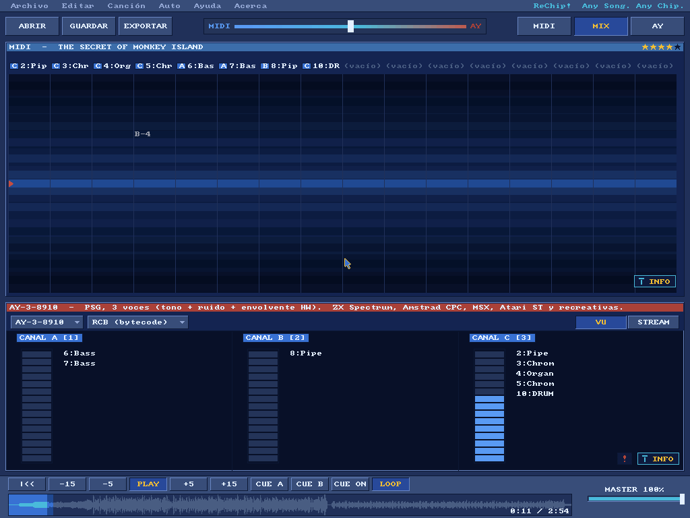

# ReChip!: a tracker driven by its keys and read by its own log

<!-- demo-motion:begin -->
<p align="center"><picture><source media="(prefers-reduced-motion: reduce)" srcset="screen.png"></picture></p>

1. `send_keys` sets the song playing; `stop` holds the tracker and `record` films it playing on.

<!-- moments-ms: 2998 -->
<!-- demo-motion:end -->

*ReChip!*, a 32-bit DOS program, converts music for vintage sound chips and plays it in a live
tracker. This demo starts it from a file in its `.scry/` folder and waits for its log to say
the song is sounding. It pauses and rewinds the song with keys the program logs, films it
playing, and quits by its own dialog.

## The program

ReChip! is not distributed with this repository. The demo needs a directory with the build
`build/RECHIPD.EXE`, its symbol table `build/RECHIPD.SYM` and the DOSBox-X conf `build/mcp.conf`.

Its `.scry/start/dev.json` is a start profile: a saved set of `start` arguments.

## Run it

```sh
uv run python demos/rechip/demo.py --cwd /path/to/rechip
```

Each line it prints is one call and its check. The window opens behind the others, so the run
does not take your keyboard.

- `--cwd PATH` (absolute or `~`-led) is the directory holding the program's build.
- `--binary PATH` (absolute or `~`-led) picks the DOSBox-X to start. Left out, it is
  `DOSBOX_X_BINARY`, else the `dosbox-x` on your `PATH`.
- `--display N` opens the window on that display. Left out, it opens on the main one.
- `--transcript PATH` moves the whole transcript; the run's other files go beside it.
- `--update-readme` rewrites this page's generated parts, `TRANSCRIPT.md`, `screen.png` and
  `loop.webp`, from a run where every step passed. It needs ffmpeg and `img2webp` on your
  `PATH`.

Exit codes: 0 every step passed, 1 a step failed, 2 a usage error, 3 nothing was demonstrated.
That last one is a checkout without its start profile or its build, a relative path or a server that did
not start.

The picture is taken on an exact frame. The warning button pulses on the program's own counter,
so the demo reads that counter and runs to the middle of the next lit half. It then stops on
the first frame the button goes dark.

## Try it yourself

[Add the server to your client](../../README.md#install) and open it in your checkout of the program. Each of these is a step of
the demo, in the order the demo makes them.

<!-- demo-transcript:begin -->
### 1. Wait for a line of the program's log

Ask:

> Wait until the program logs that the song is sounding.

Call:

```text
log_wait(pattern="PERF  \\. audio play=1", channel="guest", seconds=120)
```

Reply, 2 of 13 fields:

```json
{
  "verdict": "TARGET",
  "pattern": "PERF  \\. audio play=1"
}
```

`TARGET` means a line matching `pattern` arrived in the program's log. The program keeps running meanwhile: `log_wait` is one of the tools that answer while it runs.

<details><summary>The whole reply</summary>

```json
{
  "summary": "<volatile>",
  "status": "ok",
  "verdict": "TARGET",
  "pattern": "PERF  \\. audio play=1",
  "channel": "guest",
  "line": "<volatile>",
  "already": "<volatile>",
  "lines_total": "<volatile>",
  "lines_before": "<volatile>",
  "arrived_during": "<volatile>",
  "waited_s": "<volatile>",
  "lines_examined": "<volatile>",
  "session": {"alive": true, "running": true, "altered": false}
}
```

</details>

### 2. Press a key and check the program took it

Ask:

> Press space and check that the program logged the key.

Call:

```text
send_keys(keys=["space"], expect="key down SPACE", seconds=10)
```

Reply, 2 of 10 fields:

```json
{
  "summary": "send_keys (guest): reaction seen",
  "keys": ["space"]
}
```

The program logs every key it takes, by name. "reaction seen" means that line arrived: the key reached the program, not only the emulator.

<details><summary>The whole reply</summary>

```json
{
  "summary": "send_keys (guest): reaction seen",
  "status": "ok",
  "keys": ["space"],
  "modifiers": [],
  "route": "guest",
  "posted": 1,
  "bytes": 2,
  "frames": 2,
  "verify": {
    "checked": true,
    "seen": true,
    "expected": "key down SPACE",
    "verdict": "TARGET",
    "line": "<volatile>",
    "seen_before_waiting": "<volatile>",
    "lines_before": "<volatile>",
    "waited_s": "<volatile>",
    "lines_total": "<volatile>"
  },
  "session": {"alive": true, "running": true, "altered": false}
}
```

</details>

### 3. Stop on the frame a button goes dark

Ask:

> Wait until the screen map names `warning_dark`.

Call:

```text
screen_wait(screen="warning_dark", seconds=10)
```

Reply, 2 of 19 fields:

```json
{
  "verdict": "TARGET",
  "screen": {"name": "warning_dark", "layer": "file"}
}
```

The warning button pulses on the program's own counter. `TARGET` means the wait stopped on the first frame the screen map, the file that names the program's screens, called `warning_dark`.

<details><summary>The whole reply</summary>

```json
{
  "summary": "<volatile>",
  "status": "ok",
  "verdict": "TARGET",
  "predicate": "screen",
  "already": false,
  "waited_s": "<volatile>",
  "polls": "<volatile>",
  "sampled_every": 0,
  "screen": {"name": "warning_dark", "layer": "file"},
  "pc": "<volatile>",
  "cpu_mode": "<volatile>",
  "frame": "<volatile>",
  "regs": "<volatile>",
  "watches": [],
  "cause": "<volatile>",
  "e9": "<volatile>",
  "stop_seq": "<volatile>",
  "instruction": "<volatile>",
  "session": {"alive": true, "running": false, "altered": false}
}
```

</details>

### 4. Leave the program by its own keys

Ask:

> Answer the quit dialog: right arrow, then Enter.

Call:

```text
send_keys(keys=["right", "enter"], expect="ask res=1", seconds=10)
```

Reply, 2 of 10 fields:

```json
{
  "summary": "send_keys (guest): reaction seen",
  "keys": ["right", "enter"]
}
```

"reaction seen" means the program logged which button the dialog took. So the session closes over a program that quit by itself.

<details><summary>The whole reply</summary>

```json
{
  "summary": "send_keys (guest): reaction seen",
  "status": "ok",
  "keys": ["right", "enter"],
  "modifiers": [],
  "route": "guest",
  "posted": 2,
  "bytes": 6,
  "frames": 6,
  "verify": {
    "checked": true,
    "seen": true,
    "expected": "ask res=1",
    "verdict": "TARGET",
    "line": "<volatile>",
    "seen_before_waiting": "<volatile>",
    "lines_before": "<volatile>",
    "waited_s": "<volatile>",
    "lines_total": "<volatile>"
  },
  "session": {"alive": true, "running": true, "altered": false}
}
```

</details>
<!-- demo-transcript:end -->

<details><summary>The whole demo as one prompt</summary>

1. Start from the start profile `.scry/start/dev.json` of the checkout, with a window, on the
   normal core, with the symbols `build/RECHIPD.SYM`, and let it run.
2. Wait on the program's log for `PERF . audio play=1`, press space and show me the program
   logged `key down SPACE`.
3. Wait for `ACT . play=0`, press home and wait for `ACT . rewind`.
4. Twice, wait for the next `PERF . fps=` line written after the log's current end.
5. Stop inside the program and read the 4 bytes of `_g_ticks`, its counter in 10 ms ticks.
6. Run to the middle of the next lit 400 ms, load `demos/rechip/rechip-screen-map.json`, check
   the screen is `warning_lit` and wait for `warning_dark`.
7. Save a picture of the screen and resume.
8. Press space and wait for `ACT . play=1`, stop inside the program, record 1050 frames of
   video and resume.
9. Press alt+x and wait for `ask opens`, press right then enter and wait for `ask res=1`, and
   close.

</details>

## Tools this demo uses

| Group | Tools |
|---|---|
| [Session](../../docs/reference/session.md) | `start`, `close` |
| [Run](../../docs/reference/run.md) | `resume`, `stop`, `run_for`, `screen_wait` |
| [Machine](../../docs/reference/machine.md) | `log_wait` |
| [Input](../../docs/reference/input.md) | `send_keys` |
| [Read](../../docs/reference/read.md) | `read_memory`, `screen_map_write`, `screen_map_find` |
| [Captures](../../docs/reference/captures.md) | `record` |
| [Screen](../../docs/reference/screen.md) | `screen_view` |

Each group is a page of the reference. Some of the names need a word:

- Run: the tools that let the program run and stop it again.
- Machine: the program's log and the map of what DOS loaded.

## The transcript

[TRANSCRIPT.md](TRANSCRIPT.md) has every call of the run with its reply. The paths of your
checkout read `<host>` there, because they are your computer's.
