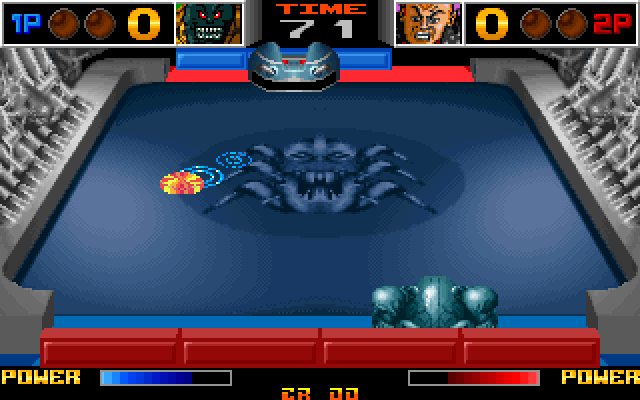

# Speed Fight: the PC game boots from its own recipe



*Speed Fight* (Eco-Games / GAMART, 1994) ran on an NEC V30 arcade board, and its team ported the
same source to MS-DOS. This demo boots the PC game from the run recipe its own repository
declares in `.scry/start/dos.json`: the conf the game's script derives, the working directory,
the program spelled from where the autoexec leaves the guest, and the TLINK map that names its
variables. The call gives only what is the run's own, and the reply says which keys the recipe
filled.

It then lets the title and the attract run, reads the credits by name, and saves a picture of
the screen.

## The game

Speed Fight is not distributed with this repository. The demo needs a copy of it with its blessed `EXES/SPEEDF.EXE` and `EXES/SPEEDF.MAP`, its `.scry/` and
its `SCRIPTS/`; a checkout of it is what `--cwd` names.

## Run it

```sh
uv run python demos/speedf/demo.py --cwd /path/to/speedf-msdos
```

- `--cwd PATH` (absolute or `~`-led) is the game's own repository checkout.
- `--binary PATH` picks the DOSBox-X to start; left out, `DOSBOX_X_BINARY`, else the `dosbox-x`
  on your `PATH`.
- The window opens in front.
- `--transcript PATH` moves the whole transcript; the run's other files go beside it.
- `--update-readme` rewrites the block below, `TRANSCRIPT.md` and `screen.png` from a run where
  every step passed.

Each line it prints is one call and its check. Exit codes: 0 every step passed, 1 a step failed,
2 a usage error, 3 nothing was demonstrated (a copy without its store or its program, a relative
path, a server that did not start).

## The prompt

Give this to an MCP client with this server connected:

> Derive the game's live-session conf with `SCRIPTS/dosbox-mcp-conf.sh`, then start from the
> recipe `.scry/start/dos.json` in the `--cwd` checkout, with a window. Run five seconds, then ten
> more, read `creditos`, save a picture of the screen and close.

## The transcript

<!-- demo-transcript:begin -->
The run is 6 calls; these are the ones that show how it is done, and every call with its reply is in [TRANSCRIPT.md](TRANSCRIPT.md).

**1. `start`**: OK start: shared DOSBox-X, parked at the debugger before DOS boots

`start(profile=...)` boots from the recipe the game's own repository declares: the conf its script derives, the working directory, the program spelled from where the autoexec leaves the guest, and the TLINK map. The call gives only what is the run's own, and the reply says which keys the recipe filled.

<details><summary>call and reply</summary>

```json
{
  "profile": "<host>",
  "shared": true,
  "captures_dir": "<host>",
  "cwd": "<host>"
}
```

```json
{
  "summary": "<volatile>",
  "status": "ok",
  "pid": "<volatile>",
  "conf": "<volatile>",
  "conf_digest": "c79ee334a86719e0",
  "watched": true,
  "bound_s": 900,
  "elapsed_s": "<volatile>",
  "captures": "off",
  "state_dir": "<volatile>",
  "shared": true,
  "ready_after_s": "<volatile>",
  "argv": "<volatile>",
  "binary": "<volatile>",
  "binary_origin": "<volatile>",
  "version": "<volatile>",
  "debugger_commands": ["A20", "BPIF", "CAPTURE", "DOSTRACE", "LOADSTATE", "MEMDUMPLIN", "PIC", "PORTINFO", "PRESENCE", "RUNSTATE", "SAVESTATE", "STEPIN", "TAP", "VGAMEMDUMP"],
  "stub": "./src/scry_dosbox_x/guest/SCRY.COM",
  "input_port": "<volatile>",
  "background": false,
  "presence": true,
  "window": "<volatile>",
  "declarations": {
    "rearm": {"rearmed": [], "stale": [], "unresolved": [], "ambiguous": [], "unarmable": []}
  },
  "symbols": {
    "held": "<volatile>",
    "base_from": "program",
    "checked": {
      "available": false,
      "why": "the table carries no symbol kinds (a link map lists none), so its code symbols cannot be told from the rest"
    }
  },
  "note": "this session runs the dynamic core, which checks breakpoints only between compiled blocks, so a code breakpoint inside one can be passed over and a run that never reaches it proves nothing. Start on the normal core: `start(flags=[\"-set\", \"cpu core=normal\"])`",
  "kept": "kept 1 (promote to review)",
  "profile": {
    "name": "<volatile>",
    "file": "<volatile>",
    "supplied": ["conf", "logfile", "program", "session_seconds", "symbols"]
  },
  "session": {"alive": true, "running": false, "altered": false}
}
```

</details>

**4. `read_memory`**: OK no credits: creditos holds 0

`creditos` is read by name: the map `start` placed names the game's own variables at the segment DOS loaded it at, the same name the arcade build's map gives.

<details><summary>call and reply</summary>

```json
{
  "ref": "creditos",
  "length": 2
}
```

```json
{
  "summary": "read_memory creditos: 2 bytes at 26AB:00000006: 0000",
  "status": "ok",
  "ref": "creditos",
  "seg_off": "26AB:00000006",
  "length": 2,
  "hex": "0000",
  "session": {"alive": true, "running": false, "altered": false}
}
```

</details>
<!-- demo-transcript:end -->
