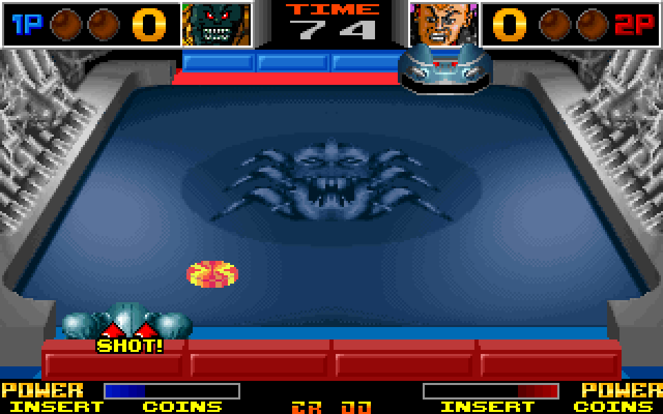

# Speed Fight: the DOS game starts from a file in its own repository

<!-- demo-motion:begin -->
<p align="center"><picture><source media="(prefers-reduced-motion: reduce)" srcset="screen.png"></picture></p>

1. `run_to` stops where the game starts playing itself, and `record` films the match.

<!-- moments-ms: 3000 -->
<!-- demo-motion:end -->

*Speed Fight* (Eco-Games / GAMART, 1994) was an arcade game, and its team ported the same
source to MS-DOS. This demo starts the DOS version from a start profile, a saved set of `start`
arguments the game's own repository keeps. Then it runs to routines by their names, reads a
variable, and films the match the game plays by itself.

## The program

Speed Fight is not distributed with this repository. The demo needs a checkout of
[the game's repository](https://github.com/MS-DOS-Club/speedf-msdos) with its
`EXES/SPEEDF.EXE` and `EXES/SPEEDF.MAP`, its `.scry/` folder, where the game keeps that start
profile, and its `SCRIPTS/`.

## Run it

```sh
uv run python demos/speedf/demo.py --cwd /path/to/speedf-msdos
```

Each line it prints is one call and its check. The window opens behind the others, so the run
does not take your keyboard.

- `--cwd PATH` (absolute or `~`-led) is the checkout of the game's repository.
- `--binary PATH` (absolute or `~`-led) picks the DOSBox-X to start. Left out, it is
  `DOSBOX_X_BINARY`, else the `dosbox-x` on your `PATH`.
- `--display N` opens the window on that display. Left out, it opens on the main one.
- `--transcript PATH` moves the whole transcript; the run's other files go beside it.
- `--update-readme` rewrites this page's generated parts, `TRANSCRIPT.md`, `screen.png` and
  `loop.webp`, from a run where every step passed. It needs ffmpeg and `img2webp` on your
  `PATH`.

Exit codes: 0 every step passed, 1 a step failed, 2 a usage error, 3 nothing was demonstrated.
That last one is a checkout without its `.scry/` folder or its program, a relative path or a server that
did not start.

The run passes two settings of its own to `start`: the normal core and a fixed speed. The
game's conf keeps the dynamic core, which can run past a code breakpoint, and `cycles=max`,
which gives the game as much speed as your computer has. The fixed speed is one the game
plays its match at pace on.

## Try it yourself

[Add the server to your client](../../README.md#install) and open it in your checkout of the game. Each of these is a step of
the demo, in the order the demo makes them.

<!-- demo-transcript:begin -->
### 1. Start from the game's own start profile

Ask:

> Start Speed Fight from the start profile its repository keeps in `.scry/start/`.

Call:

```text
start(shared=true, background=true, display="<host>", profile="<host>",
    flags=["-set", "cpu core=normal", "-set", "cpu cycles=fixed 300000"], captures_dir="<host>",
    cwd="<host>")
```

Reply, 2 of 28 fields:

```json
{
  "status": "ok",
  "kept": "1 saved for `promote`"
}
```

A start profile is a saved set of `start` arguments: the call adds only what is this run's own. `kept` says a candidate was saved for `promote`; the whole reply lists what the file filled in `profile.supplied`.

<details><summary>The whole reply</summary>

```json
{
  "summary": "<volatile>",
  "status": "ok",
  "pid": "<volatile>",
  "conf": "<volatile>",
  "conf_digest": "<volatile>",
  "watched": true,
  "bound_s": 900,
  "elapsed_s": "<volatile>",
  "captures": "off",
  "state_dir": "<volatile>",
  "shared": true,
  "ready_after_s": "<volatile>",
  "argv": "<volatile>",
  "binary": "<volatile>",
  "binary_origin": "<volatile>",
  "version": "<volatile>",
  "debugger_commands": ["A20", "BPIF", "CAPTURE", "DOSTRACE", "LOADSTATE", "MEMDUMPLIN", "PIC", "PORTINFO", "PRESENCE", "RUNSTATE", "SAVESTATE", "STEPIN", "TAP", "VGAMEMDUMP"],
  "stub": "./src/scry_dosbox_x/guest/SCRY.COM",
  "input_port": "<volatile>",
  "background": true,
  "presence": true,
  "window": "<volatile>",
  "logfile": "<volatile>",
  "declarations": {
    "rearm": {"rearmed": [], "stale": [], "unresolved": [], "ambiguous": [], "unarmable": []}
  },
  "symbols": {
    "held": "<volatile>",
    "base_from": "program",
    "checked": {
      "available": false,
      "why": "the table carries no symbol kinds (a link map lists none), so its code symbols cannot be told from the rest"
    }
  },
  "kept": "1 saved for `promote`",
  "profile": {
    "name": "<volatile>",
    "file": "<volatile>",
    "supplied": ["conf", "logfile", "program", "session_seconds", "symbols"]
  },
  "session": {"alive": true, "running": false, "altered": false}
}
```

</details>

### 2. Run until the title is drawn

Ask:

> Run the game to `titulo_dibuja_cred`, counting `draw_block` on the way.

Call:

```text
run_to(ref="titulo_dibuja_cred", control="draw_block", seconds=120)
```

Reply, 3 of 18 fields:

```json
{
  "summary": "run_to titulo_dibuja_cred: TARGET at 0951:00000819, control counted 35",
  "verdict": "TARGET",
  "control_hits": 35
}
```

`TARGET` means the run stopped where the title calls its credits line, once both planes are drawn. `control_hits` counts a routine that ran many times meanwhile.

<details><summary>The whole reply</summary>

```json
{
  "summary": "run_to titulo_dibuja_cred: TARGET at 0951:00000819, control counted 35",
  "status": "ok",
  "verdict": "TARGET",
  "target": "08EB:0E79",
  "ref": "titulo_dibuja_cred",
  "pc": "0951:00000819",
  "cpu_mode": "real",
  "target_disarmed": true,
  "control_hits": 35,
  "controls": [
    {"ref": "draw_block", "at": "08EB:46F4", "hits_in_run": 35, "removed": true}
  ],
  "frame": 78,
  "regs": {
    "EAX": "0x0000491e",
    "EBX": "0x00007fff",
    "ECX": "0x005b0000",
    "EDX": "0x00000089",
    "ESI": "0x0000c7cb",
    "EDI": "0x0000bfcb",
    "EBP": "0x0000b1aa",
    "ESP": "0x0000b19e",
    "EIP": "0x00000819",
    "CS": "0x0951",
    "DS": "0x1b73",
    "ES": "0x491e",
    "FS": "0x0008",
    "GS": "0x0000",
    "SS": "0x1b73"
  },
  "watches": [],
  "cause": "run_to's target titulo_dibuja_cred at 0951:00000819",
  "e9": {"lines_total": 0, "truncated": false, "lines": [], "mark": "<volatile>"},
  "stop_seq": 3,
  "instruction": {
    "address": "0951:00000819",
    "bytes": "52",
    "text": "push dx",
    "flow": "sequential",
    "code_bits": 16,
    "bytes_from": "memory",
    "symbol": "titulo_dibuja_cred",
    "delta": 0
  },
  "session": {"alive": true, "running": false, "altered": false}
}
```

</details>

### 3. Read a variable by its name

Ask:

> Read the game's `creditos` variable.

Call:

```text
read_memory(ref="creditos", length=2)
```

Reply, 2 of 7 fields:

```json
{
  "summary": "read_memory creditos: 2 bytes at 26AB:00000006: 0000",
  "hex": "0000"
}
```

`creditos` is a name from the game's symbol map, resolved at the segment DOS loaded the program at. The arcade build's map gives the same name.

<details><summary>The whole reply</summary>

```json
{
  "summary": "read_memory creditos: 2 bytes at 26AB:00000006: 0000",
  "status": "ok",
  "ref": "creditos",
  "seg_off": "26AB:00000006",
  "length": 2,
  "hex": "0000",
  "session": {"alive": true, "running": false, "altered": false}
}
```

</details>
<!-- demo-transcript:end -->

<details><summary>The whole demo as one prompt</summary>

1. Start DOSBox-X from the start profile `.scry/start/dos.json` of the checkout, with a window,
   on the normal core and a fixed speed.
2. Put a breakpoint on the game's first VESA call, `INT 10h AH=4Fh`, let it run there and clear
   it.
3. Run to `titulo_dibuja_cred` counting `draw_block`, and read `creditos`.
4. Run to `startdemo`, where the game starts a match by itself, counting `new_irq_video`.
5. Record 380 frames of video, take a picture of the screen and close.

</details>

## Tools this demo uses

| Group | Tools |
|---|---|
| [Session](../../docs/reference/session.md) | `start`, `close` |
| [Breakpoints](../../docs/reference/breakpoints.md) | `breakpoint_interrupt`, `declaration_clear` |
| [Run](../../docs/reference/run.md) | `resume`, `run_to` |
| [Read](../../docs/reference/read.md) | `read_memory` |
| [Captures](../../docs/reference/captures.md) | `record` |
| [Screen](../../docs/reference/screen.md) | `screen_view` |

Each group is a page of the reference. Some of the names need a word:

- Advance: the tools that let the program run and stop it again.
- Declarations: breakpoints and watches.

## The transcript

[TRANSCRIPT.md](TRANSCRIPT.md) has every call of the run with its reply. The paths of your
checkout read `<host>` there, because they are your computer's.
