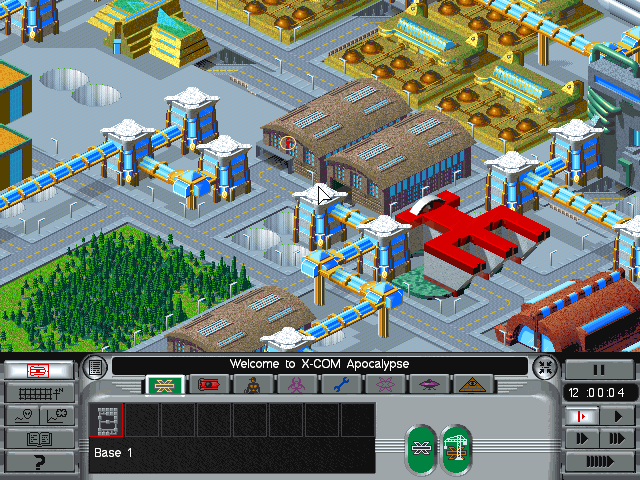

# X-COM Apocalypse: every file the game opens, read off its DOS calls

<!-- demo-motion:begin -->
<p align="center"><picture><source media="(prefers-reduced-motion: reduce)" srcset="screen.png"></picture></p>

1. The city of a new campaign, started from the menus, in 640 x 480.

<!-- moments-ms: 2843 -->
<!-- demo-motion:end -->

MicroProse's *X-COM Apocalypse* (1997) is a 32-bit DOS/4GW game that draws its menus and city
in 640 x 480. This demo starts it with every INT 21h call recorded, skips the intro, starts a
new campaign from the menus and films the city appearing. Then it lists the files the game
looked for while it loaded, each by its exact name before it opens it.

## The program

The game is commercial software, and nothing of it is in this repository. The demo runs it
from a directory you name, holding the game as its installer leaves it: `XCOMA/` with the
program, and `cd/X-COM Apocalypse.iso`, the CD image.

It checks two files before anything starts and refuses another edition, naming its digest:

| file | sha256 |
|---|---|
| `XCOMA/XCOMAPOC.EXE` | `123de1e6b94e0e75b01026820ba7528f63acd60acc62ad9b0793bf321187750e` |
| `cd/X-COM Apocalypse.iso` | `6acb86ee7447e94cdc94fe8a7d089045b77da5debd197445f3d50c4b5c98ea44` |

C: is your directory with an overlay over it in the run's own directory, so what the game
writes (DOS/4GW's swap file, its options) never lands in your copy.

## Run it

```sh
uv run python demos/xcom/demo.py --cwd /path/to/your/x-com-apocalypse
```

Each line it prints is one call and its check. The window opens behind the others, so the run
does not take your keyboard; `--watch` brings it in front, for when you want to watch it.

- `--cwd PATH` (absolute or `~`-led) is your copy of the game.
- `--binary PATH` (absolute or `~`-led) picks the DOSBox-X to start. Left out, it is
  `DOSBOX_X_BINARY`, else the `dosbox-x` on your `PATH`. The demo needs a build whose debugger
  records DOS calls (`DOSTRACE`) and reads the 640 x 480 screen (`VGAMEMDUMP`).
- `--display N` opens the window on that display. Left out, it opens on the main one.
- `--watch` shows the run: the window comes in front and takes your keyboard until the run ends.
- `--transcript PATH` moves the whole transcript; the run's other files go beside it.
- `--update-readme` rewrites this page's generated parts, `TRANSCRIPT.md`, `screen.png` and
  `loop.webp`, from a run where every step passed. It needs ffmpeg and `img2webp` on your
  `PATH`.

Exit codes: 0 every step passed, 1 a step failed, 2 a usage error, 3 nothing was demonstrated.
That last one is a directory without the game, another edition, a relative path or a server
that did not start.

The conf runs the dynamic core at a fixed speed: the game needs the speed, and a fixed clock
keeps two runs alike.

## Try it yourself

[Add the server to your client](../../README.md#install) and open it in your copy of the game.
Each of these is a step of the demo, in the order the demo makes them.

<!-- demo-transcript:begin -->
### 1. Start the game with its DOS calls recorded

Ask:

> Start X-COM Apocalypse from my copy, recording every INT 21h call it makes.

Call:

```text
start(shared=true, background=true, display="<host>", conf="<host>", cwd="<host>",
    program="XCOMAPOC.EXE", dos_calls=true, session_seconds=900, logfile="<host>",
    captures_dir="<host>")
```

Reply, 2 of 29 fields:

```json
{
  "status": "ok",
  "shared": true
}
```

With `dos_calls`, the emulator writes each INT 21h call to a file of the session's; the `log` tool reads it back on the `dos` channel.

<details><summary>The whole reply</summary>

```json
{
  "summary": "<volatile>",
  "status": "ok",
  "pid": "<volatile>",
  "conf": "./tmp/demos/xcom/xcom.conf",
  "conf_digest": "<volatile>",
  "watched": true,
  "bound_s": 900,
  "elapsed_s": "<volatile>",
  "captures": "off",
  "state_dir": "<volatile>",
  "shared": true,
  "ready_after_s": "<volatile>",
  "argv": "<volatile>",
  "binary": "<volatile>",
  "binary_origin": "<volatile>",
  "version": "<volatile>",
  "debugger_commands": ["A20", "BPIF", "CAPTURE", "DOSTRACE", "LOADSTATE", "MEMDUMPLIN", "PIC", "PORTINFO", "PRESENCE", "RUNSTATE", "SAVESTATE", "STEPIN", "TAP", "VGAMEMDUMP"],
  "stub": "./src/scry_dosbox_x/guest/SCRY.COM",
  "input_port": "<volatile>",
  "background": true,
  "presence": true,
  "overlay": {"layers": ["edge", "pointer", "record"]},
  "window": "<volatile>",
  "logfile": "<volatile>",
  "dos_calls": "<volatile>",
  "declarations": {
    "rearm": {"rearmed": [], "stale": [], "unresolved": [], "ambiguous": [], "unarmable": []}
  },
  "note": "this session runs the dynamic core, which checks breakpoints only between compiled blocks, so a code breakpoint inside one can be passed over and a run that never reaches it proves nothing. Start on the normal core: `start(flags=[\"-set\", \"cpu core=normal\"])`",
  "kept": "<volatile>",
  "session": {"alive": true, "running": false, "altered": false}
}
```

</details>

### 2. Wait for a screen by its name

Ask:

> Wait until the main menu is on screen.

Call:

```text
screen_wait(screen="main_menu", seconds=120)
```

Reply, 2 of 10 fields:

```json
{
  "verdict": "TARGET",
  "screen": {"name": "main_menu", "layer": "file"}
}
```

The screen map knows the main menu by the signature of its Load Saved Game button; the wait runs the machine retrace by retrace until it is on screen.

<details><summary>The whole reply</summary>

```json
{
  "summary": "<volatile>",
  "status": "ok",
  "verdict": "TARGET",
  "predicate": "screen",
  "already": "<volatile>",
  "waited_s": "<volatile>",
  "polls": "<volatile>",
  "sampled_every": "<volatile>",
  "screen": {"name": "main_menu", "layer": "file"},
  "session": {"alive": true, "running": false, "altered": false}
}
```

</details>

### 3. Press a button by its name

Ask:

> Press Start Campaign Game.

Call:

```text
send_mouse(target="start_campaign", action="down")
```

Reply, 3 of 26 fields:

```json
{
  "target": "start_campaign",
  "screen": "main_menu",
  "driver_arrived": true
}
```

The map gives the button's place, so the press names the button, not the pixels it covers.

<details><summary>The whole reply</summary>

```json
{
  "summary": "<volatile>",
  "status": "ok",
  "x": 318,
  "y": 186,
  "units": "screen",
  "button": "left",
  "action": "down",
  "route": "guest",
  "pointer": {
    "screen": {"x": 318, "y": 186, "width": 640, "height": 480},
    "mouse": {"x": 2548, "y": 1492, "max_x": 5120, "max_y": 3840},
    "buttons": ["left"],
    "bios_mode": "0x69",
    "vbe_mode": "0x101"
  },
  "driver_arrived": true,
  "polls": "<volatile>",
  "pc": "<volatile>",
  "cpu_mode": "<volatile>",
  "stop_seq": 19,
  "frame": "<volatile>",
  "instruction": "<volatile>",
  "regs": "<volatile>",
  "watches": [],
  "cause": "<volatile>",
  "e9": {"lines_total": "<volatile>", "truncated": false, "lines": [], "mark": "<volatile>"},
  "motion": true,
  "verify": {
    "checked": false,
    "why": "no `expect` was given, so the reply says what went into the guest and NOT that the program took it; pass expect=<E9 pattern> to confirm its reaction"
  },
  "target": "start_campaign",
  "screen": "main_menu",
  "identified_at_stop": 2,
  "session": {"alive": true, "running": false, "altered": false}
}
```

</details>

### 4. List the files the game looked for

Ask:

> Which files did the game look for with FindFirst while the campaign loaded?

Call:

```text
log(channel="dos", pattern="find first", limit=400)
```

Reply, 1 of 8 fields:

```json
{
  "summary": "log dos /find first/: 100 of 100 calls"
}
```

The game opens each file through a FindFirst of its exact name, so the DOS channel lists every file it read, the CD's film and the city's map among them.

<details><summary>The whole reply</summary>

```json
{
  "summary": "log dos /find first/: 100 of 100 calls",
  "status": "ok",
  "pattern": "find first",
  "channel": "dos",
  "lines_total": "<volatile>",
  "truncated": false,
  "calls": "<volatile>",
  "session": {"alive": true, "running": false, "altered": false}
}
```

</details>
<!-- demo-transcript:end -->

<details><summary>The whole demo as one prompt</summary>

1. Start DOSBox-X with `demos/xcom/xcom.conf`, in my copy of the game, running `XCOMAPOC.EXE`
   with a window and every DOS call recorded.
2. Let it run, and on the DOS channel wait for it to look for `smk/intro1.smk`; press Esc.
3. Wait for `ufodata/titles.pcx`, press Esc, then wait for `ufodata/b-setup.pcx` and
   `savegame/tactgame.09`, the main menu and its last save slot.
4. Stop, load `xcom-screen-map.json`, wait for the main menu on screen and press
   Start Campaign Game for half a second; wait for the difficulty menu and press Novice.
5. Let it run until it looks for `UFODATA/CITYMAP1.BLD`, stop, and record 900 frames of the city.
6. List the FindFirst calls the game made, take a picture of the screen and close.

</details>

## Tools this demo uses

| Group | Tools |
|---|---|
| [Session](../../docs/reference/session.md) | `start`, `close` |
| [Run](../../docs/reference/run.md) | `resume`, `stop`, `run_for`, `screen_wait` |
| [Input](../../docs/reference/input.md) | `send_keys`, `send_mouse` |
| [Read](../../docs/reference/read.md) | `screen_map_write`, `screen_map_find` |
| [Machine](../../docs/reference/machine.md) | `log`, `log_wait` |
| [Captures](../../docs/reference/captures.md) | `record` |
| [Screen](../../docs/reference/screen.md) | `screen_view` |

Each group is a page of the reference. Some of the names need a word:

- Run: the tools that let the program run and stop it again.
- Machine: what the machine is and what it logged, the DOS calls among it when `start` records them.

## The transcript

[TRANSCRIPT.md](TRANSCRIPT.md) has every call of the run with its reply. The paths of your
copy read `<host>` there, because they are your computer's.
